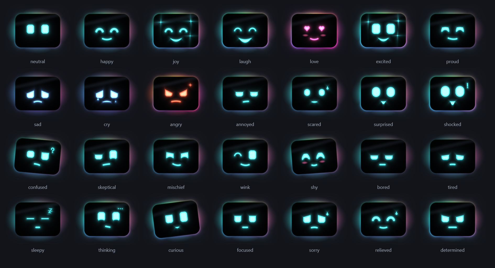
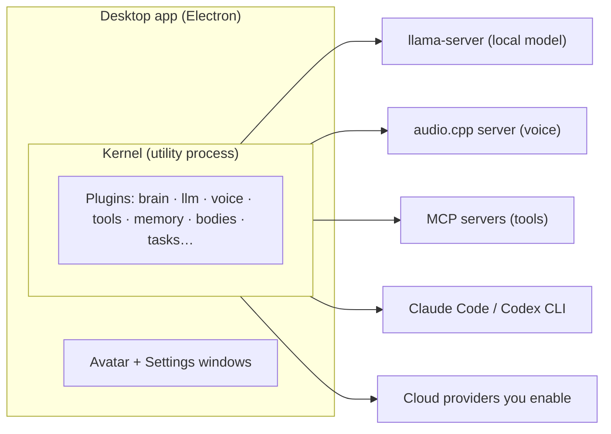

# Floppy

**A local-first voice assistant for your PC, where everything is a plugin.**

You call it by name ("Floppy…"), it answers out loud, and it acts with your tools: calendar, mail, notes, pull requests, the web.
The brain, the voice, the avatar, the tools and even the body it lives in are plugins you can swap, by config or by voice.



> **Status: early prototype.** It runs every day on its author's machine, but it is not packaged yet.
> Windows first (the code stays portable). The interface supports French and English; most docs and code comments are in French for now.

## What it does

- **Always listening, local by default.** Wake word, speech-to-text and text-to-speech all run on your computer, with or without a GPU. Cloud services are used only for the plugins you turn on.
- **Swappable brain.** A local model through [llama.cpp](https://github.com/ggml-org/llama.cpp) (Gemma, Qwen…) that delegates hard requests to Claude Code or Codex, a remote OpenAI-compatible model, or a live speech model (Gemini Live, GPT Live).
- **Swappable voice.** Listening with Silero + Parakeet ([sherpa-onnx](https://github.com/k2-fsa/sherpa-onnx), CPU). Speaking with [audio.cpp](https://github.com/0xShug0/audio.cpp) (Pocket TTS on the CPU, Qwen3-TTS on the GPU), cloud voices (Gemini TTS, ElevenLabs), or the voices built into the OS. No Python.
- **Several bodies.** The desktop app with an animated avatar, a text chat in the terminal, a WebSocket client, or a [Reachy Mini](https://www.pollen-robotics.com/reachy-mini/) robot.
- **Real tools through MCP.** Any MCP server, plus built-in connectors: browser, web search, Microsoft 365, Azure DevOps, Obsidian (read-only), Orca.
- **Approvals.** Reading is free within the rights you granted. Writing, sending or deleting asks you first, by voice or by click. Everything is logged.
- **Tasks, digests and notifications.** A scheduler runs plugin tasks (for example a daily news digest) and can send results to Telegram or by mail.
- **Settings driven by plugins.** Each plugin declares its own settings forms. An AI assistant in the Settings window (your Claude Code or Codex) can tune Floppy or write a new plugin with you.

## Requirements

- Windows 10/11, [Node.js 24](https://nodejs.org/).
- Nothing else to install by hand: on first start, the **Welcome** window reads the computer (graphics card or unified memory), recommends a level from "text only" to "all local", then downloads the right [llama.cpp](https://github.com/ggml-org/llama.cpp/releases) and [audio.cpp](https://github.com/0xShug0/audio.cpp/releases) build (CUDA, Vulkan, Metal or CPU) and the models. Run `floppy machine` to see what Floppy reads.
- For a **local brain**: a graphics chip with about 8 to 16 GB for models (NVIDIA, AMD, Intel, or an Apple chip with unified memory).
- For the **local voice**: no graphics chip needed (Pocket TTS on the CPU); the listening models take about 1 GB.
- Optional: the [Claude Code](https://docs.claude.com/en/docs/claude-code) or Codex CLI, signed in (delegation, web search, Settings assistant).
- Without a GPU: listening and voice run on the CPU; use Claude Code, Codex or a cloud model as the brain (API keys are entered in the Settings forms and stored in the OS keychain).

## Quick start

```powershell
git clone https://github.com/gleborgne/floppy.git
cd floppy
npm install
npm start          # first start creates floppy.yml (in Floppy's working folder) from floppy.example.yml
```

Then open **Settings** (tray icon) to choose a brain and a voice.

**Local brain.** Put `llama-server` in your PATH, or set its path in *Settings → Brain → llama-server program*.
Add a GGUF model in *Settings → Brain*, then activate it.

**Download models from Settings.** Under each role (Brain, Listening, Voice), *Download models* lists ready-to-use
models (and searches Hugging Face for the brain). One click downloads them; they join the list, ready to activate.

**Local voice.** Listening: download Silero VAD and Parakeet TDT v3 in *Settings → Listening → Download models*
(or by hand from the [sherpa-onnx models](https://github.com/k2-fsa/sherpa-onnx/releases/tag/asr-models), then add both in *Settings → Listening → sherpa-onnx*).
Speaking: put `audiocpp_server` in your PATH (or set its path in *Settings → Voice*), and add a model from the Hugging Face repo
`audio-cpp/audio.cpp-gguf` in *Settings → Voice → audio.cpp* (Pocket TTS for the CPU). Without them, Floppy uses the system voices.
No GPU: see the guide `docs/guide/configuration-avancee.md` (section « Floppy sans carte graphique »).

Restart Floppy. Say "Floppy" or press `Ctrl+Alt+F` to talk without the wake word.

### Command line

```powershell
npx floppy plugins            # plugin status
npx floppy chat               # a second body, in text
npx floppy approvals          # pending approvals; npx floppy approve <id> [--no]
npx floppy log 20             # audit log
npx floppy set service.tts tts-gemini     # change a choice from the CLI
npx floppy start --config <file>          # headless (disable body-electron in that file)
npm run check                 # typecheck + tests + licence check
```

Everything Floppy keeps lives in one working folder: `%LOCALAPPDATA%\floppy` by default, changeable in the Welcome window or in Settings → General (or forced with `FLOPPY_HOME`). It holds the configuration `floppy.yml` (reloaded live), the settings, the downloaded models, the agents' workspaces, third-party plugins and the logs.

## How it is built



The kernel has no dependency on Electron. Plugins declare the services they provide and need, their rights and their settings.
Heavy resources (a model on the GPU, a voice) run only while an active plugin uses them.

| Folder | Role |
|---|---|
| `packages/core` | The kernel: plugins (services, dependencies, effects, hooks), live YAML config, approvals, tool registry, audit log, local control endpoint. |
| `packages/contracts` | Service contracts by domain: types and declarations only. |
| `packages/toolkit` | Runtime code the plugins share: avatar helpers, speech and emotion helpers, memory context, desktop contribution. Depends on the kernel and the contracts. |
| `packages/setup` | Product code outside the kernel: first launch, model and program libraries for local runners. Depends on the kernel, never the other way. |
| `packages/protocol` | Kernel ↔ body protocol: emotions, states, capabilities. |
| `plugins/<family>/<name>` | All plugins: `brain`, `llm`, `voice`, `tts`, `live`, `wakeword`, `body`, `avatar`, `tools`, `memory`, `tasks`, `watch` (news digest), `notify`, `conversation`… |
| `apps/desktop` | The Electron app: kernel in a `utilityProcess`, WebGL avatar, Settings window. |
| `apps/cli` | The `floppy` CLI and the plugin catalog. |
| `services/obsidian-mcp` | Read-only Obsidian MCP server. |
| `bench` | Brain benchmark: 40 graded requests through the kernel. |
| `docs` | Specification and guides (French). |

## Documentation

- [Specification](docs/spec/README.md): kernel, plugins, brain, security, settings, tasks… (French)
- [User guides](docs/guide/README.md): notifications, cloud voices, Live mode, wake word engines, writing a plugin (French)
- [Security model](docs/spec/securite.md) and [how to report a vulnerability](SECURITY.md)

## Writing a plugin

```ts
import { definePlugin } from "@floppy/core";
import { z } from "zod";

export default definePlugin({
  manifest: { id: "my-plugin", version: "0.1.0", licence: "MIT", provides: ["myService"], inject: ["llm"] },
  config: z.object({ port: z.number().default(9000) }),
  async apply(ctx, cfg) {
    const llm = ctx.get("llm");
    ctx.spawn("my-exe", ["--port", String(cfg.port)]);   // killed when the plugin unloads
    ctx.tools.register([/* tools: level read/write/send/delete, go through approvals */]);
    ctx.provide("myService", { /* … */ });
  },
});
```

Give its `package.json` `"floppy": { "plugin": true }` (it is then found by itself; run `npm install` once to link the new workspace) and add it to `floppy.yml`. See [CONTRIBUTING.md](CONTRIBUTING.md).

## Licence

[MIT](LICENSE). Models, voices and icons used by Floppy have their own licences: see [THIRD_PARTY.md](THIRD_PARTY.md).
Models are not included in this repository; you download them and accept their licences.
