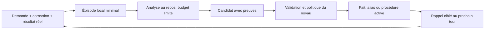

# Mémoire et apprentissage autonome des agents

**Suite de la discussion :** le contrat mémoire autonome, le fournisseur local, les corrections explicites de vocabulaire et leur observabilité ont été implémentés. Leur comportement livré est décrit dans la [spec mémoire](../spec/memoire-skills-ton-langue.md) et le [guide d'utilisation et d'audit](../guide/vocabulaire.md). Cette note conserve la recherche et les propositions initiales ; les connecteurs externes, la consolidation générale et les skills restent des évolutions proposées.

Recherche du 8 novembre 2026. Sources primaires consultées : documentation officielle et code source. Cette note distingue les mécanismes observés des propositions pour Floppy ; elle ne change pas la spec ni le comportement livré. Aucun fournisseur installé, aucun benchmark local réalisé. Les liens de code visent `main`, consulté à cette date : les interfaces devront être figées sur une version avant intégration. La récupération des SHA via l'API GitHub n'a pas abouti.

## Quels projets correspondent aux noms cités ?

« Oncho » semble désigner **Honcho**, de Plastic Labs, intégré à Hermes. « Mnemosis » semble désigner **Mnemosyne**, ici le projet `mnemosyne-oss/mnemosyne`, dont le site est `mnemosyne.site`. Ce second rapprochement reste une hypothèse : plusieurs logiciels distincts portent le nom Mnemosyne. [Intégration officielle Honcho–Hermes](https://honcho.dev/docs/v3/guides/integrations/hermes), [dépôt Mnemosyne](https://github.com/mnemosyne-oss/mnemosyne).

## Ce que fait réellement Hermes

### Des mémoires différentes selon le besoin

Le socle d'Hermes contient deux petits fichiers : `USER.md` pour le profil utilisateur et `MEMORY.md` pour les faits durables, conventions et environnement. Les valeurs documentées sont respectivement 1 375 et 2 200 caractères. Le prompt reçoit un instantané au début de la session ; les écritures suivantes persistent immédiatement mais ne modifient pas cet instantané, afin de préserver le cache. L'outil `memory` ajoute, modifie ou retire des entrées. Quand la limite est atteinte, il échoue plutôt que supprimer silencieusement des souvenirs. La documentation recommande des frontières de session naturelles. [Mémoire persistante](https://hermes-agent.nousresearch.com/docs/user-guide/features/memory), [implémentation de l'outil](https://github.com/NousResearch/hermes-agent/blob/main/tools/memory_tool.py).

La mémoire historique est distincte. Le code actuel de `session_search` interroge SQLite/FTS5 et retourne de vrais messages, avec découverte, lecture et navigation autour d'un message. Il précise qu'il ne fait **aucun appel LLM**. Les sessions d'automatisation sont moins bien classées que les sessions interactives et certaines sources techniques sont masquées, pour éviter qu'elles monopolisent le rappel. Le README général mentionne encore une synthèse LLM : pour ce point, le code est plus précis que la présentation. [Code `session_search_tool.py`](https://github.com/NousResearch/hermes-agent/blob/main/tools/session_search_tool.py).

Le savoir-faire est rangé dans des **skills**, avec instructions, références et éventuellement scripts. Une skill peut documenter une procédure, ses écueils et sa vérification. Hermes dispose aussi de `/learn` pour transformer une procédure ou des sources en skill, de prérequis d'outils et d'un chargement sélectif. Ce sont donc des procédures réutilisables, différentes d'un fait sur l'utilisateur. [Système de skills](https://hermes-agent.nousresearch.com/docs/user-guide/features/skills).

### L'auto-amélioration est une boucle d'entretien

Le fichier `agent/background_review.py` crée une exécution dérivée après un tour pour examiner si une mémoire ou une skill mérite d'être enregistrée ou corrigée. Cette exécution réutilise le contexte du parent mais n'altère pas sa conversation. Ses outils sont limités à une liste autorisée. L'amélioration observée porte sur les connaissances et procédures persistées : ce mécanisme ne réentraîne pas les poids du modèle. [Code de la revue](https://github.com/NousResearch/hermes-agent/blob/main/agent/background_review.py).

La documentation expose un budget de tokens, une fréquence et un modèle distinct pour la revue. Avec un modèle local géré, elle peut attendre que le GPU soit au repos. Les notifications rendent les changements visibles ; une option permet de mettre les écritures en attente d'approbation. Cette boucle est utile, mais son coût doit être borné et mesuré. [Contrôles de revue et d'écriture](https://hermes-agent.nousresearch.com/docs/user-guide/features/memory#controlling-memory-writes-write_approval).

### Les fournisseurs sont une extension, pas une recommandation unique

Hermes propose plusieurs fournisseurs selon les usages. La documentation présente Honcho pour la continuité entre agents et la modélisation de l'utilisateur, Mem0 pour l'extraction automatique de faits, OpenViking pour la connaissance structurée. Elle ne démontre pas qu'un fournisseur domine pour tous les besoins. Honcho n'est plus embarqué dans le dépôt principal : il vient du catalogue et est maintenu par Plastic Labs. [Fournisseurs mémoire](https://hermes-agent.nousresearch.com/docs/user-guide/features/memory-providers).

Le contrat `MemoryProvider` sépare contexte statique, rappel (`prefetch`), synchronisation des tours (`sync_turn`), outils et fermeture. Le contexte rappelé doit passer par le rappel dynamique, et non gonfler le préfixe statique. Le contrat demande un rappel rapide et une synchronisation non bloquante. [Interface du fournisseur](https://github.com/NousResearch/hermes-agent/blob/main/agent/memory_provider.py).

Le gestionnaire autorise au plus un fournisseur externe avec le socle local. Il sérialise les écritures de fond, borne les attentes, isole les exceptions, expurge les sorties vers les fournisseurs et évite que les sous-agents écrivent librement dans la mémoire principale. Attention : le rappel externe a actuellement une limite de huit secondes ; ce plafond de robustesse ne constitue pas un objectif acceptable pour une interaction vocale. [Code `memory_manager.py`](https://github.com/NousResearch/hermes-agent/blob/main/agent/memory_manager.py).

## Honcho

Honcho conserve des représentations distinctes de l'utilisateur et de l'agent, alimentées par leurs échanges. Il fournit profil, recherche, contexte de session, conclusions persistantes et questions sur la mémoire avec raisonnement LLM. L'intégration Hermes injecte les représentations au moment de l'appel, sans modifier le préfixe système. Le mode hybride combine rappel automatique et outils explicites. Il peut viser Honcho Cloud ou une instance hébergée par l'utilisateur. [Guide officiel de l'intégration](https://honcho.dev/docs/v3/guides/integrations/hermes).

L'auto-hébergement demande un service et sa configuration ; il ne signifie pas automatiquement que toutes les inférences sont locales. Il faut aussi vérifier les fournisseurs de modèles et d'embeddings choisis. Les appels de raisonnement, l'hébergement et les éventuels modèles payants constituent des coûts à évaluer sur les tâches de Floppy ; aucun tarif ni gain chiffré n'est présumé ici. [Auto-hébergement](https://honcho.dev/docs/v3/contributing/self-hosting).

Le **serveur est AGPL-3.0**, tandis que le **SDK TypeScript déclare Apache-2.0**. Au regard de la règle du dépôt imposant des licences permissives aux composants livrés, proposition : garder Honcho comme connexion optionnelle à un service, ne pas embarquer son serveur dans Floppy par défaut. Cela ne remplace pas la vérification des licences du paquet exact et de ses dépendances lors de l'intégration. [Licence serveur](https://github.com/plastic-labs/honcho/blob/main/LICENSE), [manifeste du SDK](https://github.com/plastic-labs/honcho/blob/main/sdks/typescript/package.json).

**Déduction pour Floppy :** candidat intéressant si l'objectif devient un profil utilisateur partagé entre plusieurs agents, avec inférences sur les préférences et la continuité du travail. Une correspondance exacte « nom oral → projet Orca » n'a pas besoin de ce degré de raisonnement.

## Mnemosyne

Le projet organise une mémoire de travail, une mémoire persistante et un espace temporaire dans SQLite, avec FTS5 et recherche vectorielle ; il ajoute des faits et relations temporelles. Son API expose stockage, rappel, consolidation et export/import. Il possède une intégration Hermes et une interface MCP. [README](https://github.com/mnemosyne-oss/mnemosyne/blob/main/README.md), [implémentation BEAM](https://github.com/mnemosyne-oss/mnemosyne/blob/main/mnemosyne/core/beam.py).

Son code est **MIT**. Le socle nécessite Python 3.10 ou supérieur et PyYAML ; les extras ajoutent notamment FastEmbed, ONNX Runtime, sqlite-vec ou MCP. Il faut donc distinguer stockage local simple et installation complète avec recherche sémantique : le slogan « zéro dépendance » ne décrit pas littéralement tous ces profils. [Licence](https://github.com/mnemosyne-oss/mnemosyne/blob/main/LICENSE), [dépendances](https://github.com/mnemosyne-oss/mnemosyne/blob/main/pyproject.toml).

Un point d'attention concret figure dans ses propres instructions : la version du plugin Hermes et celle du moteur doivent être compatibles ; le guide distingue actuellement un couple stable audité d'un couple utilisant le moteur 4.0 bêta. Il recommande une installation séparée du runtime Hermes pour certains modes de distribution. Ces détails évoluent : ne pas installer aveuglément la dernière version de chaque paquet. [Guide d'intégration](https://github.com/mnemosyne-oss/mnemosyne/blob/main/docs/hermes-integration.md).

Le mode local doit être explicitement configuré. Selon les options d'embedding, les textes stockés et les requêtes peuvent être envoyés à une API distante. La documentation reconnaît aussi qu'un filtre lexical du rappel par défaut peut éliminer une bonne correspondance sémantique ; élargir le rappel change à son tour les compromis de pertinence. Cela justifie des tests en français sur des paraphrases vocales et des noms de projets, plutôt qu'une confiance dans un chiffre de benchmark général. [Configuration et diagnostic du rappel](https://github.com/mnemosyne-oss/mnemosyne/blob/main/docs/configuration.md).

La consolidation et l'extraction peuvent utiliser un LLM local, une API compatible ou un backend fourni par l'agent hôte. Il existe donc une séparation réutilisable entre moteur mémoire et modèle d'entretien. Les chemins sans LLM restent disponibles. [Backend LLM de l'hôte](https://github.com/mnemosyne-oss/mnemosyne/blob/main/docs/hermes-llm-integration.md).

**Déduction pour Floppy :** candidat plus proche du besoin local-first que Honcho pour évaluer une mémoire structurée et sémantique. L'adopter ajoute cependant un runtime Python, des modèles éventuels et un cycle de mise à jour. Un adaptateur expérimental est préférable à une dépendance obligatoire avant mesure.

## Enseignements à reprendre indépendamment du fournisseur

Les points suivants sont des propositions de conception, pas des garanties fournies par les projets comparés :

- Séparer les faits utilisateur, les références exactes aux ressources, l'historique des épisodes et les procédures éprouvées.
- Apprendre après une action vérifiée ou une correction de l'utilisateur, avec provenance ; ne pas transformer une supposition de l'agent en fait confirmé.
- Faire le rappel utile avant l'action et l'entretien coûteux après, avec un budget et une priorité inférieure à la voix.
- Pour un raccourci Orca, conserver une identité de projet revalidable ; pour une recette d'outil, conserver des paramètres typés et une version de schéma. Une ligne de shell mémorisée est plus fragile.
- Donner à l'utilisateur une vue des souvenirs, de leurs sources et des dernières corrections, ainsi que les commandes corriger, oublier et annuler.
- Une recette mémorisée n'accorde aucun droit nouveau : les actions continuent à traverser les accords du noyau.
- Mesurer rappel correct, corrections répétées, échecs évités, conflits de noms, latence vocale et coût d'entretien sur un corpus propre à Floppy.

**Orientation proposée :** reprendre d'abord la boucle de mémoire et de skills d'Hermes dans l'architecture plugin de Floppy. Conserver le choix du stockage derrière un contrat, puis comparer le socle local enrichi à Mnemosyne et, pour la personnalisation entre agents, à Honcho. Une base vectorielle seule ne crée ni une politique d'apprentissage, ni une preuve qu'une procédure a fonctionné.

## Diagnostic de Floppy au 8 novembre 2026

Les constats ci-dessous viennent du dépôt local, pas d'une supposition sur les fournisseurs externes.

- Le [plugin mémoire](../../plugins/memory/local/src/index.ts) existe : `USER.md` (1 400 caractères), `MEMORY.md` (2 200), historique SQLite FTS5 et outils `remember` / `search_history`. La recherche est lexicale, avec les mots reliés par OR. Le remplissage est piloté par l'outil, dont la description vise les demandes explicites. Il n'y a ni extraction automatique, ni entrées structurées avec preuve, ni historique d'apprentissage des outils.
- Le [contrat actuel](../../packages/contracts/src/brain.ts) expose `snapshot/record/search`. `record` conserve seulement des messages utilisateur/assistant ; les sorties d'outils et leurs statuts ne constituent pas des épisodes de mémoire.
- Dans le [cerveau AI SDK](../../plugins/brain/aisdk/src/index.ts), la branche `if (agent)` retourne avant `snapshot()` et `record()`. Ce chemin transmet des tours récents au CLI, mais ne bénéficie pas de ces appels à la mémoire durable. Le [mode live](../../plugins/conversation/default/src/live.ts) possède ses propres injections et enregistrements. Il faut unifier la couverture avant d'ajouter un fournisseur.
- Les skills Floppy sont décrites dans la [spec](../spec/memoire-skills-ton-langue.md), mais aucun chargeur `read_skill` n'a été trouvé dans le catalogue et les chemins cerveau examinés. Cette page dit aussi « dans le noyau » alors que la mémoire est un plugin ; ses contrôles contre l'injection ne sont pas implémentés comme une validation dédiée dans le plugin examiné.
- [Orca](../../plugins/tools/orca/src/index.ts) sait déjà chercher des agents à partir des noms dictés et retrouver des conversations. La dernière cible annoncée reste en mémoire du processus ; aucun dictionnaire persistant d'alias utilisateur n'est présent. [L'envoi](../../plugins/tools/orca/src/send.ts) fige la cible avant l'accord puis la revérifie : propriété à préserver.
- Le [registre d'outils](../../packages/core/src/tools.ts) centralise les appels, accords et statuts. Son audit n'enregistre pas les résultats complets réussis et `ToolCallMeta` ne comporte pas de session/tour. Le hook `tool.before` peut entourer `next()`, mais les exceptions sont converties en résultat final après ce hook : il ne constitue pas seul un journal exhaustif prêt pour l'apprentissage.

## Proposition : une mémoire locale commune et une boucle d'apprentissage

**Recommandation : faire évoluer le plugin local, puis ajouter un plugin d'apprentissage.** Conserver une petite mémoire permanente et retrouver les détails à la demande. Garder les fournisseurs externes comme options évaluables. Cette proposition n'est pas une décision déjà appliquée à la spec.

### Quatre contenus distincts

| Contenu | Exemple | Stockage et utilisation proposés |
|---|---|---|
| Profil et faits durables | Préférence de réponse, projet habituel | Entrées structurées ; petite projection dans le contexte |
| Entités et alias | « le vocal » désigne le projet Floppy | Alias typés, portée utilisateur/projet, référence vérifiable |
| Épisodes | Appel échoué, correction, appel réussi | SQLite, recherche FTS5, preuves datées |
| Procédures | Méthode pour retrouver le bon agent Orca | Recettes déclaratives versionnées ; présentation `SKILL.md` à la demande |

Une même phrase peut produire plusieurs candidats, mais leurs durées de vie diffèrent. Un numéro de terminal est temporaire ; un surnom de projet peut durer. Une correction explicite de l'utilisateur prime sur une hypothèse du modèle. Une commande qui échoue une fois ne prouve pas une règle générale.

Chaque entrée structurée porterait un identifiant, un type, une portée, le contenu, les références des preuves, les dates de création/vérification, une version et un état (`candidate/active/stale/rejected`). Les procédures ajoutent les outils requis et l'empreinte de leurs schémas. La confiance doit venir des preuves et vérifications, pas seulement d'un score autoévalué par le LLM.

SQLite devient la source des entrées structurées ; les petits Markdown restent des projections lisibles/exportables. L'import des fichiers existants préserve le texte sans lui inventer une provenance. Éviter deux sources modifiables concurrentes : les modifications externes éventuelles passent par un import explicite, avec détection de version.

### Boucle proposée

1. **Observer.** À la fin d'un tour ou d'une tâche, conserver les événements utiles, avec session, tour et identifiants d'appel. Expurger les secrets et éviter d'archiver par défaut tout un mail, écran ou résultat externe.
2. **Extraire.** Déclencher une analyse surtout après une correction, une résolution d'ambiguïté ou une séquence échec/réussite. Un appel `completion` sans outils produit des candidats JSON. Le créneau d'inactivité, le budget, la file bornée et l'annulation empêchent de ralentir la voix.
3. **Vérifier.** Dédupliquer, vérifier la portée, les preuves et les schémas d'outil ; séparer les résultats constatés des affirmations du modèle. `done` signifie parfois seulement « consigne transmise », comme pour Orca, et non « travail terminé ». `unverified` ne devient jamais une réussite apprise.
4. **Activer.** Passer par une écriture contrôlée et versionnée. Une correction utilisateur explicite peut justifier un alias dès la première occurrence ; une méthode inférée reste candidate jusqu'à vérification ou répétition pertinente. Ne pas rejouer une action avec effet pour tester une recette.
5. **Retrouver.** Avant le tour, sélectionner quelques entrées selon la demande, le projet, les outils disponibles et la fraîcheur. Alias exacts et recherche lexicale d'abord ; embeddings seulement si les évaluations montrent un manque de rappel.
6. **Réviser.** Invalider une procédure si le schéma d'outil change ; revalider une cible vivante ; marquer obsolètes les observations périssables. Une suppression doit couvrir index, projections et dérivés, et empêcher que le prochain passage sur un vieil épisode réapprenne immédiatement l'élément supprimé.

Le contexte permanent conserve un préfixe stable ; les nouveaux faits pertinents arrivent dans un bloc de données propre au tour. Une mise à jour devient ainsi utilisable sans attendre une nouvelle conversation. Les recettes chargées restent subordonnées aux consignes et permissions du système.

### Placement dans le projet

- **Contrat mémoire autonome** dans `packages/contracts/src/memory.ts`, extrait de `brain.ts` : recevoir des observations, retrouver du contexte, consulter et gérer les connaissances avec leur provenance. Opérations asynchrones, annulables et bornées pour les fournisseurs distants. Aucun format Markdown, SQLite ou vectoriel imposé par le contrat.
- **`plugins/memory/local`** fournit l'implémentation livrée par défaut : stockage, import/migration, recherche, versions et projection. Des connecteurs optionnels Honcho et Mnemosyne pourront fournir le même contrat. Les outils visibles par les cerveaux et les politiques d'apprentissage restent communs ; les caractéristiques propres aux fournisseurs sont des capacités explicites.
- **Nouveau `plugins/memory/learning`** gère la file de consolidation, utilise un slot `completion` et soumet les candidats au module mémoire. Ses tâches lentes démarrent après `apply`, ses ressources passent par `ctx`, ses attentes sont bornées. Les données restent sous `ctx.home`.
- Une petite Interface mémoire commune offre la sélection du contexte, l'observation et la consultation. Les opérations de mutation du modèle restent des outils contrôlés. Cerveau local, CLI et live consomment le même contexte ; les adaptateurs ne réimplémentent pas la recherche.
- En première étape, instrumenter les appels existants ; pour une couverture complète, ajouter au noyau une observation **générique** d'appel terminé, y compris les échecs, sans connaissance du plugin mémoire. Propager session/tour/appel dans les métadonnées, y compris via les accès MCP. Choisir un seul propriétaire de l'enregistrement de chaque message pour éviter les doublons live/cerveau.
- **`plugins/tools/orca`** reste propriétaire de la résolution d'une référence Orca vers une cible actuellement disponible. La mémoire conserve le sens des alias ; elle ne choisit pas seule un terminal à partir d'un ancien identifiant.
- Charger les recettes par les outils Floppy, communs à tous les cerveaux. Ajouter les nouveaux plugins au catalogue et à `floppy.example.yml`, leurs réglages et formulaires déclaratifs, puis régénérer `docs:services`. Tous les textes utilisateur sont fr/en.

Suite à la discussion, prévoir dès le départ des fournisseurs interchangeables derrière ce contrat, avec un seul fournisseur actif et un format d'export/import Floppy pour les connaissances transférables. Livrer d'abord le fournisseur local ; évaluer ensuite les connecteurs. Un fournisseur qui assure déjà l'extraction et la consolidation ne doit pas subir une seconde analyse identique par le plugin d'apprentissage.

### Autonomie compatible avec les accords

Le souhait est d'éviter de demander « retiens ceci » à chaque fois. Je propose un réglage explicite **apprentissage local automatique** : alias issus de corrections explicites, faits opérationnels vérifiés et recettes limitées aux outils existants. Les inférences personnelles incertaines restent des propositions.

Le [gestionnaire actuel](../../packages/core/src/approval.ts) combine essentiellement une règle par niveau et une surcharge qui ne peut que la durcir. Mettre `write: always` autoriserait beaucoup trop d'actions. L'autonomie ciblée nécessite donc **une extension de politique du noyau**, bornée à l'écriture mémoire, à ses catégories autorisées et à son stockage, avec audit, révocation et refus explicite prioritaire. Le plugin ne s'accorde pas lui-même une exception. Sans cette extension, utiliser les accords existants, éventuellement pour un lot de candidats.

Apprendre une méthode ne donne aucun droit supplémentaire à son exécution. Les envois, suppressions et autres actions continuent par le registre et leurs accords normaux. Les observations et brouillons internes peuvent être accumulés comme l'historique ; ils ne deviennent pas des consignes actives par simple présence dans le stockage.

Les écrans de relecture permettraient « ce qui a été appris », preuve, correction, oubli et annulation de la dernière consolidation, via les composants Settings existants. Une erreur de mémoire ne doit pas exiger d'éditer une base à la main.

### Exemple Orca

Tu dis « regarde le projet vocal ». Floppy hésite ; tu précises « par vocal, je parle de Floppy ». Il retient l'alias avec cette correction comme preuve et une identité de projet vérifiable, pas un `paneKey` durable.

À la prochaine demande, il retrouve cet alias, interroge Orca, puis résout l'agent actuel. Si plusieurs agents du projet correspondent, l'alias ne tranche pas leur tâche. Si tu demandes un envoi, la cible est figée et revérifiée selon le mécanisme existant. Si le projet a disparu ou changé d'identité, Floppy ne remplace pas silencieusement la cible.

Une recette peut retenir l'ordre « identifier le projet → chercher l'agent courant → lire son état ». Elle ne conserve pas un ancien appel brut à rejouer ni une autorisation d'envoyer.

## Cas prioritaire : apprendre les corrections de reconnaissance vocale

Besoin exprimé : un nom tel que le canal Teams **Core Team** est mal transcrit par le STT français ; après correction par l'utilisateur, Floppy doit retenir la correspondance pour les demandes suivantes. La transcription erronée exacte n'a pas été fournie. « corps Tim » ci-dessous est un exemple fictif, pas une observation du système.

### Comportement proposé

1. Le STT produit « lis le canal corps Tim ». Floppy conserve le texte brut du tour accepté.
2. L'utilisateur corrige : « Non, je parle de Core Team », l'épelle, corrige le texte ou sélectionne le bon canal dans les résultats. Floppy relie la correction au tour et au fragment concernés. Une simple hésitation, une ressemblance phonétique ou un résultat vide ne suffisent pas à confirmer une correspondance.
3. Après identification non ambiguë, la mémoire conserve une **correction de vocabulaire**, éventuellement reliée à l'entité réelle : variante observée, nom canonique, application, compte/espace, équipe et canal, langue d'entrée, preuve utilisateur, date et version. L'identifiant du modèle STT est une provenance utile, sans rendre automatiquement la correction inutilisable après changement de modèle.
4. Au tour suivant, une variante déjà validée dans une demande de canal Teams est résolue vers Core Team. La correction explicite peut devenir active immédiatement selon la politique d'apprentissage choisie, sans attendre la consolidation du soir ni demander de dire « mémorise » en plus. La confirmation « c'est retenu » n'est émise qu'après persistance réussie.
5. L'utilisateur peut dire « oublie cette correction » ou changer sa portée. Une correction ambiguë reste candidate et nécessite de préciser la cible ; elle ne remplace pas une règle valide sur une simple supposition du modèle.

### Un vocabulaire contextualisé

Séparer **variante transcrite → nom canonique** et **nom/alias → référence métier**. Un canal Core Team peut exister dans plusieurs équipes ou comptes : connaître son orthographe ne suffit pas à choisir son identité. Le plugin Microsoft 365 reste responsable de la résolution et de la vérification de la cible accessible.

Appliquer les correspondances aux expressions entières et au rôle du fragment (nom du canal, projet, personne), avec priorité aux règles les plus spécifiques. Une variante proche mais jamais confirmée constitue un candidat, pas une nouvelle règle auto-validée. Conserver transcription originale, interprétation et correction utilisée pour pouvoir expliquer ou annuler le choix.

Exemple : dans « envoie au canal corps Tim le message “Tim a mal au corps” », seule la cible peut être résolue. Le contenu cité n'est pas réécrit. Les phrases ordinaires hors de Teams, les textes saisis et la dictée libre ne subissent pas par défaut ces remplacements. Un lexique de dictée pourra être proposé séparément, avec une portée explicite.

### Placement dans le parcours vocal

Le [contrat STT actuel](../../packages/contracts/src/voice.ts) retourne seulement du texte. La [conversation](../../plugins/conversation/default/src/voice-events.ts) traite l'écho, les accords et l'activation avant de transmettre la demande au cerveau. La correction proposée intervient **sur les demandes acceptées**, sans modifier la détection du réveil ni les réponses oui/non aux accords. Elle doit aussi couvrir les commandes locales, qui peuvent éviter le cerveau.

Prévoir un plugin `plugins/voice/vocabulary` qui consomme le contrat mémoire et expose la résolution de vocabulaire. Le contrat mémoire conserve des corrections structurées accessibles par recherche exacte et par portée ; il ne doit pas réduire cette capacité à un rappel sémantique probabiliste. Un cache local versionné peut servir les corrections actives si le fournisseur est distant ; l'oubli et les modifications invalident également ce cache.

Avant le cerveau, fournir le texte brut et les interprétations candidates ; ne produire une substitution que si la portée est certaine. Lors de la résolution des arguments d'outils, utiliser le même vocabulaire pour désambiguïser les noms. Éviter toute modification tardive d'une cible après présentation de l'accord.

Le [mode live](../../plugins/conversation/default/src/live.ts) reçoit directement l'audio : modifier le texte affiché après son événement `input_transcript` ne corrige pas ce que le modèle a déjà entendu. Il faut lui fournir le vocabulaire pertinent en contexte et conserver la résolution des cibles dans les outils, avant l'accord et l'exécution. Si un moteur STT expose un jour des indications de vocabulaire, les fournir en complément ; le contrat actuel ne possède pas cette option et aucun support universel n'est présumé.

### Critères de recette

- Une correction explicite de Core Team persiste après redémarrage et reste utilisable avec un autre cerveau.
- Une demande contenant la variante déjà apprise retrouve le bon canal dans le bon compte et la bonne équipe ; deux homonymes restent ambigus sans contexte supplémentaire.
- Un texte cité, une dictée libre, une réponse d'accord et une phrase hors du domaine conservent leurs mots.
- Un mauvais résultat d'outil ou une hypothèse du cerveau ne crée pas une correction confirmée.
- Une correction du tour interrompu/recollé n'est pas rattachée à un autre tour et n'est pas enregistrée deux fois.
- Une règle corrigée ou oubliée cesse d'agir immédiatement, y compris dans le cache et les sessions actives ; elle n'est pas recréée à partir de son ancienne preuve.
- Une cible corrigée est montrée correctement dans l'accord d'envoi et vérifiée avant l'action ; le mode live ne se contente pas de corriger ses sous-titres.

Cette capacité est proposée comme premier cas concret du contrat mémoire autonome. Aucun apprentissage réel de Core Team ni modification du parcours vocal n'est réalisé par cette note.

## Mise en œuvre et critères de succès proposés

1. **Socle et premier bénéfice.** Contrat mémoire indépendant, fournisseur local, couverture identique local/CLI/live, entrées versionnées, corrections vocales contextualisées (Core Team) et alias Orca. Tests : correction conservée après redémarrage, entrée nouvelle visible dans le tour suivant, absence de doublons, cible ambiguë ou disparue.
2. **Apprentissage automatique.** Épisodes corrélés, extraction au repos, activation par politique ciblée, déduplication, oubli et écran de relecture. Tests : refus conservé, secret exclu, contradiction et concurrence, traitement repris sans double écriture, timeout et arrêt propres.
3. **Procédures et évaluation.** Recettes sans exécution de code arbitraire, chargement à la demande, invalidation au changement de schéma. Mesurer leur intérêt avant d'ajouter recherche vectorielle ou fournisseur externe.

Construire un jeu d'une trentaine de scénarios français/anglais, avec erreurs de dictée, correction explicite, redémarrage, changement de cerveau, ancien terminal et outil mis à jour. Comparer sans apprentissage et avec apprentissage : résolution correcte au premier essai, erreurs répétées, souvenirs faux, appels évités, latence du rappel et coût de consolidation. Une amélioration doit réduire les erreurs sans augmenter les actions sur une mauvaise cible. Les objectifs de latence sont à fixer et mesurer sur la machine cible ; aucun gain chiffré n'est établi ici.

Pour l'implémentation, chaque comportement changé aura son test à côté ; réponses réseau simulées, puis `npm run check`. Cette recherche ne modifie aucun comportement et n'installe aucun fournisseur.

### Vérification du dépôt pendant l'analyse

`npm run check` a passé les trois vérifications TypeScript puis échoué dans Vitest : 1 198 tests réussis, 10 échecs et 2 ignorés (166 fichiers). Les échecs concernent Electron et ses ACL, le coffre système indisponible dans cette session, la voix système, l'arrêt de processus et des délais de tests CLI/MCP. Leur cause complète n'a pas été diagnostiquée dans cette recherche ; ils ne permettent pas de déclarer le dépôt vert. `npm run licences`, exécuté séparément puisque la chaîne s'était arrêtée, passe. Aucun code de production ou de test n'a été modifié pour cette note.
