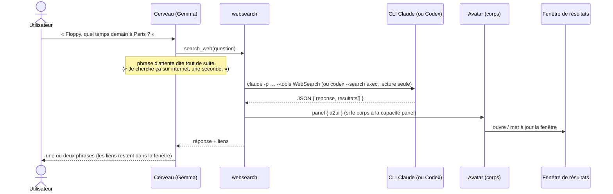

# Recherche web et fenêtre de résultats A2UI (implémenté)

## Recherche web (`plugins/tools/websearch`)

Floppy cherche sur internet avec **l'abonnement Claude ou Codex** de l'utilisateur (pas de clé d'API). C'est une
application (Réglages → Connecteurs → Applications) : on l'ajoute, l'éteint ou la retire.

- Claude : `-p --output-format json --tools WebSearch` (+ `WebFetch` si « lire les pages »), `--permission-mode dontAsk`,
  aucun MCP (`--strict-mcp-config` vide), modèle Haiku par défaut. Codex : `codex --search exec --ephemeral -s read-only
  --output-schema` (réponse au format JSON imposé).
- Durée mesurée : ~15 à 20 s (Claude Haiku), ~25 s (Codex). D'où la **phrase d'attente** : un outil peut déclarer
  `waitPhrase` (`ToolDef`), dite par le cerveau dès qu'il choisit l'outil.
- La date du jour est donnée au CLI (sinon il se trompe de jour pour « demain »).
- Les résultats peuvent inclure une date de publication ISO 8601, uniquement si la source l'indique explicitement (`null` si inconnue). Les dates valides sont transmises au service `search` pour la Veille ; les dates absentes ou illisibles restent absentes.
- Sécurité : la question est un argument (jamais de shell) ; le contenu du web est une donnée, pas une consigne ; seuls
  les liens `http(s)` sont gardés ; l'application est marquée **cloud** (l'activer à la voix demande l'accord).

## Fenêtre de résultats A2UI

Plutôt que des cartes sur l'avatar, les résultats longs s'ouvrent dans une **fenêtre** de l'app.

- Protocole : message `panel { id, title, a2ui }` (noyau → corps), capacité de corps `panel`.
- `a2ui` : messages A2UI v0.8 (`surfaceUpdate` avec ses composants, puis `beginRendering` avec la racine).
- Composants rendus (`apps/desktop/src/renderer/panel.ts`) : `Column`, `Row`, `List`, `Card`, `Text` (`usageHint`
  h1 à h5, body, caption), `Button`, `Divider`, `Image` (https seulement).
- Le texte est toujours mis en `textContent` (jamais de HTML). CSP stricte. La fenêtre n'a qu'un pont : recevoir une
  surface, envoyer une action.
- Action d'un bouton : `open_url` → le processus principal vérifie `http(s)` et ouvre le navigateur (le clic est
  le consentement).
- Un corps sans écran (Reachy) ne reçoit pas de fenêtre : la réponse est seulement dite.

## Au démarrage : Floppy « dort »

Tant que la voix et le cerveau chargent leurs modèles, l'avatar dort (yeux fermés, zzz). Il se réveille au premier
état envoyé par la conversation (« idle »). Quand la conversation s'arrête (changement de cerveau ou de voix), elle
envoie « sleep » à tous les corps, puis « idle » quand elle repart. La fenêtre se branche en général avant que la
conversation démarre : au démarrage, la conversation envoie donc « idle » aux corps déjà branchés, pas seulement à
ceux qui arrivent après elle.
