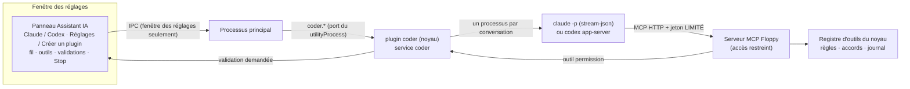
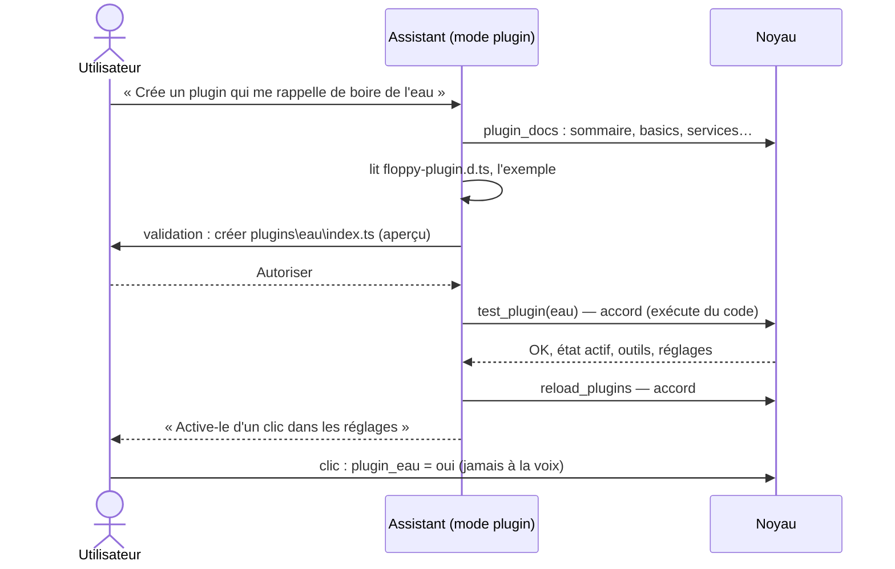

# Assistant IA et plugins utilisateur (implémenté)

[← Retour à la spec](README.md)

État : **fait** (5 novembre 2026). Code : `assistant\plugins\assistant\coder`, `assistant\apps\cli\src\user-plugins.ts`, `assistant\apps\desktop\src\renderer\assistant.js`.

Dans la fenêtre des réglages, un **assistant IA** aide à régler Floppy et à **écrire ses propres plugins**. Il utilise **le Claude Code ou le Codex de l'utilisateur** (son abonnement, par le CLI officiel déjà connecté), jamais une clé API.

## Vue d'ensemble

## Les 2 modes

| | Réglages | Créer un plugin |
|---|---|---|
| Dossier de travail | `<home>\workspaces\coder\settings` (vide) | `<home>\plugins` |
| Outils intégrés du CLI | **aucun** (pas de shell, fichiers, web) | `Read`, `Edit`, `Write`, `Glob`, `Grep` (pas de shell, pas de web) |
| Outils Floppy (MCP limité) | `list_settings`, `change_setting`, `undo_setting`, `plugin_status` | `plugin_docs` (wiki), `test_plugin`, `reload_plugins`, `plugin_status`, `list_settings` + `permission` |
| Écritures | changer un réglage (risque contrôlé par le noyau) | **chaque écriture de fichier validée par l'utilisateur**, avec aperçu du changement ; tout chemin hors de `<home>\plugins` est refusé même si l'utilisateur dit oui |

- **Jeton MCP limité** : un jeton par conversation, qui ne voit et n'appelle que les outils de son mode (les autres répondent « Outil inconnu », journal `mcp.scope_refused`). Le jeton complet reste réservé à la délégation.
- **Contrôle au lancement** : si le CLI expose un outil non prévu (nouvelle version), la conversation s'arrête et c'est journalisé.
- **Claude** : `claude -p --input-format stream-json --output-format stream-json --include-partial-messages --strict-mcp-config --setting-sources project --disable-slash-commands --tools <liste> --allowedTools <liste>` + `--permission-prompt-tool mcp__floppy__permission` en mode plugin. Conversation sur plusieurs tours dans un même processus ; après Stop, reprise avec `--resume <session_id>`.
- **Codex** : `codex app-server`, fil avec bac à sable (`read-only` pour les réglages, `workspace-write` dans `<home>\plugins` pour les plugins), demandes d'accord de Codex transformées en validations. Testé avec un faux serveur seulement.
- **Non connecté** : la conversation affiche une carte « lance `claude auth login` » (ou `codex login`).

### Ce que l'assistant sait de la config

- Il ne lit **jamais** `floppy.yml` ni `settings.json`. Il ne voit les réglages qu'à travers `list_settings`, qui donne pour chacun : clé, groupe, valeur actuelle, choix possibles (ou bornes, ou texte libre avec préréglages) et risque.
- `change_setting` valide **par le code** : clé connue, valeur dans les choix ou les bornes, risque (`ask` = accord de l'utilisateur, `cli` = refusé, l'utilisateur clique lui-même). Une valeur fausse est refusée avec la liste des choix.
- Le prompt impose : lister avant de changer, ne jamais deviner une clé ou une valeur, dire ancienne → nouvelle valeur.
- Limite : ce qui n'est pas un réglage (ajouter un serveur MCP, son adresse, sa liste d'outils) n'est pas modifiable par l'assistant.

## Les plugins utilisateur

- Un plugin = `<home>\plugins\<id>\index.ts`, qui exporte par défaut un objet `{ manifest, config?, apply(ctx, cfg) }`, avec seulement des `import type`. Le kit (`floppy-plugin.d.ts`, `AGENTS.md`/`CLAUDE.md`, exemple `exemple-minuteur`) est copié au premier usage, sans écraser.
- Chaque plugin a un réglage `plugin_<id>` (groupe « Plugins utilisateur », risque **cli**) : il ne s'active **que par un clic** (ou la CLI), jamais à la voix, car c'est du code non vérifié.
- **Au démarrage, un plugin désactivé n'est pas lu** (lire = exécuter son code) : il est seulement listé par son nom. Il est lu au clic d'activation, ou par `reload_plugins` / `test_plugin` (niveau write : accord demandé).
- `test_plugin` le fait tourner dans un **noyau jetable** (10 s) et rend : état, erreur, services manquants, outils, réglages, journal.
- Rechargement à chaud : le noyau remplace la définition et redémarre seulement ce plugin et ses dépendants (`replacePlugin`).
- Risque restant : un plugin personnel activé tourne dans le noyau avec tous les droits.
- Un dossier qui a un `floppy-plugin.json` (plugin distribué) n'est jamais importé : il tourne dans un processus isolé. Installer le plugin de quelqu'un d'autre, le faire relire par un agent IA, le mode debug et le SDK : [plugins-tiers.md](plugins-tiers.md).

### Le wiki des plugins (`plugin_docs`)

L'agent qui écrit un plugin ne voit que le dossier `<home>\plugins`. Pour qu'il connaisse la structure et les contrats de Floppy sans quitter l'application, le noyau a un outil de lecture `plugin_docs`, un wiki **en anglais** (`apps/cli/src/plugins/wiki.ts`, enregistré par `boot.ts`). Sans argument : le sommaire ; `{ page }` : une page ; `{ search }` : les lignes qui contiennent tous les mots.

| Pages | Source |
|---|---|
| `basics`, `tools`, `settings`, `languages`, `events`, `services`, `security`, `testing` | écrites à la main, en anglais : `packages/sdk/wiki/*.md` (une ligne `# titre`, une ligne `> résumé`) |
| `contract-notify`, `contract-completion`, `contract-search`, `contract-documents` | lues dans `packages/core/src/services.ts` et `packages/contracts/src/` à chaque appel : jamais en retard sur le code |
| `active-services` | calculée : qui fournit chaque service maintenant (manifestes livrés + état des entrées) |
| `existing-tools` | calculée : noms et niveaux des outils déjà enregistrés |
| `example-<nom>` | le code complet des exemples du SDK (`packages/sdk/examples`) |

- Pourquoi un outil et pas des fichiers copiés : le kit copié dans `<home>\plugins` n'est jamais écrasé (il vieillit), certaines pages sont calculées, et le même outil marche pour Claude Code et Codex.
- La consigne du mode plugin dit d'appeler `plugin_docs` d'abord, et qu'une API absente du wiki n'existe pas pour un plugin.
- Services d'un plugin personnel : `optional`/`inject` dans le manifeste, puis `ctx.maybe`/`ctx.get` (fournisseur unique) ou `ctx.offers` + `ctx.borrowItem` (éléments au choix : canaux `notify`, modèles `completion`, moteurs `search`). Ces méthodes et les 4 contrats sont dans `floppy-plugin.d.ts` ; `packages/sdk/test/types.test.ts` vérifie qu'ils suivent le noyau. Un plugin tiers (processus isolé) n'a pas de services : `offers` rend `[]`, `get` et `borrowItem` lèvent une erreur claire.
- L'outil est aussi visible du cerveau à la voix (niveau `read`, sans effet).

## Testé

- Avec le **vrai Claude** (noyau jetable) : mode réglages (liste, puis « passe le modèle sur haiku » change bien le réglage) ; mode plugin (lecture du kit, **écriture validée**, `test_plugin` OK, `reload_plugins`).
- Tests automatiques : 22 tests du plugin coder (faux CLI : flux, plusieurs tours, Stop + reprise, validations, chemins refusés, connexion requise), jeton MCP limité, 7 tests des plugins utilisateur (dont : code d'un plugin désactivé jamais exécuté au démarrage).
- Le panneau dans la vraie fenêtre : visible, Claude et Codex détectés. Le fil complet dans la fenêtre reste à essayer à la main.

## Ajouter des éléments avec l'assistant (mode « réglages »)

L'assistant de la fenêtre peut aussi gérer les **éléments** (voir [elements.md](elements.md)) : « ajoute le MCP Office 365 ».

| Outil | Ce qu'il fait | Clic de l'utilisateur |
|---|---|---|
| `list_items`, `list_item_types` | voir les éléments, les types qu'on peut ajouter et les champs de chaque formulaire | non (lecture) |
| `toggle_item` | activer / désactiver | comme à la voix (accord si cloud) |
| `add_app` | ajouter une application livrée avec Floppy (Orca…) | toujours un accord ; valeurs par défaut |
| `try_item` | se connecter et lister les outils (peut lancer une commande) | **oui** |
| `add_item`, `edit_item`, `delete_item` | ajouter, modifier, supprimer | **oui** |

- Ces outils existent seulement pour l'assistant de la fenêtre (jeton MCP restreint, `plugins/assistant/coder/src/items-tools.ts`), jamais pour le cerveau à la voix.
- Après le clic « Autoriser », l'opération part comme un clic dans la fenêtre (`via: "ui"`).
- Les secrets ne passent jamais par la conversation : les champs secrets sont retirés des valeurs ; l'utilisateur les tape dans « Modifier ».
- L'assistant ne doit pas inventer une commande de serveur MCP : il demande celle de la documentation du serveur.
