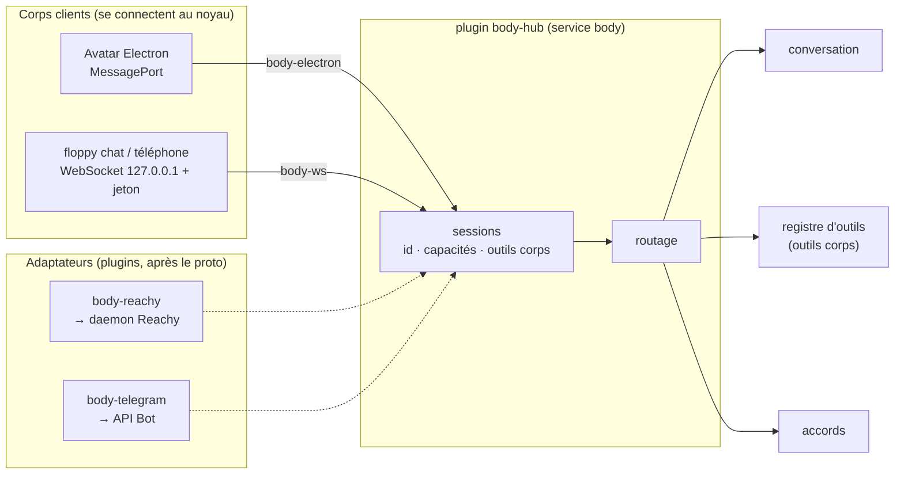
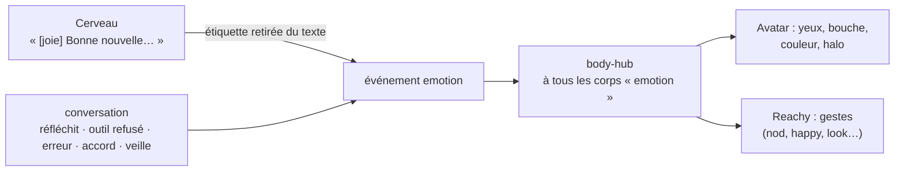
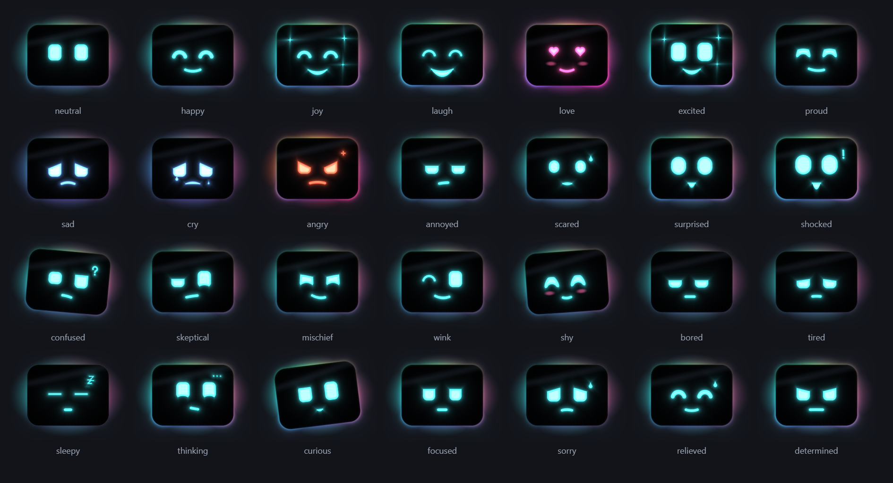
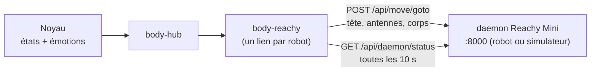
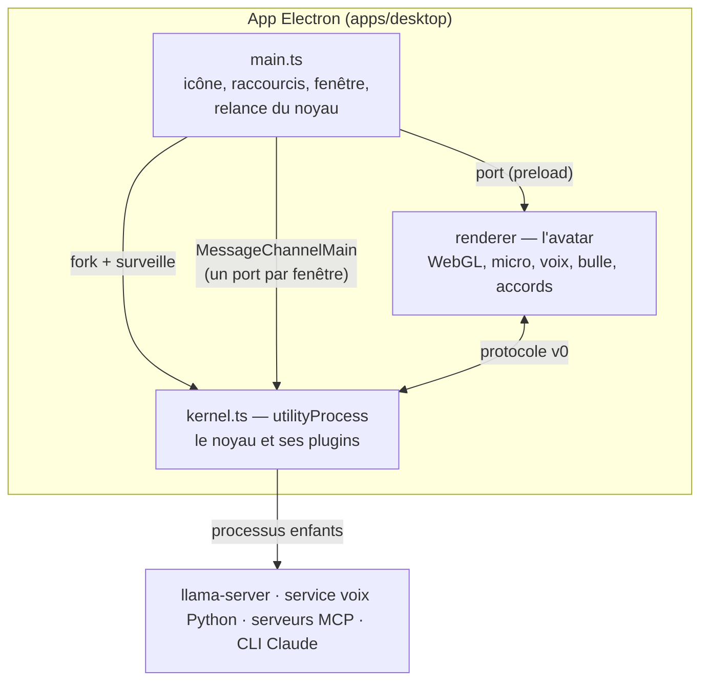
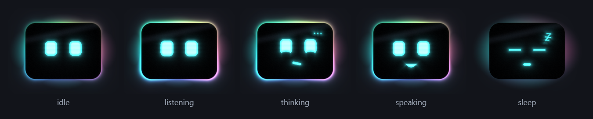
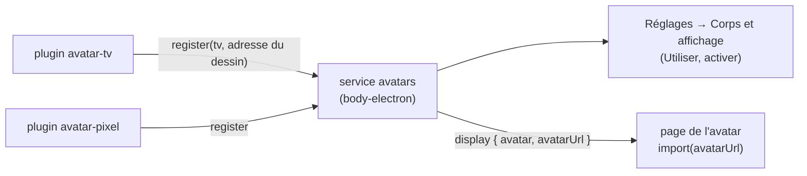

# Corps, émotions et avatar (implémenté)

[← Retour à la spec](README.md)

État : **fait** dans le proto (5 novembre 2026). Code : `assistant\packages\protocol`, `assistant\plugins\body\*`, `assistant\apps\desktop`.

## Plusieurs corps en même temps

Un **corps** montre l'assistant et l'écoute : l'avatar du bureau, Reachy, un téléphone, Telegram, un terminal. **Plusieurs corps peuvent être branchés en même temps**, dans n'importe quelle combinaison (avatar + Reachy, Reachy + Telegram sans avatar…).

### Capacités

Au branchement (`hello`), chaque corps déclare ses capacités et ses outils.

| Capacité | Avatar | `floppy chat` | Reachy (prévu) | Telegram (prévu) |
|---|---|---|---|---|
| `voice` (micro + son en temps réel) | oui | — | oui | — |
| `text` (messages écrits) | — | oui | — | oui |
| `display` (bulle, carte) | oui | — | — | oui |
| `emotion` | oui (visage) | — | oui (tête, antennes) | — |
| `approval` | oui (boutons, « oui ») | oui (« o » / « n ») | oui (« oui »), si l'option est cochée | oui (boutons), coupé par défaut |
| `panel` (fenêtre de résultats A2UI, voir [a2ui.md](a2ui.md)) | oui | — | — | — |
| outils corps | `afficher_carte`, `ouvrir_reglages` | — | gestes | — |

`ouvrir_url` n'est **plus** un outil de l'avatar : c'est le plugin `browser` (Réglages → Connecteurs, voir [elements.md](elements.md#navigateur-pluginstoolsbrowser)). Un corps sans écran peut donc aussi ouvrir une page.

### Règles de routage

| Quoi | Règle |
|---|---|
| Réponse | **au corps d'origine du tour**, dans sa forme : voix sur un corps vocal, texte sur un corps texte |
| État, émotion | à **tous** les corps qui ont `emotion` |
| Demande d'accord | à tous les corps qui ont `approval` (et autorisés par `approvalsFrom`) ; **la première réponse gagne** ; les autres reçoivent `approval.closed` |
| Outil corps | au corps d'origine s'il a l'outil, sinon au premier corps qui l'a |
| Corps débranché | ses outils sortent du registre ; un tour en cours s'arrête ; ses appels d'outil en attente échouent tout de suite |
| Identité | l'id et le nom viennent du **transport** (`attach(transport, { id, name, managed })`), pas du `hello` ; sans id de confiance, un id aléatoire. Un `tool.result` n'est accepté que du corps à qui l'appel (id aléatoire) a été envoyé |

Testé (`plugins/conversation/default/test/conversation.test.ts`) : une question tapée dans le corps texte reçoit sa réponse en texte, rien n'est dit par l'avatar ; l'accord apparaît sur les 2 corps ; débrancher un corps retire ses outils corps.

## Le protocole noyau ↔ corps (v0)

Mêmes messages sur les 2 transports : `MessagePort` (avatar, dans l'app) et WebSocket `127.0.0.1` avec jeton (autres corps). Types : `assistant\packages\protocol\src\index.ts`.

| Sens | Message | Rôle |
|---|---|---|
| corps → noyau | `hello` | id, nom, capacités, outils corps |
| corps → noyau | binaire | micro : float32 mono 16 kHz |
| corps → noyau | `text` | message tapé |
| corps → noyau | `ptt`, `mute` | parler (raccourci), dormir |
| corps → noyau | `playback` | la voix joue / la file audio est vide |
| corps → noyau | `approval.response`, `tool.result` | réponse à un accord, résultat d'un outil corps |
| noyau → corps | `welcome` | version du protocole, nom de l'assistant |
| noyau → corps | `state`, `emotion`, `mood`, `cue` | `sleep` · `idle` · `listening` · `thinking` · `speaking` ; émotion avec intensité et durée (liste plus bas) ; humeur ; signal bref (`nod`, `perk`, `startle`, `wake`) |
| noyau → corps | `transcript`, `reply.delta`, `reply.done` | texte de la bulle |
| noyau → corps | binaire | voix : 4 octets (taux) + PCM int16 |
| noyau → corps | `interrupt` | vider la file audio |
| noyau → corps | `duck` (`on`) | baisser la voix (on) ou lui rendre son volume (off), sans vider la file ; `interrupt` rend aussi le volume |
| noyau → corps | `approval.request`, `approval.closed` | carte d'accord |
| noyau → corps | `tool.call`, `card`, `notify`, `error` | outil corps, carte, notification |

## Les émotions

L'émotion est **pilotée par le noyau** et rendue par chaque corps à sa façon : visage de l'avatar, tête et antennes de Reachy.

- **Le cerveau** commence sa réponse par une étiquette : `[content] C'est fait.` Le noyau la retire du texte (jamais lue à voix haute) et en fait un événement. Mesuré : aucune baisse de justesse sur le banc des 40 demandes.
- **Au milieu de la réponse**, il peut en remettre une quand son émotion change : `[content] C'est fait. [malicieux] Et j'ai rangé.` En voix, l'émotion attend que **sa phrase commence à être dite** (pas avant). Au milieu, seule une vraie émotion est retirée : `[1]` reste dans le texte.
- **Intensité** : `[joie+]` forte (1.25), `[content-]` légère (0.45), aussi « très … », « un peu … » (`parseEmotionTag`). Sans intensité : 1. Une émotion légère donne un petit sourire ; sur Reachy, un geste plus discret.
- **La conversation** ajoute les émotions de situation : `thinking` pendant la réflexion, `sorry` si un outil est refusé, `confused` s'il échoue, `curious` quand un accord est demandé, `focused` pendant une délégation, `sleepy` en veille, retour à `neutral` après quelques secondes.
- **Réaction immédiate** à ce qu'on lui dit (`feel.ts`, mots-clés, sans LLM) : « merci » → content, « haha » → rire, « bravo » → fier, « t'es nul » → triste… Elle dure ~1 s, puis le visage réfléchit ; l'étiquette du cerveau a le dernier mot.
- **Mode Live** : le modèle ne donne pas d'émotion. La conversation la devine dans ce qu'on dit et dans ce qu'il dit, phrase par phrase.
- **Humeur** (`mood.ts`, message `mood` : valence -1..1, énergie 0..1) : le fond émotionnel. Chaque émotion la pousse un peu ; elle revient lentement vers le caractère de base (plutôt content). Seul plus de 3 minutes, il perd de l'énergie (fatigué, puis il pique du nez) ; on lui parle, il se réveille. Au repos, le visage montre l'humeur au lieu du neutre.
- **Signaux** (message `cue`) : `nod` petit hochement quand on lui parle (pause après au moins 0.5 s de parole), `perk` il se redresse au réveil ou au bouton parler, `startle` sursaut quand on le coupe.
- **Il entend son nom** (signal `wake`, envoyé dès la détection, quel que soit le détecteur) : petit saut et hochement du visage, un anneau part de la tête, et la bulle affiche « Je t'écoute… » avec des barres qui suivent le micro. La ligne reste tant qu'il écoute ; elle part quand la phrase est transcrite. Rien n'a été dit : la bulle se ferme tout de suite.
- 28 émotions dans le protocole (`EMOTIONS`). Le cerveau n'en voit que 12 en français (`PROMPT_EMOTIONS_FR`) : une liste courte pour un petit modèle.

### Reachy Mini

Le plugin `body-reachy` (implémenté, `plugins/body/reachy`) branche un Reachy Mini comme corps. Il est ajouté depuis
la fenêtre des réglages : « Corps et affichage » → « Ajouter un corps » → Reachy Mini (voir [elements.md](elements.md)).

- Capacités : `emotion`, `gesture`, et `approval` si l'option est cochée.
- Les 28 émotions donnent une quinzaine de gestes (`nod`, `shake`, `happy`, `look_*`, `rest`, `dance`, `tilt`,
  `droop`, `perk`, `puzzle`, `grumpy`, `scared`, `mischief`, `sleepy`, `proud`, `shy`). Un test vérifie qu'aucune
  émotion n'est oubliée. Les états donnent une posture de fond (`thinking` → regarde en haut).
- Outils corps : `hocher_tete`, `secouer_tete`, `regarder(direction)`, `content`, `danser` (niveau lecture : ce sont
  de petits gestes, sans accord).
- Robot injoignable : débranché du hub, une seule ligne au journal, il se rebranche seul.
- **Pas encore de voix sur le robot** : l'audio du Reachy passe par GStreamer/WebRTC, pas par l'API REST. En
  attendant, Floppy écoute et parle par le PC ; Reachy fait les gestes. En simulation, il n'y a pas d'audio robot.
- Testé avec un faux daemon. Pas encore vérifié avec le simulateur ni le robot (sens des angles à confirmer).

## L'avatar du bureau

Une seule app Electron contient le noyau (`utilityProcess`) et l'avatar.

- **Le visage** : un écran noir **4:3 aux bords arrondis**, des yeux et une bouche lumineux, un **halo animé** aux couleurs qui tournent autour de la tête, une **aurore colorée** derrière. Tout est dessiné par un **shader WebGL2** (formes SDF) : bords nets à toute taille, 60 images/s, presque rien pour le processeur. Légère courbure de tube cathodique, lignes de balayage fines, reflet sur la vitre.
- **Une émotion = un jeu de paramètres** (`plugins/avatar/tv/renderer/face.js`) : taille et coins des yeux, paupières (haut inclinée, bas en arc), bouche (courbe, ouverture, inclinaison), regard, inclinaison de la tête, couleur, joues, halo, et des détails (larmes, sueur, « z », étoiles, « ? », « ! », colère, « … »). L'intensité multiplie l'écart au visage neutre.
- **Vivant** : chaque paramètre suit sa cible comme un **ressort** un peu souple (il dépasse un peu, puis revient). Une émotion vive commence par un petit **tassement**, puis un saut ; une émotion lourde affaisse le visage. Il **respire** (plus lentement s'il est fatigué), cligne parfois **deux fois**, cligne souvent quand son expression change. En parlant, la tête accompagne la voix et la bouche change de forme.
- **Il vous regarde** : les yeux suivent la souris, même hors de sa fenêtre (`main.ts` envoie la position). Il **entend** : en écoute, les yeux et le halo réagissent au volume du micro.
- **On peut le toucher** : un clic sur la tête (sans bouger) le fait rire, rougir, faire un clin d'œil… À force, il s'agace, puis se fâche. On le déplace toujours en le faisant glisser (déplacement fait à la main, la tête n'est plus une zone « drag »).
- **Petites manies au repos** (`app.ts`, toutes les 15 à 40 s) : un coup d'œil ailleurs, un air malicieux, il chantonne, il bâille s'il est fatigué, il s'ennuie après 3 minutes seul. Une réaction locale est brève ; l'émotion du noyau revient ensuite.
- Mouvement réduit (réglage du système) : pas de ressort, pas de respiration ni de rebond.
- **L'état** s'ajoute à l'émotion : l'écoute agrandit les yeux et éclaire le halo ; la réflexion fait lever les yeux avec « … » ; la parole fait **bouger la bouche avec le niveau réel de la voix** ; la veille ferme les yeux.

- **La bulle de BD** au-dessus de la tête, avec une pointe vers le visage : ce que l'utilisateur a dit (« Toi »), la réponse qui s'écrit, les cartes d'accord (Oui / Non, barre de temps restant). La fenêtre a une **taille fixe et transparente** : les clics traversent les zones vides ; la tête et la bulle restent cliquables.
- **Micro** : `AudioWorklet` à 16 kHz, annulation d'écho. **Voix** : lecture en file, coupure immédiate sur `interrupt`.
- **Icône** dans la barre des tâches : couleur selon l'état, rouge si un plugin est en erreur ou en attente (détail au survol). Menu : parler, dormir, montrer/cacher (change le réglage avatar_visible), **Réglages…**, relancer le noyau, journaux, quitter.
- **Affichage réglable** (aussi à la voix) : avatar visible, masquer après N minutes sans activité, bulle, toujours devant. **Caché, il revient dès qu'on l'active** (mot d'activation, raccourci, demande d'accord, tour en cours) ; s'il a été caché exprès, il repart ~10 s après la fin. Testé : caché → une demande → visible → caché à nouveau 25 s après.
- **Raccourcis** : `Ctrl+Alt+F` parler (sans mot d'activation), `Ctrl+Alt+T` écrire une demande, `Ctrl+Alt+D` dicter dans la fenêtre active, `Ctrl+Alt+M` dormir/réveiller, `Ctrl+Alt+H` montrer/cacher. Tous sont réglables dans Réglages → Système → Raccourcis clavier (vide = désactivé).
- **Écrire à Floppy** : le raccourci global ou le menu de l'icône ouvre une fenêtre sombre avec le champ déjà sélectionné. Entrée envoie, Maj+Entrée ajoute une ligne, Échap annule. Un second appel ramène le même brouillon au premier plan. La fenêtre se ferme après transmission ; si l'avatar n'est pas connecté, elle garde le brouillon et montre une erreur. Interface en français et anglais.
- La saisie envoie le message `text` au **même corps avatar** : même conversation, mémoire, outils, accords et réponse vocale qu'une demande parlée. Les corps uniquement texte continuent à recevoir une réponse écrite. En Live, Gemini reçoit un tour utilisateur texte complet ; GPT emprunte son chemin de délégation habituel au cerveau, puis prononce le résultat via sa voix Live.
- **Sécurité** : fenêtre isolée (`contextIsolation`, bac à sable, pas de Node), CSP stricte sans réseau, micro autorisé pour cette seule fenêtre, la page ne voit aucun jeton. Elle ne peut rien ouvrir elle-même. Le seul geste possible est un bouton de la fenêtre de résultats : l'action `ouvrir_url`, que le processus principal accepte seulement depuis cette fenêtre et pour une adresse http(s) (le clic est le consentement, voir [a2ui.md](a2ui.md)).

Galerie des émotions (réglages, captures) : `npx electron apps/desktop/scripts/capture.mjs plugins/avatar/tv/gallery/gallery.html <sortie.png>`.

## Les avatars sont des plugins

Famille `plugins/avatar/<id>/` (comme `plugins/brain/`, `plugins/voice/`…) :

| Fichier | Contenu |
|---|---|
| `avatar.json` | id, nom (fr/en), description (fr/en), émotions dessinées |
| `src/index.ts` | le plugin du noyau : `export default defineAvatar(import.meta.url)` (de `@floppy/contracts`, `packages/contracts/src/avatars.ts`) |
| `renderer/index.js` | le dessin : `export function create(container, { reducedMotion })` → `{ setState, setEmotion(name, intensity, ms), setLevel, destroy }`, et en option `setMood(valence, energy)`, `lookAt(x, y)` (-1..1), `setHearing(niveau)`, `cue(nom)` (`nod`, `perk`, `startle`, `wake`, `poke`), `resize` |

- Un avatar s'installe comme un plugin (une entrée dans `floppy.yml`) ; il s'inscrit auprès du service `avatars` de
  `body-electron` (facultatif : sans l'app, en mode `--headless`, il ne bloque rien).
- La page de l'avatar charge seulement un module local (`file://`) envoyé par le noyau.
- **Avatar par défaut** : le choix de l'utilisateur s'il existe ; sinon `avatar` dans la config de `body-electron` (`floppy.yml` met `tv`) ; sinon le **premier avatar actif par id**. Aucun n'est codé en dur.
- Les avatars sont trouvés dans `plugins/avatar/<id>/avatar.json` (plus dans `apps/desktop`).
- **Mode `--headless`** (sans l'app) : `body-electron` reste actif avec un **avertissement** (« inactif : pas dans l'application »), pas une erreur. Le registre d'avatars existe quand même, sans affichage.
- `tv` : le visage TV en WebGL (`face.js`, `face-gl.js`, rendu inchangé ; la galerie des émotions les importe d'ici).
- `pixel` : un rond jaune avec un visage en **points lumineux** (16 × 16), en WebGL. Chaque point glisse vers sa
  nouvelle valeur avec une vague depuis le centre ; ombre douce, reflet, liseré, halo coloré selon l'état, respiration,
  bouche qui suit la voix. 12 émotions dessinées, les autres vont à la plus proche.
- `essaim` : un **essaim de particules** (1 600 particules, traînées) en mouvement perpétuel, sans visage la plupart
  du temps. Tout est calculé dans le vertex shader (WebGL2), 1 seul appel de dessin. Chaque état est un champ de
  mouvement (tore au repos, entonnoir vers le bas en écoute, orbites en réflexion, ondes en parole, poussière au sol
  en veille, fontaine, pluie, boule qui tremble, explosion, cœur, 2 tourbillons). Les particules glissent d'un champ à
  l'autre. Parfois, une partie de l'essaim forme un visage un instant (joie, amour, clin d'œil, surprise, clic, ou au
  hasard au repos).
- `gyre` : une **présence 3D abstraite**, sans visage : un noyau en fil de lumière qui se déforme (avec la voix en
  parlant, avec des pics en colère) et des anneaux inclinés qui tournent comme un gyroscope. Une émotion = un jeu de
  paramètres qui glissent. Ondes venues du bas en écoute, pulsations en parole, éclats en surprise, image doublée en
  confusion.
- `goutte` : une **goutte de gel sombre** qui brille de l’intérieur (1 fragment shader, formes SDF). Corps mou qui
  frissonne, bord néon, lueur interne, bulles, 2 yeux de lumière. La bouche (une petite onde) ne se montre qu’en parlant.
- `oscillo` : un **tube de néon rond** avec un double anneau. Yeux et sourcils en néon ; la bouche est une onde
  d’oscilloscope (elle suit la voix entendue en écoute et le niveau de la voix en parole). Le néon scintille parfois.
- `iris` : un **œil-caméra à diaphragme** (6 lamelles) et un anneau de 24 LED. Pas de bouche : l’ouverture, le regard,
  les paupières et les LED montrent tout (écoute vers le micro, réflexion qui tourne, niveau de la voix).
- `pixelcat` : un **chat en pixels**, façon jeu vidéo rétro (sprite 32 × 32 redessiné à chaque image, agrandi sans
  flou par le shader, yeux qui brillent, lignes de balayage). Oreilles, yeux, bouche, queue et un petit signe (z, ?, !, cœur).
- Les 6 gèrent toute l'interface : humeur, regard (la forme ou les yeux suivent la souris), oreille, ressort (tassement puis
  rebond), hochement, sursaut, clic, mouvement réduit (et clignement pour ceux qui ont des yeux).
- Le noyau envoie toujours les mêmes états et émotions : un avatar n'a rien à savoir du reste.
