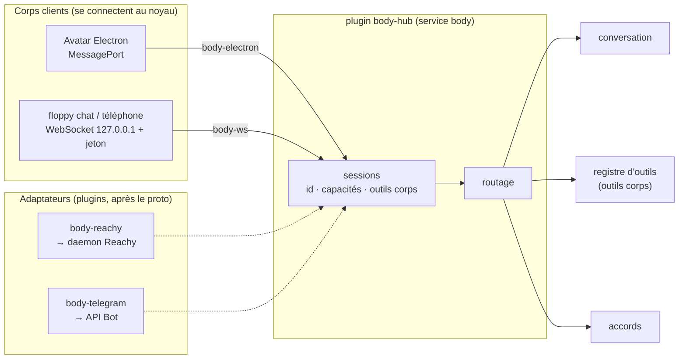
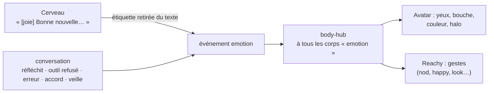
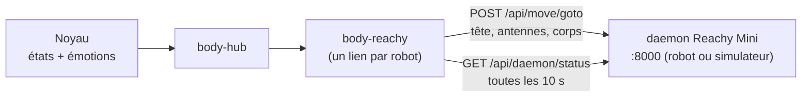
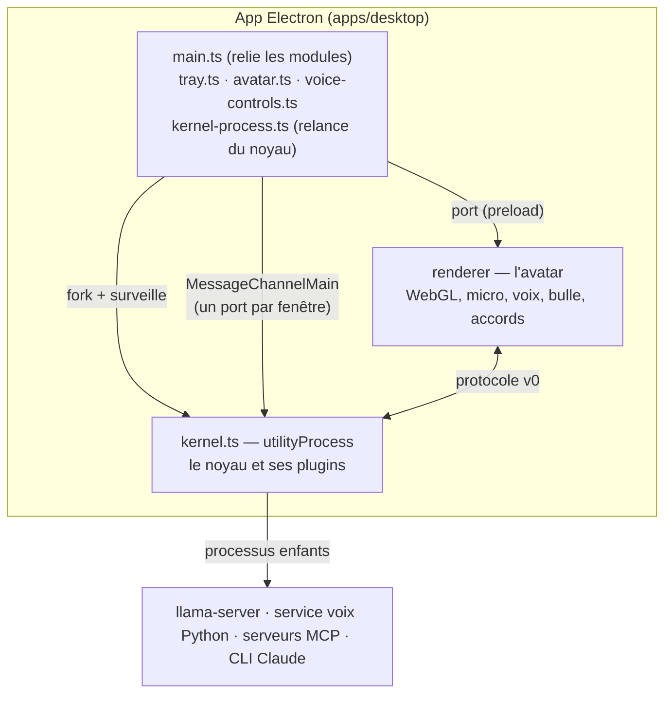
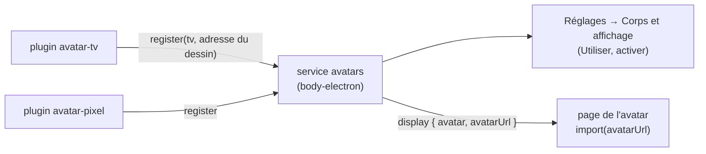

# Corps, émotions et avatar (implémenté)

[← Retour à la spec](README.md)

État : **fait** dans le proto (5 novembre 2026). Code : `assistant\packages\protocol`, `assistant\plugins\body\*`, `assistant\apps\desktop`.

## Plusieurs corps en même temps

Un **corps** montre l'assistant et l'écoute : l'avatar du bureau, Reachy, un téléphone, Telegram, un terminal. **Plusieurs corps peuvent être branchés en même temps**, dans n'importe quelle combinaison (avatar + Reachy, Reachy + Telegram sans avatar…).

### Capacités

Au branchement (`hello`), chaque corps déclare ses capacités et ses outils.

| Capacité | Avatar | `floppy chat` | Reachy (prévu) | Telegram (prévu) |
|---|---|---|---|---|
| `voice` (micro + son en temps réel) | oui | — | oui | — |
| `text` (messages écrits) | — | oui | — | oui |
| `display` (bulle, carte) | oui | — | — | oui |
| `emotion` | oui (visage) | — | oui (tête, antennes) | — |
| `approval` | oui (boutons, « oui ») | oui (« o » / « n ») | oui (« oui »), si l'option est cochée | oui (boutons), coupé par défaut |
| `panel` (fenêtre de résultats A2UI, voir [a2ui.md](a2ui.md)) | oui | — | — | — |
| `choice` (choisir une option dans une liste, voir [noyau.md](noyau.md#choix-dans-une-liste)) | selon l'app | oui (numéro) | — | — |
| outils corps | `afficher_carte`, `ouvrir_reglages` | — | gestes | — |

`ouvrir_url` n'est **plus** un outil de l'avatar : c'est le plugin `browser` (Réglages → Connecteurs, voir [elements.md](elements.md#navigateur-pluginstoolsbrowser)). Un corps sans écran peut donc aussi ouvrir une page.

### Règles de routage

| Quoi | Règle |
|---|---|
| Réponse | **au corps d'origine du tour**, dans sa forme : voix sur un corps vocal, texte sur un corps texte |
| État, émotion | à **tous** les corps qui ont `emotion` |
| Demande d'accord | à tous les corps qui ont `approval` (et autorisés par `approvalsFrom`) ; **la première réponse gagne** ; les autres reçoivent `approval.closed` |
| Outil corps | au corps d'origine s'il a l'outil, sinon au premier corps qui l'a |
| Corps débranché | ses outils sortent du registre ; un tour en cours s'arrête ; ses appels d'outil en attente échouent tout de suite |
| Identité | l'id et le nom viennent du **transport** (`attach(transport, { id, name, managed })`), pas du `hello` ; sans id de confiance, un id aléatoire. Un `tool.result` n'est accepté que du corps à qui l'appel (id aléatoire) a été envoyé |

Testé (`plugins/conversation/default/test/conversation.test.ts`) : une question tapée dans le corps texte reçoit sa réponse en texte, rien n'est dit par l'avatar ; l'accord apparaît sur les 2 corps ; débrancher un corps retire ses outils corps.

## Le protocole noyau ↔ corps (v0)

Mêmes messages sur les 2 transports : `MessagePort` (avatar, dans l'app) et WebSocket `127.0.0.1` avec jeton (autres corps). Types : `assistant\packages\protocol\src\index.ts`.

| Sens | Message | Rôle |
|---|---|---|
| corps → noyau | `hello` | id, nom, capacités, outils corps |
| corps → noyau | binaire | micro : float32 mono 16 kHz |
| corps → noyau | `text` | message tapé |
| corps → noyau | `ptt`, `mute` | parler (raccourci), dormir |
| corps → noyau | `playback` | la voix joue / la file audio est vide |
| corps → noyau | `approval.response`, `tool.result` | réponse à un accord, résultat d'un outil corps |
| corps → noyau | `choice.response` | l'option choisie (`id` de la demande, `option`) |
| noyau → corps | `welcome` | version du protocole, nom de l'assistant |
| noyau → corps | `state`, `emotion`, `mood`, `cue` | `sleep` · `idle` · `listening` · `thinking` · `speaking` ; émotion avec intensité et durée (liste plus bas) ; humeur ; signal bref (`nod`, `perk`, `startle`, `wake`) |
| noyau → corps | `transcript`, `reply.delta`, `reply.done` | texte de la bulle |
| noyau → corps | binaire | voix : 4 octets (taux) + PCM int16 |
| noyau → corps | `interrupt` | vider la file audio |
| noyau → corps | `duck` (`on`) | suspendre la lecture du bureau (on) ou la reprendre (off), sans perdre les mots ; `interrupt` vide la file et retire la suspension |
| noyau → corps | `approval.request`, `approval.closed` | carte d'accord |
| noyau → corps | `choice.request`, `choice.closed` | liste d'options à choisir (titre, options, `ttl_s`) ; fermeture (`picked` si choisi) |
| noyau → corps | `tool.call`, `card`, `notify`, `error` | outil corps, carte, notification |

## Les émotions

L'avatar TV donne priorité aux états actifs sur les émotions de repos (`sleepy`, `tired`, `bored`) : les ZZZ
disparaissent dès le passage en écoute, réflexion ou parole. En écoute sans autre émotion, il ouvre les yeux,
prend une expression curieuse et sourit légèrement ; le signal `wake` ajoute son rebond et son hochement habituels.
Le visage attentif reste lisible lorsque les mouvements sont réduits.

### Profil d'expressivité

Le réglage `expressiveness` (Voix) propose **discret**, **naturel** et **joueur**, à chaud, avec **joueur par défaut**.
Il module l'intensité des émotions envoyées aux corps (facteurs 0,45 / 0,8 / 1) et le jeu des voix compatibles.
Il ne modifie pas la fréquence des gestes autonomes. Les consignes vocales des modèles Live reçoivent aussi
ce profil, à l'ouverture et à chaud quand le ton ou l'expressivité change.
Tous les moteurs ne jouent pas les émotions : les réglages (Voix) indiquent, sur chaque voix, si elle les joue (ElevenLabs : seulement les modèles v3 et v4).

En mode séparé, la file de parole reçoit une intention par phrase, déduite de l'émotion du cerveau : expliquer,
rassurer, plaisanter ou neutre. L'intention persiste jusqu'à la prochaine émotion ; la même émotion pilote
l'avatar à la lecture. `TtsService.speak` reçoit un champ facultatif `delivery` (intention, profil, langue, ton,
émotion et intensité),
séparé du texte prononcé. Qwen CustomVoice 1.7B à voix intégrée reçoit ces consignes dans `instructions`.
La variante est reconnue par son nom de fichier standard (1.7b puis customvoice) ; un fichier renommé n'active
pas automatiquement ce pilotage. Qwen Base/clonage, Pocket, Supertonic et les fournisseurs sans adaptation restent compatibles
et ignorent ce champ. Gemini TTS traduit désormais ce champ dans son prompt de synthèse, avant la transcription
inchangée : intention, profil, langue et ton, avec une voix et un débit réguliers. La voix sélectionnée reste
la même. Rassurer écarte le ton sarcastique et le style fixe de la voix pour garder une consigne calme.

Depuis le 8 novembre 2026, **Fish Audio S2 Pro** traduit aussi `delivery`, dans `plugins/tts/audiocpp/src/expression.ts`.
Le profil est reconnu par famille et nom du fichier standard ; S1, les fichiers renommés et les modèles inconnus
n'héritent pas automatiquement de sa syntaxe. Une seule balise anglaise est préfixée au texte de synthèse :
`[soft tone]` pour rassurer, `[warm and playful]` pour le jeu, `[clear and engaging]` pour expliquer ; curiosité
explicite et faible intensité ont leur variante. Le profil discret atténue le jeu et ne balise pas le neutre.
Aucun rire ni changement de débit n'est ajouté automatiquement, et le ton libre n'est pas interpolé dans une balise.
Le découpage Fish emploie `text_chunk_mode=tag_aware`. Texte visible, historique et référence de clonage restent
inchangés. Une balise explicite en début de texte d'essai n'est pas doublée. Sans `delivery`, le texte n'est pas enrichi.
Ces profils sont des adaptations explicites documentées, pas une découverte automatique des émotions par les métadonnées.
Les sources sont la [fiche Fish S2 Pro](https://huggingface.co/fishaudio/s2-pro) et le
[contrat audio.cpp v0.9.4](https://github.com/0xShug0/audio.cpp/blob/v0.9.4/model_specs/fish_audio.json).

Depuis le 10 novembre 2026, le jeu conserve aussi l'émotion précise et son intensité : satisfaction,
fierté, surprise, soulagement, curiosité, etc. `speechStyle` produit une description courte commune,
traduite en consignes pour Qwen/Gemini et en balises pour Fish. L'intensité est bornée entre 0 et 1,5,
atténuée par le profil, puis exprimée en trois niveaux (léger, normal, fort). Zéro ne produit pas de couleur.
La réassurance reste douce quelle que soit l'intensité ; rire, pleurs et colère deviennent un jeu vocal
sans bruit ajouté ni agressivité. Les consignes demandent des contrastes d'intonation et des accents,
sans remplacer l'émotion par une hausse du volume ou du débit. Le texte prononcé reste séparé des consignes.

**VoxCPM2** reçoit désormais cette description entre parenthèses au début de l'entrée de synthèse,
selon la [convention audio.cpp v0.9.4](https://github.com/0xShug0/audio.cpp/blob/v0.9.4/docs/tts.md#voxcpm2).
Seuls la famille `voxcpm2` et un nom standard `voxcpm2-*` activent cette adaptation : une variante comme
VocalRender n'en hérite pas. La référence et sa transcription restent inchangées ; une description déjà
présente dans un texte d'essai n'est pas doublée. Qwen Base/clonage et les autres familles ne reçoivent
toujours aucune nouvelle syntaxe expressive. Aucun téléchargement ni changement de voix n'est automatique.

Les canaux cloud utilisent le même jeu : Gemini dans ses instructions, ElevenLabs dans une balise
pour `eleven_v3`, `eleven_v4` et `eleven_v4_turbo` seulement. Le modèle ElevenLabs configuré n'est pas changé ;
Flash/v2 et les modèles inconnus gardent le texte brut. Les requêtes passent par `ctx.fetch`.

`bench/voice-compare.ts` produit sept paires WAV (témoin/joueur), les temps du premier bloc, le temps total et
la durée du son et une page d'écoute `index.html`, dans `bench/out/voice-compare`. Il lance un noyau isolé sur
un autre port et ne change pas la voix sélectionnée. Qwen utilise `--voice` ; Fish utilise `--family fish_audio`,
`--reference <WAV>` et `--transcript <fichier texte>`. VoxCPM2 utilise `--family voxcpm2 --reference <WAV>`
(transcription facultative). Les scènes couvrent explication, réassurance, plaisanterie, satisfaction,
surprise légère/forte sur le même texte et soulagement. Les fichiers de mesures gardent la direction envoyée.
La graine de comparaison vaut 42 par défaut (`--seed`),
sans fixer celle des conversations ordinaires. Une graine identique n'implique pas une réalisation acoustique identique
quand on change le texte conditionnant le modèle. Les mesures excluent le chargement et ne prouvent pas la qualité
perceptive. Les essais locaux du 8 novembre ont généré sans erreur trois paires Fish en français avec la référence
SIWIS du projet et trois paires Qwen CustomVoice avec Anna. Leur naturel reste à évaluer à l'écoute.
Gemini reste à comparer ultérieurement.

### Synchronisation avec la lecture (7 novembre 2026)

En mode séparé, **toutes** les émotions associées à une phrase, y compris la première, attendent son audio.
Le corps du bureau annonce la capacité facultative `speech_timing`. Pour ce corps d'origine seulement,
le message `emotion` porte `nextAudio` (identifiant de phrase, unique dans le tour). Il précède immédiatement
le premier bloc de la phrase, **après** l'éventuel bloc de silence entre paragraphes. Le transport doit conserver
l'ordre JSON/audio (MessagePort et WebSocket). Le PCM et son en-tête restent inchangés.

Le lecteur associe cette expression à l'heure programmée du bloc dans `AudioContext.currentTime` et la montre
au premier rafraîchissement audio correspondant (environ 33 ms). Une synthèse en avance ne fait donc plus
changer le visage pendant la phrase précédente. Une interruption ou reconnexion efface aussi les expressions
en attente et la réaction locale temporaire. Les blocs d'un tour annulé restent rejetés par la conversation.
Les autres corps reçoivent une émotion immédiate, sans `nextAudio`. Les émotions de situation restent immédiates.
Le mode Live utilise les mêmes repères de lecture, avec un alignement par bloc décrit plus bas.

La TV accepte `setAttention(target)`, facultatif pour les autres avatars : `listening` regarde au centre,
`thinking` en haut de côté, `speaking` recentre le regard, `approval` regarde la carte située au-dessus.
L'attention prime sur la souris et passe par les ressorts existants ; au repos, le regard libre revient.
Une interruption utilisateur remet une expression neutre et l'écoute, sans sursaut systématique.
La TV retire les gestes brefs résiduels au passage en écoute. Le mouvement réduit reste respecté.

**Interruption et parole expressive.** Sur le bureau, `duck` suspend l'horloge audio et coupe le niveau de bouche
dès la détection locale, sans attendre la fin de l'énoncé ni sa transcription. La vérification d'écho reste dans
la conversation : un écho reprend au même endroit, une vraie demande annule la file. Les expressions restent
figées avec le son ; les nouveaux blocs reçus pendant la pause ne relancent pas la lecture. Les attentes de
confirmation restent bornées par les délais de la conversation. En Live à appels de fonctions (Gemini),
la détection locale coupe immédiatement la lecture et rejette l'ancienne génération, sans attendre le réseau.

La bouche suit le son et non le seul volume : `mouth-shape.ts` (page de l'avatar, sans minuterie ni DOM) lit le
spectre de l'analyseur (`getFloatFrequencyData`, en dB, repassé en puissance) et en tire `open` (le niveau habituel,
simplement lissé) et `wide` (0 = arrondie « o/ou », 1 = étirée « i/é/s »), la part d'énergie des 1,8-7 kHz contre
100 Hz-1 kHz, nulle sous le seuil de silence. Lissage exponentiel indépendant de la cadence (montée 20 ms, descente
55 ms) : pas de retard visible. `app-playback.ts` appelle `setLevel` comme avant pour tous les avatars et, en plus,
`setMouth(open, wide)` si l'avatar l'a ; pause, coupure, fin de lecture et interruption remettent la forme à zéro.
La TV module la largeur (et à peine le coin) autour de la bouche de l'émotion, par ses ressorts, seulement pendant
une voix audible : une bouche triste reste triste. Mouvement réduit, hôte ancien ou galerie sans `setMouth` :
comportement inchangé (ouverture seule).

Pendant la parole, la TV souligne les attaques de volume par un bref relèvement des yeux, une inclinaison
alternée de la tête et un léger déplacement du regard. Au moins 420 ms séparent deux accents ; ils retombent
seuls, sans battement périodique sur un son constant. Le regard propre à l'émotion reste visible. La bouche
se referme au silence même pour le rire. Le mouvement réduit désactive ces accents, en gardant l'articulation.
Le soulèvement passe lui aussi par un ressort, plutôt que de recevoir directement les pics audio. La rotation,
le regard, l'échelle et le soulèvement sont davantage amortis (0,72), avec des pas d'intégration de 1/120 s au plus.
Chaque accent a désormais une montée de 140 ms et une retombée de 340 ms, avec vitesse et accélération nulles
aux extrémités. Deux accents peuvent se chevaucher : chacun garde sa direction jusqu'au bout, sans retourner
brutalement le reliquat du précédent. L'amplitude reste proche du réglage précédent (environ 3° et 6 pixels
sur la séquence de référence), avec un très léger zoom. La respiration garde une phase continue lorsque
l'état change ; son rythme, son amplitude et le balancement d'écoute se fondent progressivement.
La posture de parole revient au repos progressivement à la fin du son.

### Gestuelle par intention de phrase

En mode séparé, la conversation attribue à chaque phrase `explain`, `playful`, `question` ou `none`.
Cette première version utilise les émotions déjà émises par le cerveau, des indices bilingues de la phrase
(question, hésitation, connecteurs d'explication) et la demande initiale. Les émotions tristes, inquiètes ou
agacées neutralisent cette gestuelle. Il n'y a ni nouvel appel au modèle ni changement des consignes TTS.
Ce classement reste heuristique ; il ne reconnaît pas précisément les mots importants ou la chute d'une blague.

Un seul plan par phrase (`SentencePlan`, `plugins/conversation/default/src/plan.ts`) porte désormais l'émotion à montrer (avec son apaisement), le geste, le silence de paragraphe et la livraison donnée à la voix. Une fonction pure, `planSentence`, le construit quand la phrase part à la synthèse ; `voice-events.ts` le consomme au premier bloc audio, dans l'ordre fixe silence, émotion, geste, audio, et le retire alors (ou à la fin de la phrase). Les phrases hors plan (erreur, demande d'accord, initiatives) n'ont ni émotion planifiée ni geste ; elles reçoivent la même livraison par `deliveryFor`. Le mode Live ne l'utilise pas encore.

Le message `speech.gesture` porte l'intention, l'intensité du profil et `nextAudio`. Il va uniquement au corps
vocal d'origine s'il annonce `speech_timing`, immédiatement avant le premier bloc de la phrase et après
l'éventuelle pause de paragraphe. Le bureau le place sur la même horloge audio que les émotions. Un repère
ancien garde son heure de départ : une fenêtre qui reprend tard ne rejoue pas un geste périmé.

La TV joue de petites séquences : deux hochements pour expliquer, regard et inclinaison malicieux pour
plaisanter, regard en haut de côté puis retour pour questionner ou hésiter. Sens et amplitude varient légèrement
entre les gestes, sans hasard ; un même geste ne redémarre pas à moins de 700 ms d'intervalle. Un changement
d'intention fond le geste précédent sur 220 ms. La bouche reste liée au son. La progression suit l'horloge de
lecture, donc `duck` la fige ; interruption, reconnexion, fin de lecture ou sortie de parole l'annulent.
Le mouvement réduit désactive ces séquences. Les méthodes d'avatar `setSpeechTime(seconds)` et
`setSpeechGesture(intent, intensity, at)` restent facultatives pour les plugins existants.

### Gestes et attention communs aux huit avatars

Le bureau passe à `create(container, options)` une source facultative `options.motion`, sans dépendance entre
plugins. `sample()` donne six signaux sans unité (`nod`, `lean`, `lookX`, `lookY`, `smile`, `open`) ; `gaze()` donne
une cible d'attention ou `null` au repos. La source partage les enveloppes, le fondu, les variations d'amplitude
et l'horloge audio. Chaque dessin interprète ces signaux et les amortit, sans modifier le niveau de la bouche :

- TV : hochements, inclinaison, regard et sourire ; conserve son moteur autonome pour les galeries sans hôte.
- Pixel : déplacement du regard, inclinaison et petits hochements du disque lumineux.
- Chat : inclinaison et hochement doux du sprite, regard et amplitude de la queue ; conserve son dessin en pixels.
- Iris : déplacement de la lentille, ouverture et rotation des lamelles.
- Goutte : compression, élargissement, inclinaison et regard.
- Oscillo : décalage du visage, sourcils et très légère expansion ; l'onde reste liée à la voix.
- Gyre : inclinaison, soulèvement et ouverture du noyau.
- Essaim : regroupement, expansion et orientation du nuage.

L'attention recentre l'écoute et la parole, regarde de côté en réflexion et vers le haut pour un accord.
Les mouvements propres aux nouveaux gestes s'arrêtent en mouvement réduit ; leurs cibles sont effacées
à l'interruption ou à la sortie de parole, puis les dessins reviennent progressivement. Le changement d'avatar
pendant une réponse reprend la source en cours, sans rejouer le début du geste. Sans `motion`, les plugins
continuent de fonctionner dans leurs galeries et chez un ancien hôte.

### Jeu et synchronisation Live

Gemini Live et GPT Live reçoivent des consignes conversationnelles bilingues adaptées au profil : débit
régulier, même voix, explications soulignées, réassurance calme sans sarcasme ni rire forcé. Ces consignes
n'imposent pas une récitation de texte et ne changent ni les outils ni les accords.

La transcription de sortie est associée au **prochain bloc audio accepté** de la même génération, puis les
émotions et gestes attendent sa lecture réelle sur le bureau. Les fragments sont réunis pour reconnaître une
intention et ne redémarrent pas le même geste à chaque paquet. L'audio ne patiente jamais pour attendre du
texte. Le texte reçu après le dernier bloc n'engendre aucun geste ; un repère qui attend plus de 1,2 s, une fin
de génération, une coupure ou un changement de génération l'invalide. Ce n'est pas un alignement au mot près.

Le contrat `LiveEvent.output_transcript` accepte une `generation` facultative. Gemini l'émet comme pour
l'audio, et livre le texte avant le son lorsqu'ils sont dans le même paquet. GPT marque l'époque de sa socket
(la coupure ouvre toujours une autre socket). Les transcriptions d'une génération rejetée ne changent ni
les sous-titres ni les gestes ; celles d'un fournisseur ancien sans époque sont ignorées après une coupure
jusqu'au prochain audio accepté. Les corps sans `speech_timing` gardent les émotions immédiates.

**Émotion dite par le modèle (expérimental, désactivé par défaut).** Un modèle Live qui parle ne peut pas écrire `[content]`. Pour un moteur à appels de fonctions (Gemini), la conversation ajoute aux outils de la session un outil propre au Live, `exprimer_emotion` (`emotion` parmi les douze noms stables, `intensite` : `legere`, `normale`, `forte`). Il n'est jamais dans le registre d'outils du noyau (les cerveaux du mode séparé ne le voient pas) ; `LiveConversation` y répond tout de suite, sans accord ni trace d'outil, et l'émotion est montrée comme celle des mots-clés : calée sur le prochain bloc audio accepté de la même génération, avec le même `timing`. Un appel d'une génération écartée, ou après une coupure, ne change pas le visage ; une émotion inconnue est ignorée. Tant que le modèle a annoncé une émotion pour une réponse, la devinette par mots-clés n'est pas appliquée à son visage (les gestes suivent l'émotion annoncée) ; une réponse sans appel garde le comportement d'avant. `LiveService.open` reçoit `silentTools` : Gemini déclare ces outils `NON_BLOCKING` et répond avec `scheduling: "SILENT"`, pour que l'appel ne suspende pas la parole et ne soit pas dit. Réglage `emotion_live` (voix, désactivé par défaut ; appliqué à la prochaine session Live). **Jamais essayé sur un vrai compte** : seules des réponses simulées sont testées. GPT Live (délégation) n'est pas concerné.

Validation : réponses réseau simulées pour les fournisseurs cloud, tests du vrai lecteur avec horloge audio,
tests des signaux communs et des uniformes des sept autres dessins, et comparaison de la TV autonome/partagée.
Le rendu et le jeu réels des voix cloud restent à auditionner avec un compte configuré.

Tests : file d'expressions et vrai lecteur avec une horloge audio simulée (`apps/desktop/test`),
routage et rejet des anciens blocs (`conversation.test.ts`), cibles du regard (`avatar/tv/test/attention.test.ts`).

L'émotion est **pilotée par le noyau** et rendue par chaque corps à sa façon : visage de l'avatar, tête et antennes de Reachy.

- **Le cerveau** commence sa réponse par une étiquette : `[content] C'est fait.` Le noyau la retire du texte (jamais lue à voix haute) et en fait un événement. Mesuré : aucune baisse de justesse sur le banc des 40 demandes. Tous les cerveaux texte le font : AI SDK, Claude Code, Codex et Antigravity (même filtre, voir [Le cerveau](cerveau.md)).
- **Au milieu de la réponse**, il peut en remettre une quand son émotion change : `[content] C'est fait. [malicieux] Et j'ai rangé.` En voix, l'émotion attend que **sa phrase commence à être dite** (pas avant). Au milieu, seule une vraie émotion est retirée : `[1]` reste dans le texte.
- **L'émotion s'apaise** (voix, mode séparé) : la phrase qui porte l'étiquette garde son intensité, chaque phrase suivante sans nouvelle étiquette prend celle d'avant × 0,6 (`settle.ts`) ; sous 0,3 l'émotion tombe (voix neutre, geste sans émotion) jusqu'à la prochaine étiquette. Avec une intensité de 1 : 1 → 0,6 → 0,36 → aucune. Le visage suit : une expression par phrase avec l'intensité apaisée, puis un `neutral` à la première phrase sans émotion. Ces expressions d'apaisement ne poussent pas l'humeur (seule l'étiquette le fait). Le mode Live ne change pas.
- **Intensité** : `[joie+]` forte (1.25), `[content-]` légère (0.45), aussi « très … », « un peu … » (`parseEmotionTag`). Sans intensité : 1. Une émotion légère donne un petit sourire ; sur Reachy, un geste plus discret.
- **La conversation** ajoute les émotions de situation : `thinking` pendant la réflexion, `sorry` si un outil est refusé, `confused` s'il échoue, `curious` quand un accord est demandé, `focused` pendant une délégation, `sleepy` en veille, retour à `neutral` après quelques secondes.
- **Réaction immédiate** à ce qu'on lui dit (`feel.ts`, mots-clés, sans LLM) : « merci » → content, « haha » → rire, « bravo » → fier, « t'es nul » → triste… Elle dure ~1 s, puis le visage réfléchit ; l'étiquette du cerveau a le dernier mot.
- **Mode Live** : le modèle ne donne pas d'émotion. La conversation la devine dans ce qu'on dit et dans ce qu'il dit, phrase par phrase.
- **Humeur** (`mood.ts`, message `mood` : valence -1..1, énergie 0..1) : le fond émotionnel. Chaque émotion la pousse un peu ; elle revient lentement vers le caractère de base (plutôt content). Seul plus de 3 minutes, il perd de l'énergie (fatigué, puis il pique du nez) ; on lui parle, il se réveille. Au repos, le visage de la TV montre l'humeur au lieu du neutre : petit sourire calme à l'humeur de base, paupières lourdes et regard bas quand il est seul longtemps (somnolent, jamais triste), mine penaude seulement si le moral est franchement bas (valence sous -0.3).
- **Signaux** (message `cue`) : `nod` petit hochement quand on lui parle (pause après au moins 0.5 s de parole), `perk` il se redresse au réveil ou au bouton parler, `startle` sursaut disponible pour une surprise. Une interruption ordinaire revient calmement à l'écoute.
- **Il entend son nom** (signal `wake`, envoyé dès la détection, quel que soit le détecteur) : petit saut et hochement du visage, un anneau part de la tête, et la bulle affiche « Je t'écoute… » avec des barres qui suivent le micro. La ligne reste tant qu'il écoute ; elle part quand la phrase est transcrite. Rien n'a été dit : la bulle se ferme tout de suite.
- 28 émotions dans le protocole (`EMOTIONS`). Le cerveau n'en voit que 12 en français (`PROMPT_EMOTIONS_FR`) : une liste courte pour un petit modèle.

### Reachy Mini

Le plugin `body-reachy` (implémenté, `plugins/body/reachy`) branche un Reachy Mini comme corps. Il est ajouté depuis
la fenêtre des réglages : « Corps et affichage » → « Ajouter un corps » → Reachy Mini (voir [elements.md](elements.md)).

- Capacités : `emotion`, `gesture`, et `approval` si l'option est cochée.
- Les 28 émotions donnent une quinzaine de gestes (`nod`, `shake`, `happy`, `look_*`, `rest`, `dance`, `tilt`,
  `droop`, `perk`, `puzzle`, `grumpy`, `scared`, `mischief`, `sleepy`, `proud`, `shy`). Un test vérifie qu'aucune
  émotion n'est oubliée. Les états donnent une posture de fond (`thinking` → regarde en haut).
- Outils corps : `hocher_tete`, `secouer_tete`, `regarder(direction)`, `content`, `danser` (niveau lecture : ce sont
  de petits gestes, sans accord).
- Robot injoignable : débranché du hub, une seule ligne au journal, il se rebranche seul.
- **Pas encore de voix sur le robot** : l'audio du Reachy passe par GStreamer/WebRTC, pas par l'API REST. En
  attendant, Floppy écoute et parle par le PC ; Reachy fait les gestes. En simulation, il n'y a pas d'audio robot.
- Testé avec un faux daemon. Pas encore vérifié avec le simulateur ni le robot (sens des angles à confirmer).

## L'avatar du bureau

Une seule app Electron contient le noyau (`utilityProcess`) et l'avatar.

- **Le visage** : un écran noir **4:3 aux bords arrondis**, des yeux et une bouche lumineux, un **halo animé** aux couleurs qui tournent autour de la tête, une **aurore colorée** derrière. Tout est dessiné par un **shader WebGL2** (formes SDF) : bords nets à toute taille, 60 images/s, presque rien pour le processeur. Légère courbure de tube cathodique, lignes de balayage fines, reflet sur la vitre.
- **Une émotion = un jeu de paramètres** (`plugins/avatar/tv/renderer/face.js`) : taille et coins des yeux, paupières (haut inclinée, bas en arc), bouche (courbe, ouverture, inclinaison), regard, inclinaison de la tête, couleur, joues, halo, et des détails (larmes, sueur, « z », étoiles, « ? », « ! », colère, « … »). L'intensité multiplie l'écart au visage neutre.
- **Vivant** : chaque paramètre suit sa cible comme un **ressort** un peu souple (il dépasse un peu, puis revient). Une émotion vive commence par un petit **tassement**, puis un saut ; une émotion lourde affaisse le visage. Il **respire** (plus lentement s'il est fatigué), cligne parfois **deux fois**, cligne souvent quand son expression change. En parlant, la tête accompagne la voix et la bouche change de forme.
- **Il vous regarde** : les yeux suivent la souris, même hors de sa fenêtre (`avatar.ts` envoie la position). Il **entend** : en écoute, les yeux et le halo réagissent au volume du micro.
- **On peut le toucher** : un clic sur la tête (sans bouger) le fait rire, rougir, faire un clin d'œil… À force, il s'agace, puis se fâche. On le déplace toujours en le faisant glisser (déplacement fait à la main, la tête n'est plus une zone « drag »).
- **Petites manies au repos** (`app-life.ts`, toutes les 15 à 40 s) : un coup d'œil ailleurs, un air malicieux, il chantonne, il bâille s'il est fatigué, il s'ennuie après 3 minutes seul. Une réaction locale est brève ; l'émotion du noyau revient ensuite. Le choix (`quirks.ts`, pur) suit l'humeur : humeur nettement négative ou émotion négative du noyau (`sorry`, `sad`, `confused`, `annoyed`, `angry`, `scared`, `cry`) depuis moins d'une minute → ni malice, ni clin d'œil, ni chantonnement (regard ailleurs, soupir discret ou rien) ; bonne humeur → les manies joueuses sont plus fréquentes.
- Mouvement réduit (réglage du système) : pas de ressort, pas de respiration ni de rebond.
- **L'état** s'ajoute à l'émotion : l'écoute agrandit les yeux et éclaire le halo ; la réflexion fait lever les yeux avec « … » ; la parole fait **bouger la bouche avec le niveau réel de la voix** ; la veille ferme les yeux.

- **La bulle de BD** au-dessus de la tête, avec une pointe vers le visage : ce que l'utilisateur a dit (« Toi »), la réponse qui s'écrit, les cartes d'accord (Oui / Non, barre de temps restant) et les **listes de choix** (capacité `choice` : une carte `pick`, un bouton pleine largeur par option avec son détail, barre de temps ; un clic envoie `choice.response`, `choice.closed` retire la carte). Une liste ouverte retient la bulle et l'avatar comme un accord (pas de masquage automatique). La fenêtre a une **taille fixe et transparente** : les clics traversent les zones vides ; la tête et la bulle restent cliquables.
- **Bouton « Ouvrir la conversation »** : une petite pastille ronde accrochée au coin haut droit de la bulle (un peu en dehors, donc toujours dans la fenêtre et dans la zone cliquable), visible dès que la bulle l'est ; info-bulle et `aria-label` suivent la langue de l'interface. Elle ouvre la fenêtre « Conversation ».
- **Bulle cachée quand la conversation est ouverte** : tant que la fenêtre « Conversation » est ouverte et visible (pas réduite), le processus principal le dit à la page de l'avatar (`chat-open`) qui masque toute la bulle, cartes comprises : le même texte ne s'affiche pas deux fois. Elle revient quand la fenêtre se ferme ou se réduit.
- Une notification sans texte de conversation utilise toute la hauteur disponible au-dessus du visage, avec défilement pour les longs textes. Une carte d'information ne disparaît pas automatiquement pendant la parole ou l'écoute ; le retour au repos lui laisse dix secondes avant fermeture. La fermeture de la dernière carte sans autre contenu masque la bulle au lieu de laisser une pointe vide.
- **Micro** : `AudioWorklet` à 16 kHz, annulation d'écho. **Voix** : lecture en file, coupure immédiate sur `interrupt`.
- **Icône** dans la barre des tâches : couleur selon l'état, rouge si un plugin est en erreur ou en attente (détail au survol). Menu : parler, conversation, dormir, montrer/cacher (change le réglage avatar_visible), **Réglages…**, relancer le noyau, journaux, quitter.
- **Affichage réglable** (aussi à la voix) : avatar visible, masquer après N minutes sans activité, bulle, toujours devant. **Caché, il revient dès qu'on l'active** (mot d'activation, raccourci, demande d'accord, tour en cours) ; s'il a été caché exprès, il repart ~10 s après la fin. Testé : caché → une demande → visible → caché à nouveau 25 s après.
- **Raccourcis** : `Ctrl+Alt+F` parler (sans mot d'activation), `Ctrl+Alt+T` ouvrir la conversation (écrire une demande), `Ctrl+Alt+D` dicter dans la fenêtre active, `Ctrl+Alt+M` dormir/réveiller, `Ctrl+Alt+H` montrer/cacher. Tous sont réglables dans Réglages → Système → Raccourcis clavier (vide = désactivé).
- **Fenêtre « Conversation »** (`chat-window.ts`, journal pur dans `chat-log.ts`, page `renderer/chat.*`) : le fil de ce que l'utilisateur dit et de ce que Floppy répond, avec un champ de saisie toujours disponible en bas. Elle remplace l'ancienne fenêtre de saisie qui se fermait après l'envoi.
  - **Journal** : tenu par le processus principal, **en mémoire seulement** (rien sur disque), borné à 200 entrées, depuis le démarrage de l'app. La page de l'avatar relaie ce qu'elle reçoit du noyau (transcription finale, `reply.delta` / `reply.done`, `notify`, `card`, `error`, demandes d'accord et de choix et leur fermeture) par `floppyHost.chat(...)` ; chaque champ est relu dans le preload puis dans le processus principal, et seule la page de l'avatar est acceptée. La fenêtre reçoit tout le journal à son chargement, puis les changements ; la fermer garde le journal.
  - **Affichage** : « Toi » et les réponses dans l'ordre. Une réponse s'écrit en texte brut pendant qu'elle arrive ; à `reply.done` le processus principal la rend en Markdown (`renderMarkdown`, nettoyé) et la page n'affiche que ce HTML (le seul `innerHTML`). Les liens s'ouvrent par l'app (http, https, mailto). Le texte est sélectionnable ; le fil suit le bas sauf si l'utilisateur est remonté. Infos et erreurs : cartes compactes.
  - **Saisie** : Entrée envoie, Maj+Entrée ajoute une ligne, la composition (IME) est respectée, Échap ferme la fenêtre ; elle reste ouverte après l'envoi. Même chemin et mêmes vérifications qu'une demande au clavier : texte → page de l'avatar → message `text` du noyau (même conversation, mémoire, outils, accords et réponse vocale qu'une demande parlée). Si Floppy n'est pas prêt, le brouillon reste et une erreur traduite s'affiche.
  - **Accords et choix** : Oui / Non et les lignes d'une liste (libellé, détail, barre de temps restant) sont cliquables dans la fenêtre ; la réponse passe par le processus principal (qui vérifie que la demande est en attente et que l'option existe), puis par la page de l'avatar jusqu'au noyau. Fermée, l'entrée montre le résultat (accordé, refusé ou expiré, option retenue, « aucun choix ») et perd ses boutons. Touches **1 à 9** : choisissent la ligne correspondante de la liste en attente la plus récente quand le champ de saisie est vide ou n'a pas le focus ; dès qu'on a écrit quelque chose dans le champ, un chiffre reste du texte.
  - **Place** (`chatSpot` dans `placement.ts`, pur) : juste au-dessus de la tête de l'avatar (bord bas = haut de la tête − 8 px, bords droits alignés), 420 × 520 px réduits jusqu'à 320 px de haut si la place manque ; sans place au-dessus, sous l'avatar ; sinon à côté (à gauche, sinon à droite) ; toujours dans la zone utile de l'écran. Elle **suit l'avatar** quand il bouge (glissé, `placer_avatar`, « remettre en bas à droite »). Si l'utilisateur la déplace ou la redimensionne (écart de plus de 3 px avec la dernière place posée), elle reste où il l'a mise jusqu'à sa fermeture.
  - **Ouverture** : par l'utilisateur (raccourci `Ctrl+Alt+T`, entrée « Conversation » du menu de l'icône, entrée « Ouvrir la conversation » du clic droit sur l'avatar, bouton de la bulle) : la fenêtre passe devant et le champ prend le focus. Par Floppy, **sans prendre le focus** (`showInactive` + `moveTop`) : à l'arrivée d'une liste de choix, et quand une réponse terminée dépasse 600 caractères ou 12 lignes. Même place dans les deux cas. Interface en français et anglais, langue suivie en direct.
- Les corps uniquement texte continuent à recevoir une réponse écrite. En Live, Gemini reçoit un tour utilisateur texte complet ; GPT emprunte son chemin de délégation habituel au cerveau, puis prononce le résultat via sa voix Live.
- **Sécurité** : fenêtre isolée (`contextIsolation`, bac à sable, pas de Node), CSP stricte sans réseau, micro autorisé pour cette seule fenêtre, la page ne voit aucun jeton. Elle ne peut rien ouvrir elle-même. Le seul geste possible est un bouton de la fenêtre de résultats : l'action `ouvrir_url`, que le processus principal accepte seulement depuis cette fenêtre et pour une adresse http(s) (le clic est le consentement, voir [a2ui.md](a2ui.md)).

Galerie des émotions (réglages, captures) : `npx electron apps/desktop/scripts/capture.mjs plugins/avatar/tv/gallery/gallery.html <sortie.png>`.

## Les avatars sont des plugins

Famille `plugins/avatar/<id>/` (comme `plugins/brain/`, `plugins/voice/`…) :

| Fichier | Contenu |
|---|---|
| `avatar.json` | id, nom (fr/en), description (fr/en), émotions dessinées |
| `src/index.ts` | le plugin du noyau : `export default defineAvatar(import.meta.url)` (de `@floppy/toolkit`, `packages/toolkit/src/avatars.ts`) |
| `renderer/index.js` | le dessin : `export function create(container, { reducedMotion })` → `{ setState, setEmotion(name, intensity, ms), setLevel, destroy }`, et en option `setMood(valence, energy)`, `setMouth(open, wide)` (0..1, forme de la bouche d'après le son, en plus de `setLevel` ; `wide` 0 = arrondie, 1 = étirée), `lookAt(x, y)` (-1..1), `setHearing(niveau)`, `cue(nom)` (`nod`, `perk`, `startle`, `wake`, `poke`), `resize` |
| `renderer/life.js` | (goutte, iris, oscillo, pixelcat) le « vivant » commun : `makeLife`, `approach`, `moodTint` ; importé par `index.js` (`./life.js`), comme `tv` importe `./face.js` |

- `life.js` a une seule source, `scripts/avatar/life.js`, copiée octet pour octet dans le dossier `renderer/` de chaque avatar qui l'utilise (`npm run vendor:avatars`) : un plugin ne dépend pas d'un autre et son dessin doit marcher seul. `apps/desktop/test/avatar-life.test.ts` échoue si une copie diffère de la source, et `avatar-life-golden.test.ts` rejoue une séquence sur chaque dessin réel et compare les uniformes envoyés au GPU à un enregistrement.
- Un avatar s'installe comme un plugin (une entrée dans `floppy.yml`) ; il s'inscrit auprès du service `avatars` de
  `body-electron` (facultatif : sans l'app, en mode `--headless`, il ne bloque rien).
- La page de l'avatar charge seulement un module local (`file://`) envoyé par le noyau.
- **Avatar par défaut** : le choix de l'utilisateur s'il existe ; sinon `avatar` dans la config de `body-electron` (`floppy.yml` met `tv`) ; sinon le **premier avatar actif par id**. Aucun n'est codé en dur.
- Les avatars sont trouvés dans `plugins/avatar/<id>/avatar.json` (plus dans `apps/desktop`).
- **Mode `--headless`** (sans l'app) : `body-electron` reste actif avec un **avertissement** (« inactif : pas dans l'application »), pas une erreur. Le registre d'avatars existe quand même, sans affichage.
- `tv` : le visage TV en WebGL (`face.js`, `face-gl.js`, rendu inchangé ; la galerie des émotions les importe d'ici).
- `pixel` : un rond jaune avec un visage en **points lumineux** (16 × 16), en WebGL. Chaque point glisse vers sa
  nouvelle valeur avec une vague depuis le centre ; ombre douce, reflet, liseré, halo coloré selon l'état, respiration,
  bouche qui suit la voix. 12 émotions dessinées, les autres vont à la plus proche.
- `essaim` : un **essaim de particules** (1 600 particules, traînées) en mouvement perpétuel, sans visage la plupart
  du temps. Tout est calculé dans le vertex shader (WebGL2), 1 seul appel de dessin. Chaque état est un champ de
  mouvement (tore au repos, entonnoir vers le bas en écoute, orbites en réflexion, ondes en parole, poussière au sol
  en veille, fontaine, pluie, boule qui tremble, explosion, cœur, 2 tourbillons). Les particules glissent d'un champ à
  l'autre. Parfois, une partie de l'essaim forme un visage un instant (joie, amour, clin d'œil, surprise, clic, ou au
  hasard au repos).
- `gyre` : une **présence 3D abstraite**, sans visage : un noyau en fil de lumière qui se déforme (avec la voix en
  parlant, avec des pics en colère) et des anneaux inclinés qui tournent comme un gyroscope. Une émotion = un jeu de
  paramètres qui glissent. Ondes venues du bas en écoute, pulsations en parole, éclats en surprise, image doublée en
  confusion.
- `goutte` : une **goutte de gel sombre** qui brille de l’intérieur (1 fragment shader, formes SDF). Corps mou qui
  frissonne, bord néon, lueur interne, bulles, 2 yeux de lumière. La bouche (une petite onde) ne se montre qu’en parlant.
- `oscillo` : un **tube de néon rond** avec un double anneau. Yeux et sourcils en néon ; la bouche est une onde
  d’oscilloscope (elle suit la voix entendue en écoute et le niveau de la voix en parole). Le néon scintille parfois.
- `iris` : un **œil-caméra à diaphragme** (6 lamelles) et un anneau de 24 LED. Pas de bouche : l’ouverture, le regard,
  les paupières et les LED montrent tout (écoute vers le micro, réflexion qui tourne, niveau de la voix).
- `pixelcat` : un **chat chibi en pixels**, façon jeu vidéo rétro (sprite 32 × 32 redessiné à chaque image, agrandi sans
  flou par le shader, lignes de balayage). Grande tête ronde, petites oreilles, corps compact, museau crème et joues roses.
  Les yeux sont sombres avec un reflet crème, sans lueur ; ils suivent le regard dans la même direction, y compris en
  écoute et en surprise. Oreilles, yeux, bouche, queue et un petit signe (z, ?, !, cœur) expriment les états et émotions ;
  le halo et les signes flottants gardent la lumière de l'état.
- Les 6 gèrent toute l'interface : humeur, regard (la forme ou les yeux suivent la souris), oreille, ressort (tassement puis
  rebond), hochement, sursaut, clic, mouvement réduit (et clignement pour ceux qui ont des yeux).
- Le noyau envoie toujours les mêmes états et émotions : un avatar n'a rien à savoir du reste.
