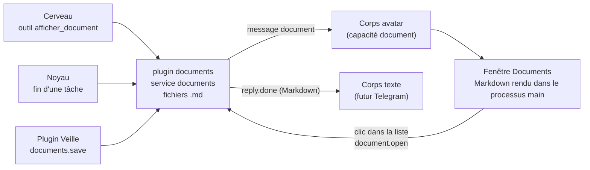

# Documents Markdown (implémenté)

[← Retour à la spec](README.md)

État : **fait** le 6 novembre 2026. Code : `assistant\plugins\display\documents`, `assistant\apps\desktop` (fenêtre Documents), `assistant\packages\protocol`.

## L'idée

Floppy peut répondre par un **document** au lieu d'une longue phrase : un tableau, une comparaison, une liste de liens, le digest de la [veille](veille.md). Le document s'affiche dans une fenêtre. À l'oral, Floppy dit une seule phrase de résumé.

Les documents sont des fichiers Markdown dans `<home>\documents\` (`AAAA-MM-JJ-HHMM-titre.md`, avec un petit en-tête YAML : titre, date, source, tags). On peut les lire hors de Floppy.

## Qui fait quoi

- **Service `documents`** (contrat dans `packages\core\src\services.ts`) : `save`, `show`, `list`, `get`.
- **Choix du corps** (`show`) : le corps demandé s'il sait afficher ; sinon un corps texte reçoit le Markdown ; sinon le premier corps qui sait afficher ; sinon rien (un corps voix seule comme Reachy : le cerveau répond à l'oral).
- **Outils du cerveau** (lecture) : `afficher_document`, `ouvrir_document` (« le dernier », « hier », « veille », des mots du titre), `lister_documents`. Le prompt du cerveau dit d'utiliser `afficher_document` pour une réponse longue, seulement si l'outil est visible.

## Sécurité de la fenêtre

- Le Markdown est rendu dans le processus **main** avec `markdown-it`, **sans HTML brut** (`html: false`) : un document ne peut pas injecter de code.
- Seuls les liens `http`, `https` et `mailto` deviennent des liens. Un clic passe par le main, qui vérifie l'adresse puis ouvre le navigateur.
- Fenêtre isolée (sandbox), CSP stricte, navigation et nouvelles fenêtres bloquées. Le main vérifie l'expéditeur de chaque message.

## Messages du protocole

| Sens | Message | Rôle |
|---|---|---|
| noyau → corps | `document { id, titre, markdown, liste? }` | Montrer un document (+ les 30 derniers pour la liste) |
| corps → noyau | `document.open { id }` | L'utilisateur a cliqué un document dans la liste |
