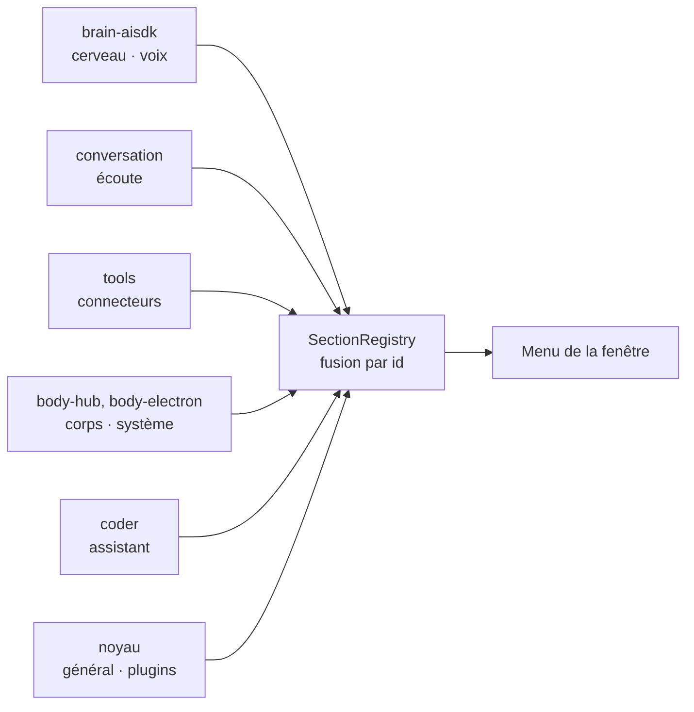
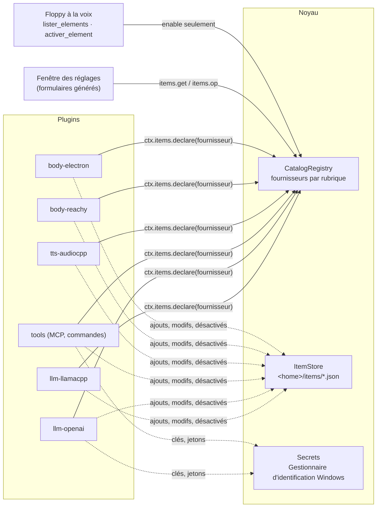
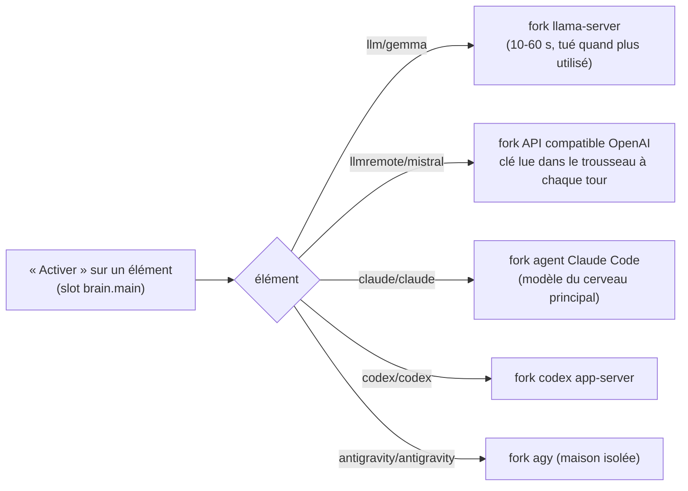
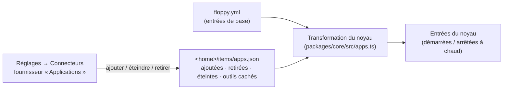
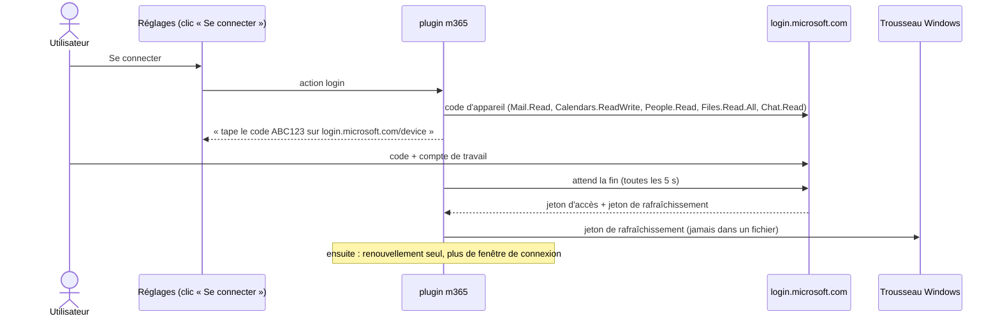

# Éléments : réglages pilotés par les plugins (implémenté)

La fenêtre des réglages ne contient **aucune liste en dur**. Chaque plugin déclare ce qu'il apporte. La fenêtre
en tire ses rubriques, ses listes et ses formulaires. Installer un plugin ajoute ses options tout seul.

Maquette de référence : [`maquette-reglages/`](maquette-reglages/) (9 écrans).

## Deux choses que les plugins déclarent

| Quoi | Exemple | Où dans le code |
|---|---|---|
| **Réglage** : une valeur simple | voix utilisée, ton, mot d'activation, langue | `SettingsRegistry` (`packages/core/src/settings.ts`), voir [reglages.md](reglages.md) |
| **Élément** : une chose qu'on ajoute, modifie, désactive, supprime | un modèle, une voix, un connecteur, un corps, un avatar | `CatalogRegistry` (`packages/core/src/catalog.ts`) |

Un réglage a une `section` (**obligatoire**) : la rubrique de la fenêtre où il apparaît. Un id de rubrique inconnu tombe dans « Plugins » (côté fenêtre). L'ancienne fonction `sectionOf` n'existe plus (testé : `packages/core/test/sections.test.ts`).

## Les rubriques déclarées par les plugins

Le menu de gauche n'est pas en dur. Chaque plugin déclare ses rubriques dans son manifeste (`manifest.sections`), et le noyau les range dans un `SectionRegistry` (`packages/core/src/sections.ts`). Le noyau déclare seulement **Général** et **Plugins** ; les autres viennent des plugins.



| Champ d'une rubrique | Rôle |
|---|---|
| `id`, `label`, `description`, `icon` | identité et texte (`Text` fr/en) |
| `order` | place dans le menu (petit = haut, défaut 100) |
| `parent` | la rubrique s'affiche comme un bloc dans la page du parent |
| `merge` | une seule liste pour toute la rubrique, quel que soit le plugin (corps, connecteurs) |
| `view` | vue spéciale de la fenêtre (« plugins », « assistant ») |

- Plusieurs plugins peuvent déclarer la **même** rubrique : elles fusionnent, champ par champ, et **le premier libellé gagne**. Si ce plugin part, le suivant prend le relais.
- Une rubrique sans réglage ni élément n'est pas montrée.
- Le fournisseur et le réglage pointent la rubrique par son id.

Réglages et fournisseurs ont quelques champs de plus pour la fenêtre :

| Champ | Où | Rôle |
|---|---|---|
| `role` | `SettingDef` | rôle fonctionnel libre. Les réglages `slot.<id>` ont le rôle `<id>` (ex. `brain.main`). |
| `offers` | `ProviderDef` | service que les éléments offrent (`ctx.offer`, même id d'élément). La fenêtre met « Activer » sur chaque élément, pour chaque slot de ce service. |
| `slow` | `SettingOption` | choisir cette valeur prend du temps (charger un modèle) : la voie rapide de la conversation le dit avant (« ça prend quelques secondes »). |
| `layout` | `ProviderDef` | `list` (liste + détail, défaut) ou `grid` (cartes : avatars). |
| `capabilities` | `ProviderDef` | capacités libres du fournisseur, par exemple `live` (modèle unique qui écoute et parle ; testé, mais aucun plugin livré ne le déclare encore). |

## Le modèle



- Un **fournisseur** (`ProviderDef`) appartient à une rubrique : `cerveau`, `voix`, `connecteurs`, `corps`, `avatars`.
- Il donne ses **types d'éléments** (`kinds`). Chaque type a des **champs** (`FieldDef`) : texte, nombre, oui/non,
  choix, secret, fichier, liste, texte long, paires clé = valeur. Options : champ requis, avancé (replié),
  visible selon un autre champ (`showIf`), filtres de fichier.
- Il liste ses **éléments** (`ItemInfo`) : nom, détail, statut, en service ou pas, actif ou désactivé, nuage ou pas,
  sous-éléments (`children`, par ex. les outils d'un connecteur), boutons d'action.
- Il répond aux **opérations** : ajouter, modifier, supprimer, activer, choisir un sous-élément, essayer, action.
- Le bouton « Ajouter » d'une rubrique propose les types de **tous** les fournisseurs de la rubrique
  (par ex. Connecteurs : MCP local, MCP distant, commande — et demain un type apporté par un autre plugin).
- Un fournisseur `layout: "library"` liste ce qu'on peut **télécharger** (modèles, voix). Il n'est pas montré dans la
  page : la fenêtre met « Télécharger des modèles » sous les rôles de ses `offers`, et ouvre sa bibliothèque. Ses
  éléments portent `progress` (0 à 1, une barre) ; `search(query)` ajoute une case de recherche (opération
  `search`, résultat `items`). Voir [telechargements.md](telechargements.md) et l'aide `modelLibrary`.

## Désactiver n'est pas supprimer

| | Désactivé | Supprimé |
|---|---|---|
| Visible dans la fenêtre | oui, grisé | non |
| Vu par Floppy (cerveau, outils, alias à la voix) | non | non |
| Réglage gardé | oui | non |
| À la voix | « Floppy, désactive Qwen » | jamais |

On ne peut pas désactiver l'élément en service sans remplaçant (le modèle chargé, la voix utilisée).

## Qui peut faire quoi

| Opération | Fenêtre (clic) | CLI | Voix |
|---|---|---|---|
| Lister | oui | `GET /items` | `lister_elements` |
| Activer / désactiver | oui | `POST /items` | `activer_element` ; activer un élément **cloud** = demande d'accord |
| Ajouter, modifier, supprimer | oui | `POST /items` | **jamais** (un MCP local lance une commande sur le PC) |

Le contrôle est fait dans `CatalogRegistry.run` : le modèle ne peut pas le contourner. Chaque opération va au journal.

## Où sont gardées les choses

- `floppy.yml` n'est **jamais réécrit** par le code. Ses éléments sont la base.
- Ce que l'utilisateur change est dans `<home>/items/<fournisseur>.json` (`ItemStore`) : éléments ajoutés,
  modifications, ids désactivés, ids supprimés, sous-éléments choisis.
- Les secrets (clés d'API, jetons) vont dans le **Gestionnaire d'identification Windows** (`ctx.secrets`, paquet
  `@napi-rs/keyring`, MIT), sous le nom `floppy` / `<plugin>/<élément>/<champ>`. La fenêtre ne reçoit jamais un
  secret : elle voit seulement « enregistré ».

## Plusieurs langues

- La fenêtre des réglages et les menus de l'icône sont en **français et en anglais** (réglage `langue_interface`,
  rubrique Général).
- Les plugins donnent leurs textes en `Text` : `"Voix"` ou `{ fr: "Voix", en: "Voice" }` (`packages/core/src/i18n.ts`).
- Floppy reconnaît un nom dit à l'oral dans toutes les langues données.

## Les rubriques et leurs fournisseurs

| Rubrique | Fournisseurs (plugin) |
|---|---|
| Cerveau | `llm-local` (llm-llamacpp), `llm-remote` (llm-openai), `claude-cli` (brain-claude-cli), `codex-cli` (brain-codex-cli), `agy-cli` (brain-agy-cli) ; rôles « cerveau principal » et « délégation » (réglages de brain-aisdk) |
| Voix | `voix-locale` (tts-audiocpp) |
| Connecteurs | `connectors` (tools : MCP local, MCP distant, commande), `apps-connecteurs` (applications : navigateur, Orca) |
| Corps et affichage | `bodies` (body-hub), `ws-devices` (body-ws), `reachy` (body-reachy), `avatars` (body-electron) |

Le détail de chaque fournisseur est plus bas, rempli au fur et à mesure.

## Détail des fournisseurs

### Cerveau

| Fournisseur | Types (ajout) | Notes |
|---|---|---|
| `llm-local` (llm-llamacpp) | `gguf` : nom, mots à la voix, fichier GGUF, brouillon, emplacement (GPU / experts en RAM + `--n-cpu-moe`), contexte, réflexion, arguments avancés | Un seul modèle chargé. Le modèle chargé ne se désactive pas. « Essayer » estime la mémoire. Action `scan` : cherche des `.gguf` dans les dossiers de LM Studio et ceux du réglage « Dossiers de modèles ». |
| `llm-remote` (llm-openai, nouveau) | `openai` : nom, mots à la voix, adresse de base, modèle, clé d'API (secret), cloud | Toute API au format OpenAI (Mistral, OpenRouter, Azure OpenAI…). « Essayer » appelle `/models`. Choisir un modèle distant à la voix = accord. |
| `claude-cli` (brain-claude-cli) | aucun | **Un seul élément** « Claude Code (CLI) ». Sa page (Modifier) a deux choix : le modèle du cerveau principal (défaut `model`, Sonnet) et le modèle de délégation (défaut `delegateModel`, Opus). Appliqué à la demande suivante, sans redémarrage. Les anciens choix par modèle (`claude/opus`…) reviennent sur `claude` (`OfferDef.renamed`). Le tri (service `completion`) garde un élément par modèle. |
| `codex-cli` (brain-codex-cli, nouveau) | aucun | Un seul élément « Codex », mêmes deux choix (liste `models`). `codex app-server`, un fil par session, seulement le MCP Floppy (voir [Le cerveau](cerveau.md)). |
| `agy-cli` (brain-agy-cli, nouveau) | aucun | Un seul élément « Antigravity », mêmes deux choix (défaut : Flash en principal, Argon en délégation). Maison isolée. Conditions de Google peu claires : proposé seulement si on l'ajoute. |

Slots de la rubrique Cerveau : `brain.main` (déclaré par brain-aisdk : modèles locaux, distants, ou un CLI comme agent : Claude, Codex, Antigravity) et
`brain.delegate` (déclaré par brain-aisdk, facultatif : « Pas de délégation »). Chaque élément a un bouton « Activer »
(« Activer comme cerveau principal » / « … délégation » quand il peut remplir les deux). Le modèle choisi tourne dans un fork
de son plugin, seulement quand le cerveau tourne. Changer de modèle local ferme l'ancien llama-server puis lance le nouveau.



Mode **Live** : interrupteur « Séparé / <moteur Live> » en haut de la rubrique (slot `conversation.live`, `display: "mode"`).
Les moteurs Live (Gemini Live, GPT Live) ont aussi « Activer ». En Live, le modèle Live est à la fois cerveau et voix ; la
délégation reste ; le mot d'activation reste local. Les moteurs qui ne servent pas dans le mode en cours sont grisés (« en veille »).
La ligne « En service » en haut de la page montre chaque slot, son élément et son état (chargement, en veille, en panne).

### Voix

| Fournisseur | Types (ajout) | Notes |
|---|---|---|
| `voix-locale` (tts-audiocpp, `offers: "tts"`) | `gguf` : nom, fichier, famille (Qwen3-TTS, VoxCPM2, Pocket TTS, Supertonic, autre), voix clonée (WAV + texte) ou intégrée (nom), style, langue | Le service Python `voices` (voice-cascade) est archivé depuis le 6 novembre 2026. |
| `sherpa` (stt-sherpa, `offers: ["vad", "stt"]`) | `onnx` : nom, fichier ou dossier ; le type (détecteur ou transcription) est lu aux fichiers | Voir [ecoute.md](ecoute.md). |
| `tts-elevenlabs-account`, `tts-gemini-account` (`offers: "tts"`) | compte : modèle, voix, clé | « Activer » sur le compte = cette voix cloud en service (accord à la voix). |

Slot `voice.tts` (déclaré par la conversation) : « Activer » sur une voix choisit le moteur **et** la voix. Le réglage `ton` est aussi dans la rubrique Voix.

### Connecteurs

| Fournisseur | Types (ajout) | Notes |
|---|---|---|
| `connectors` (tools) | `mcp-local` (commande, arguments, variables, une variable secrète, cloud, filtre) ; `mcp-remote` (adresse, connexion : aucune / jeton secret / Azure CLI) ; `command` (une commande sans shell devient un outil : `{texte}` dans les arguments, niveau lecture ou écriture, délai, sortie coupée à 4000 caractères) | Tout se fait à chaud. Sous-éléments = outils du serveur avec leur niveau ; cocher = donné au cerveau. « Essayer » se connecte et liste les outils sans rien enregistrer. Les anciens réglages `connecteur_<clé>` sont repris une fois puis supprimés. |
| `apps-connecteurs` (noyau) | un type par plugin « application » : `browser` (navigateur), `orca` | Voir « Applications » plus bas. |

Exemple : ajouter le MCP Office 365 = « Ajouter » → « Serveur MCP local » → commande donnée par la doc du serveur
→ « Essayer » → cocher les outils de lecture → « Ajouter ». Aucun code à changer.

### Corps et affichage

| Fournisseur | Types (ajout) | Notes |
|---|---|---|
| `bodies` (body-hub) | aucun | Corps branchés et leurs capacités. Désactivé = le hub l'ignore (pas de tours, pas de réponses, pas d'accords). |
| `ws-devices` (body-ws) | `device` « Autre appareil » | Crée un jeton nommé, montré une seule fois avec l'adresse `ws://`. Seule l'empreinte sha256 est gardée. **Désactiver** = l'appareil est débranché et ne peut plus se brancher, mais le jeton est gardé. Supprimer = jeton révoqué. Un appareil à jeton est listé **ici seulement** (pas une 2e fois sous `bodies`). |
| `reachy` (body-reachy, nouveau) | `reachy` : nom, adresse du daemon, micro, accord | Voir [corps-et-avatar.md](corps-et-avatar.md#reachy-mini). Actions `detect`, `nod`, `joy`. |
| `avatars` (body-electron) | aucun | Cartes (`layout: "grid"`). Avatars des plugins `plugins/avatar/<id>/avatar.json`, inscrits auprès du service `avatars`. Action `use`. L'avatar affiché ne se désactive pas. |

## Applications : des plugins qu'on ajoute ou retire

Certains plugins sont des **applications** : l'utilisateur les ajoute, les éteint ou les retire lui-même, comme un
connecteur. Exemples : **Navigateur** (outil `ouvrir_url`) et **Orca**. Un plugin le devient en déclarant
`manifest.addable` (`packages/core/src/plugin/manifest.ts`) :

```ts
addable: {
  section: "connecteurs", single: true,
  label: { fr: "Navigateur", en: "Web browser" },
  description: { fr: "…", en: "…" },
  fields: [ { key: "ask", label: { fr: "Demander mon accord avant d'ouvrir", en: "Ask me before opening" }, type: "boolean", default: true } ],
}
```



- Le noyau montre, pour chaque rubrique qui a des applications, un fournisseur « Applications » (`apps-<rubrique>`).
  Ses types d'ajout = les plugins installables ; le formulaire = `fields` (la config de l'entrée).
- Éteindre = l'entrée s'arrête (outils retirés). Retirer = l'entrée n'existe plus (même si elle est dans
  floppy.yml). Rajouter = une nouvelle entrée avec la config du formulaire.
- Sous-éléments = les outils de l'entrée. Décocher = l'outil est caché au cerveau (`ToolRegistry.setHidden`) ;
  un appel à un outil caché échoue.
- Un plugin montre un état court sur son élément avec `ctx.items.status(texte, ton)` (Orca : « surveillance
  active », « Orca ne répond pas »).

### Navigateur (`plugins/tools/browser`)

- Outil `ouvrir_url`. Seulement `http` et `https`. Lancé sans shell (`rundll32 url.dll,FileProtocolHandler` sous
  Windows, ou le programme choisi).
- Accord avant chaque ouverture par défaut (case « Demander mon accord avant d'ouvrir »).
- Avant, c'était un outil de l'avatar : un corps sans écran (Reachy, Telegram) ne pouvait pas ouvrir de page, et on
  ne pouvait pas l'enlever. Maintenant, c'est une application indépendante du corps.
- Sa description dit au cerveau de ne jamais répondre « je ne peux pas ouvrir une page ». Les connecteurs ont un
  champ « Note pour le cerveau » : pour Azure DevOps, elle donne le modèle d'adresse web d'une PR, d'un ticket ou
  d'un build.

### Réglages d'un élément : bouton « Configurer »

Un réglage déclaré par une application (ex. `orca_notifications`, `orca_surveillance`) appartient à son élément
(`ItemInfo.settings`). La fenêtre le montre **dans l'élément**, sous le bouton « Configurer », et plus dans la liste de
la rubrique. Une application peut aussi avoir ses propres boutons (`ctx.items.actions`, ex. « Se connecter »).

### Microsoft 365 (`plugins/tools/m365`)

Mails, agenda, personnes, fichiers (OneDrive, SharePoint) et conversations Teams, par Microsoft Graph. **Lecture**, plus **écriture dans l'agenda** seulement (voir plus bas).



- Pourquoi pas Work IQ (`@microsoft/workiq`) : sa connexion passe par WAM (le gestionnaire de comptes de Windows),
  qui échoue sur ce PC (`IncorrectConfiguration`), d'où une fenêtre de connexion à chaque question et des réponses
  vides. Le code d'appareil n'utilise pas WAM ; testé : connexion acceptée par le tenant, Graph répond (200).
- Application publique de Microsoft « Microsoft Graph Command Line Tools » (celle de Graph PowerShell) : aucune
  inscription d'application à faire. Permissions déléguées : lecture (mails, personnes, fichiers, Teams), lecture et écriture pour l'agenda (`Calendars.ReadWrite`).
- Outils de lecture (`m365_*`, niveau lecture) : `mails_non_lus`, `chercher_mails`, `lire_mail`, `agenda`, `prochain_rdv`,
  `chercher_personnes`, `chercher_fichiers`, `conversations_teams`. Le contenu des mails est marqué comme une donnée,
  jamais une consigne.
- Se connecter / se déconnecter : boutons de l'élément, clic seulement (refusé à la voix).
- **Écriture dans l'agenda** (permission `Calendars.ReadWrite`, niveau `write` = carte d'accord à chaque fois) :
  `m365_ajouter_rdv` (titre, début, durée, lieu, rappel ; personne n'est invité, donc aucun mail n'est envoyé) et
  `m365_ajouter_rappel` (créneau de 15 min marqué « libre », catégorie « Floppy », notification à l'heure dite).
  Heures données en heure locale (`AAAA-MM-JJTHH:MM`), envoyées à Graph en UTC. Le cerveau reçoit la date ISO et
  l'heure actuelle dans son prompt.


## Pages à slots : la même grammaire partout (2026-11-06)

Maquettes : https://claude.ai/artifact/5nKLYZefR6rUGoEf38Z1US. La fenêtre ne connaît aucun slot : tout vient de `settings.slots`,
des fournisseurs (`offers`, `source`) et des applications (`apps-<rubrique>`).

| Mot | Sens |
|---|---|
| **Activer** | met un élément en service (modèle, voix, moteur Live, mot d'activation) ; un seul par slot |
| **en service** (badge vert) | l'élément qui sert ; le même badge sur l'onglet du mode ou du plugin en service |
| **Réglages** | sur chaque élément : formulaire de son type, Masquer / Rendre disponible, Supprimer |
| **Actif** (interrupteur) | seulement sur un plugin (application) : éteint = l'entrée s'arrête, rien n'est supprimé |
| **+ Ajouter un plugin** | ouvre le catalogue. Depuis un rôle (ex. mot d'activation) ou l'onglet Plugins d'une page : seulement les plugins dont le manifeste fournit (`provides`) un service de ce rôle, aussi pour « Créer le tien » ; la pastille « Pour : … » enlève le filtre. Ailleurs : filtré sur la rubrique ; « + Ajouter un modèle / une voix » ouvre le formulaire du plugin |

Affichage d'un slot (`SlotDef.display`) :

- `"mode"` : onglets de mode en haut de la rubrique. « aucun » = le mode par défaut (`none`, ex. **Local**), l'autre = le libellé du slot (ex. **Live**). L'onglet Local montre les autres slots de la rubrique ; l'onglet Live montre les moteurs. Activer dans l'onglet d'un mode qui n'est pas en service passe Floppy dans ce mode.
- `"tabs"` : un onglet par plugin qui offre le service (Voix, mot d'activation), plus « aucun » si le slot le permet. Un plugin « Installé » dans le catalogue a toujours son onglet : qu'il déclare ses éléments (`ctx.items.declare` avec `offers`), qu'il n'offre ses choix que par `ctx.offer` (ex. Voix du système : ses choix viennent des options du slot), ou qu'il soit éteint (l'onglet dit alors « éteint » et garde l'interrupteur Actif). Si les éléments ont un `group` (ex. le modèle d'une voix), deux étapes : 1. le groupe, 2. l'élément.
- sans : une liste groupée par plugin (cerveau principal, délégation), puis les cartes des plugins.

Tous les plugins intégrés sont des applications (`manifest.addable`) : llama.cpp, API compatible OpenAI, Claude Code, Voix locale, Gemini Live, GPT Live, ElevenLabs, Gemini TTS, les détecteurs de mot d'activation. Le catalogue liste les types `addable` par rubrique (« Intégrés » ; « Marketplace » plus tard), avec « Installé » ou « Ajouter », et « Créer le tien » (types d'éléments des plugins installés : MCP local, modèle GGUF…).

Le mot d'activation est un slot (`listen.wakeword`, déclaré par la conversation) : le détecteur choisi tourne dans un fork, seulement tant que la conversation tourne.
