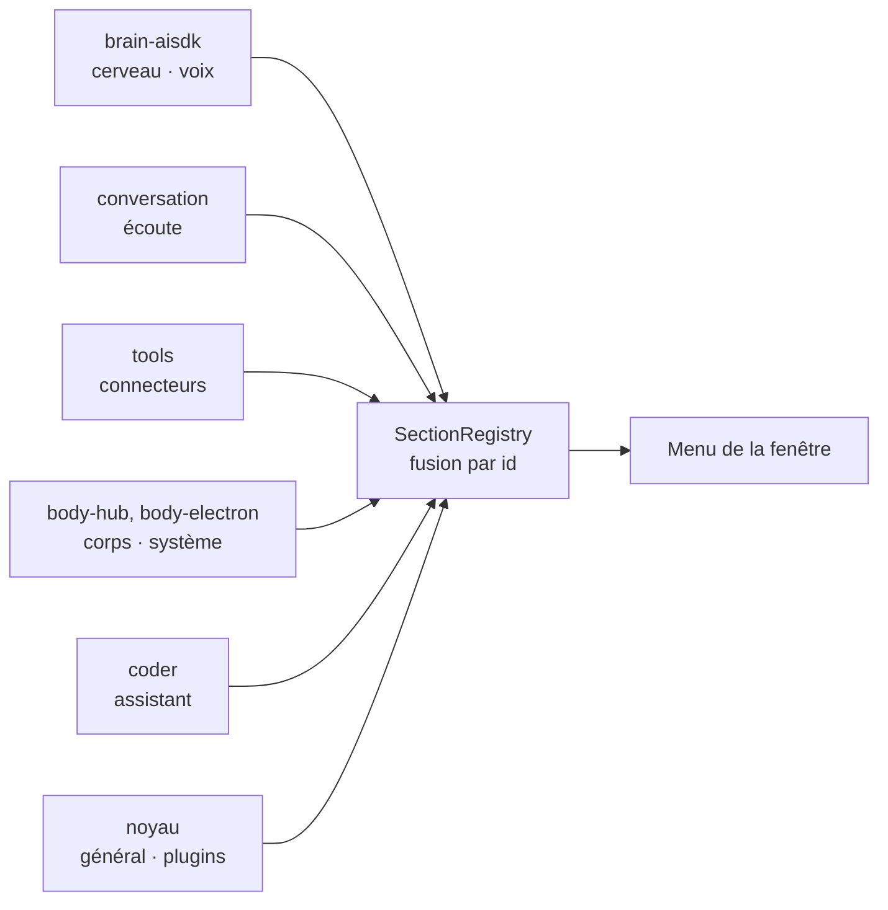
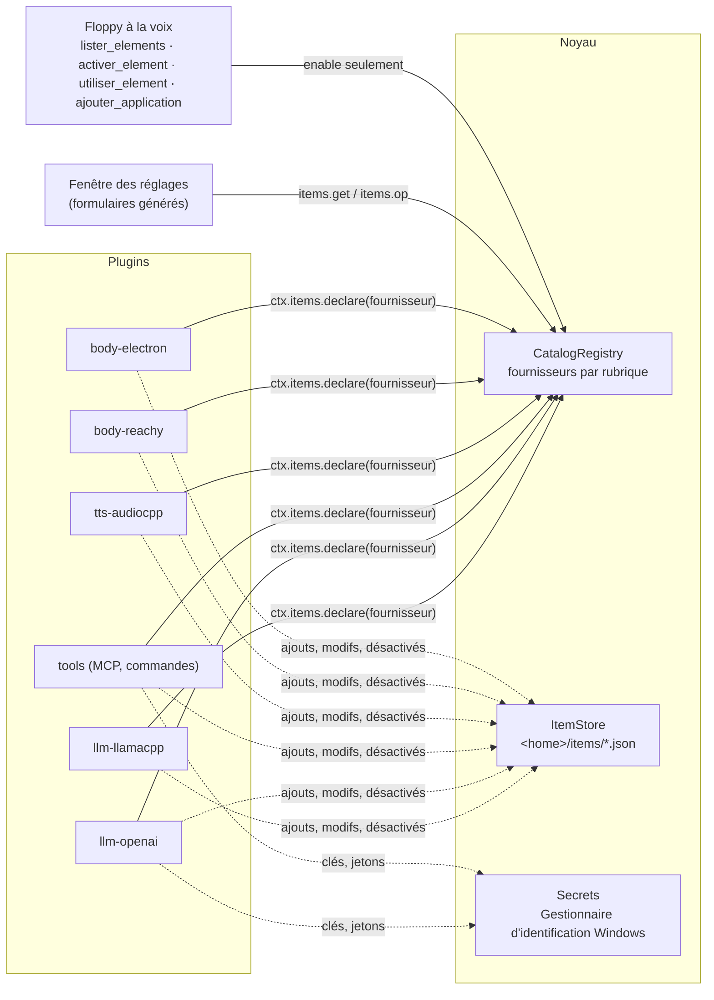
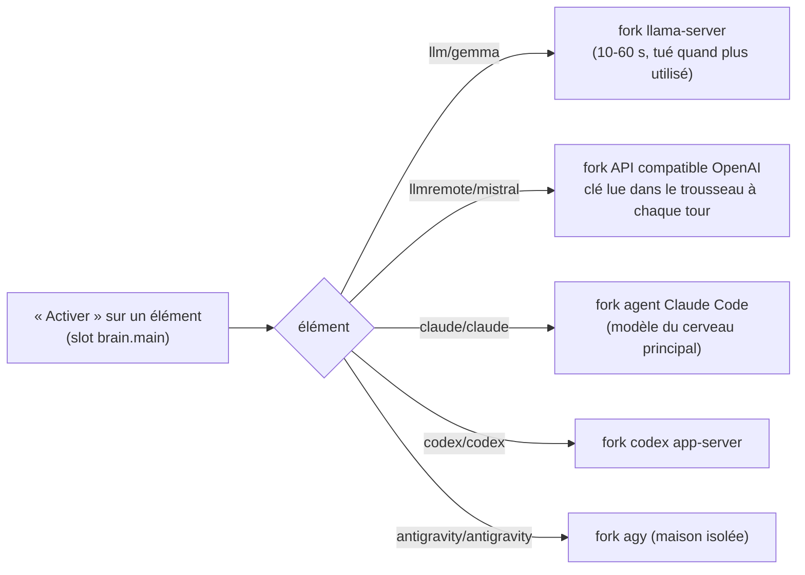
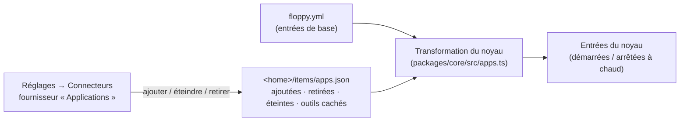
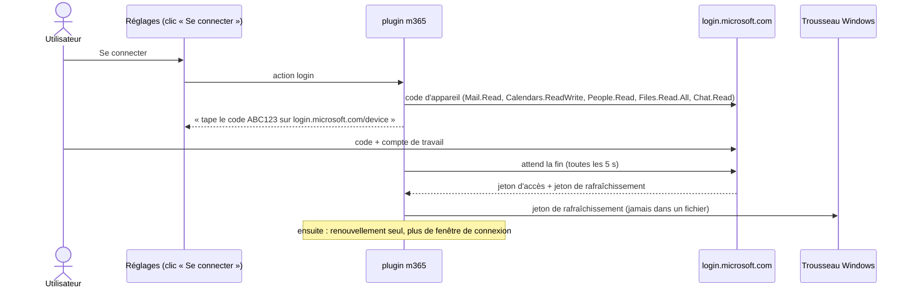

# Éléments : réglages pilotés par les plugins (implémenté)

La fenêtre des réglages ne contient **aucune liste en dur**. Chaque plugin déclare ce qu'il apporte. La fenêtre
en tire ses rubriques, ses listes et ses formulaires. Installer un plugin ajoute ses options tout seul.

Maquette de référence : [`maquette-reglages/`](maquette-reglages/) (9 écrans).

## Deux choses que les plugins déclarent

| Quoi | Exemple | Où dans le code |
|---|---|---|
| **Réglage** : une valeur simple | voix utilisée, ton, mot d'activation, langue | `SettingsRegistry` (`packages/core/src/settings.ts`), voir [reglages.md](reglages.md) |
| **Élément** : une chose qu'on ajoute, modifie, désactive, supprime | un modèle, une voix, un connecteur, un corps, un avatar | `CatalogRegistry` (`packages/core/src/catalog.ts`) |

Un réglage a une `section` (**obligatoire**) : la rubrique de la fenêtre où il apparaît. Un id de rubrique inconnu tombe dans « Plugins » (côté fenêtre). L'ancienne fonction `sectionOf` n'existe plus (testé : `packages/core/test/sections.test.ts`).

## Les rubriques déclarées par les plugins

Le menu de gauche n'est pas en dur. Chaque plugin déclare ses rubriques dans son manifeste (`manifest.sections`), et le noyau les range dans un `SectionRegistry` (`packages/core/src/sections.ts`). Le noyau déclare seulement **Général** et **Plugins** ; les autres viennent des plugins.



| Champ d'une rubrique | Rôle |
|---|---|
| `id`, `label`, `description`, `icon` | identité et texte (`Text` fr/en) |
| `order` | place dans le menu (petit = haut, défaut 100) |
| `parent` | la rubrique s'affiche comme un bloc dans la page du parent |
| `merge` | une seule liste pour toute la rubrique, quel que soit le plugin (corps, connecteurs) |
| `view` | vue spéciale de la fenêtre (« plugins », « assistant ») |

- Plusieurs plugins peuvent déclarer la **même** rubrique : elles fusionnent, champ par champ, et **le premier libellé gagne**. Si ce plugin part, le suivant prend le relais.
- Une rubrique sans réglage ni élément n'est pas montrée.
- Le fournisseur et le réglage pointent la rubrique par son id.

Réglages et fournisseurs ont quelques champs de plus pour la fenêtre :

| Champ | Où | Rôle |
|---|---|---|
| `role` | `SettingDef` | rôle fonctionnel libre. Les réglages `slot.<id>` ont le rôle `<id>` (ex. `brain.main`). |
| `offers` | `ProviderDef` | service que les éléments offrent (`ctx.offer`, même id d'élément). La fenêtre met « Activer » sur chaque élément, pour chaque slot de ce service. |
| `slow` | `SettingOption` | choisir cette valeur prend du temps (charger un modèle) : la voie rapide de la conversation le dit avant (« ça prend quelques secondes »). |
| `note` | `OfferItem` → `SettingOption` | courte précision bilingue d'un élément offert (`ctx.offer`), affichée sous son nom dans la liste du slot, jointe à son détail. Relue à chaque lecture de `items()`. Le noyau ne lui donne aucun sens (voix : « Joue les émotions » ou non). |
| `layout` | `ProviderDef` | `list` (liste + détail, défaut) ou `grid` (cartes : avatars). |
| `capabilities` | `ProviderDef` | capacités libres du fournisseur, par exemple `live` (modèle unique qui écoute et parle ; testé, mais aucun plugin livré ne le déclare encore). |

## Le modèle



- Un **fournisseur** (`ProviderDef`) appartient à une rubrique : `brain`, `voice`, `connectors`, `body`, `avatars` (les autres : `listening`, `system`, `tasks`, `watch`).
- Il donne ses **types d'éléments** (`kinds`). Chaque type a des **champs** (`FieldDef`) : texte, nombre, oui/non,
  choix, secret, fichier, liste, texte long, paires clé = valeur, **enregistrement audio**. Options : champ requis,
  avancé (replié), visible selon un autre champ (`showIf`), filtres de fichier. Un fournisseur qui a 2 ou 3 types
  montre un bouton « + … » par type (ex. « + Nouvelle voix », « + Modèle de voix local ») ; au-delà, un seul bouton
  qui fait choisir le type.
- Champ **`audio`** (2026-11-07) : la fenêtre enregistre au micro (« M'enregistrer ») ou importe un fichier (WAV, MP3,
  M4A, OGG…). `prompts` : phrases à lire, une au hasard, « Autre phrase » en change ; `textKey` : le champ qui reçoit
  la phrase lue (sauf si l'utilisateur y a écrit autre chose) ; `seconds` : durée conseillée. À la fin, la fenêtre
  coupe le silence aux bords, vérifie la durée, la saturation et le bruit de fond, et donne le son en WAV mono 24 kHz,
  en adresse `data:audio/wav` (le plugin le lit avec `wavFromDataUrl` : 16 Mo au plus). Une valeur qui n'est pas une
  adresse `data:` est celle que le plugin a rendue (ex. le chemin du fichier gardé) : rien n'a changé. Le micro n'est
  ouvert que pendant l'enregistrement ; rien ne quitte l'ordinateur.
- Un **son à jouer** : `OpResult.audio` (adresse `data:audio/wav`, voir `wavDataUrl`). La fenêtre le joue après un
  essai (et montre un lecteur pour le réécouter) ou une action. Une action marquée `play` est un bouton rond
  « lecture » au début de la ligne de l'élément (ex. « Écouter » une voix).
- Il liste ses **éléments** (`ItemInfo`) : nom, détail, statut, en service ou pas, actif ou désactivé, nuage ou pas,
  sous-éléments (`children`, par ex. les outils d'un connecteur), boutons d'action.
- Il répond aux **opérations** : ajouter, modifier, supprimer, activer, choisir un sous-élément, essayer, action.
- Le bouton « Ajouter » d'une rubrique propose les types de **tous** les fournisseurs de la rubrique
  (par ex. Connecteurs : MCP local, MCP distant, commande — et demain un type apporté par un autre plugin).
- Un fournisseur `layout: "library"` liste ce qu'on peut **télécharger** (modèles, voix). Il n'est pas montré dans la
  page : la fenêtre met « Télécharger des modèles » sous les rôles de ses `offers`, et ouvre sa bibliothèque. Ses
  éléments portent `progress` (0 à 1, une barre) ; `search(query)` ajoute une case de recherche (opération
  `search`, résultat `items`). Voir [telechargements.md](telechargements.md) et l'aide `modelLibrary`.

## Désactiver n'est pas supprimer

| | Désactivé | Supprimé |
|---|---|---|
| Visible dans la fenêtre | oui, grisé | non |
| Vu par Floppy (cerveau, outils, alias à la voix) | non | non |
| Réglage gardé | oui | non |
| À la voix | « Floppy, désactive Qwen » | jamais |

On ne peut pas désactiver l'élément en service sans remplaçant (le modèle chargé, la voix utilisée).

## Qui peut faire quoi

| Opération | Fenêtre (clic) | CLI | Voix |
|---|---|---|---|
| Lister | oui | `GET /items` | `lister_elements` |
| Activer / désactiver | oui | `POST /items` | `activer_element` ; activer un élément **cloud** = demande d'accord |
| Passer sur un élément (bouton « Utiliser » : l'avatar affiché) | oui | `POST /items` | `utiliser_element` : seulement les actions `use` que l'élément marque `voice: true` (choix sans risque). « Utiliser » d'un modèle (l'ajouter à la liste) reste refusé à la voix |
| Ajouter une **application** livrée avec Floppy (Orca, navigateur…) | oui | `POST /items` | `ajouter_application` : **toujours** une demande d'accord, valeurs par défaut seulement |
| Ajouter un autre élément (MCP, commande…), modifier, supprimer | oui | `POST /items` | **jamais** (un MCP local lance une commande sur le PC) |

Le contrôle est fait dans `CatalogRegistry.run` : le modèle ne peut pas le contourner. Chaque opération va au journal.

### Installer une application à la voix

« Floppy, tu sais te connecter à Orca ? » → `lister_elements` montre, sous « À ajouter », les applications pas encore
ajoutées (plugins `manifest.addable`). « Oui, j'ai un plugin pour ça. » → « Alors installe-le. » → `ajouter_application`.

- Seuls les fournisseurs marqués `voiceAdd` l'acceptent (les « Applications » du noyau) : c'est du code livré avec Floppy.
  Un MCP ou une commande ne s'ajoutent jamais à la voix.
- Le noyau demande **toujours** l'accord (« Ajouter Orca », avec « données dans le cloud » si besoin), même si la règle
  `write` est « always ».
- Le formulaire prend ses **valeurs par défaut**. S'il a un champ obligatoire sans défaut (adresse, clé), Floppy répond
  d'ajouter l'application dans la fenêtre des réglages, sans rien demander.
- Une application « une seule à la fois » déjà ajoutée n'est pas ajoutée deux fois : éteinte, elle se rallume avec
  `activer_element`.

## Où sont gardées les choses

- `floppy.yml` n'est **jamais réécrit** par le code. Ses éléments sont la base.
- Ce que l'utilisateur change est dans `<home>/items/<fournisseur>.json` (`ItemStore`) : éléments ajoutés,
  modifications, ids désactivés, ids supprimés, sous-éléments choisis.
- Les secrets (clés d'API, jetons) vont dans le **Gestionnaire d'identification Windows** (`ctx.secrets`, paquet
  `@napi-rs/keyring`, MIT), sous le nom `floppy` / `<plugin>/<élément>/<champ>`. La fenêtre ne reçoit jamais un
  secret : elle voit seulement « enregistré ».

## Plusieurs langues

- La fenêtre des réglages et les menus de l'icône sont en **français et en anglais** (réglage `ui_language`,
  rubrique Général).
- Les plugins donnent leurs textes en `Text` : `"Voix"` ou `{ fr: "Voix", en: "Voice" }` (`packages/core/src/i18n.ts`).
- Floppy reconnaît un nom dit à l'oral dans toutes les langues données.

## Les rubriques et leurs fournisseurs

| Rubrique | Fournisseurs (plugin) |
|---|---|
| Cerveau | `llm-local` (llm-llamacpp), `llm-remote` (llm-openai), `claude-cli` (brain-claude-cli), `codex-cli` (brain-codex-cli), `agy-cli` (brain-agy-cli) ; rôles « cerveau principal » et « délégation » (réglages de brain-aisdk) |
| Voix | `local-voice` (tts-audiocpp) |
| Connecteurs | `connectors` (tools : MCP local, MCP distant, commande), `apps-connectors` (applications : navigateur, Orca) |
| Corps et affichage | `bodies` (body-hub), `ws-devices` (body-ws), `reachy` (body-reachy), `avatars` (body-electron) |

Le détail de chaque fournisseur est plus bas, rempli au fur et à mesure.

## Détail des fournisseurs

### Cerveau

| Fournisseur | Types (ajout) | Notes |
|---|---|---|
| `llm-local` (llm-llamacpp) | `gguf` : nom, mots à la voix, fichier GGUF, brouillon, emplacement (GPU / experts en RAM + `--n-cpu-moe`), contexte, réflexion, arguments avancés | Un seul modèle chargé. Le modèle chargé ne se désactive pas. « Essayer » estime la mémoire. Action `scan` : cherche des `.gguf` dans les dossiers de LM Studio et ceux du réglage « Dossiers de modèles ». |
| `llm-remote` (llm-openai, nouveau) | `openai` : nom, mots à la voix, adresse de base, modèle, clé d'API (secret), cloud | Toute API au format OpenAI (Mistral, OpenRouter, Azure OpenAI…). « Essayer » appelle `/models`. Choisir un modèle distant à la voix = accord. |
| `claude-cli` (brain-claude-cli) | aucun | **Un seul élément** « Claude Code (CLI) ». Sa page a deux choix : le modèle du cerveau principal (défaut `model`, Sonnet) et le modèle de délégation (défaut `delegateModel`, Opus). Appliqué à la demande suivante, sans redémarrage. Les anciens choix par modèle (`claude/opus`…) reviennent sur `claude` (`OfferDef.renamed`). Le tri (service `completion`) garde un élément par modèle. |
| `codex-cli` (brain-codex-cli, nouveau) | aucun | Un seul élément « Codex », deux choix complétés par le catalogue du CLI et un bouton « Actualiser les modèles » (comme Claude et Antigravity). La config `models` reste une liste de secours et d'ajouts personnels. `codex app-server`, un fil par session, seulement le MCP Floppy (voir [Le cerveau](cerveau.md)). |
| `agy-cli` (brain-agy-cli, nouveau) | aucun | Un seul élément « Antigravity », mêmes deux choix (défaut : Flash en principal, Argon en délégation). Maison isolée. Conditions de Google peu claires : proposé seulement si on l'ajoute. |

Slots de la rubrique Cerveau : `brain.main` (déclaré par brain-aisdk : modèles locaux, distants, ou un CLI comme agent : Claude, Codex, Antigravity) et
`brain.delegate` (déclaré par brain-aisdk, facultatif : « Pas de délégation »). Chaque élément a un bouton « Activer »
(« Activer comme cerveau principal » / « … délégation » quand il peut remplir les deux). Le modèle choisi tourne dans un fork
de son plugin, seulement quand le cerveau tourne. Changer de modèle local ferme l'ancien llama-server puis lance le nouveau.



Mode **Live** : interrupteur « Séparé / <moteur Live> » en haut de la rubrique (slot `conversation.live`, `display: "mode"`).
Les moteurs Live (Gemini Live, GPT Live) ont aussi « Activer ». En Live, le modèle Live est à la fois cerveau et voix ; la
délégation reste ; le mot d'activation reste local. Les moteurs qui ne servent pas dans le mode en cours sont grisés (« en veille »).
La ligne « En service » en haut de la page montre chaque slot, son élément et son état (chargement, en veille, en panne).

### Voix

| Fournisseur | Types (ajout) | Notes |
|---|---|---|
| `local-voice` (tts-audiocpp, `offers: "tts"`) | `voice` (« Nouvelle voix ») : nom, enregistrement (champ `audio`), ce qu'il dit, modèle qui la fait parler (seulement ceux qui clonent : Qwen3-TTS Base, VoxCPM2, Pocket TTS), phrase d'essai. `gguf` : nom, fichier, famille (Qwen3-TTS, VoxCPM2, Pocket TTS, Supertonic, autre), voix clonée (WAV + texte) ou intégrée (nom), style, langue | Voir « Studio de voix » ci-dessous. Le service Python `voices` (voice-cascade) est archivé depuis le 6 novembre 2026. |
| `sherpa` (stt-sherpa, `offers: ["vad", "stt"]`) | `onnx` : nom, fichier ou dossier ; le type (détecteur ou transcription) est lu aux fichiers | Voir [ecoute.md](ecoute.md). |
| `tts-elevenlabs-account`, `tts-gemini-account` (`offers: "tts"`) | compte : modèle, voix, clé | « Activer » sur le compte = cette voix cloud en service (accord à la voix). |

Slot `voice.tts` (déclaré par la conversation) : « Activer » sur une voix choisit le moteur **et** la voix. Le réglage `ton` est aussi dans la rubrique Voix.

#### Studio de voix (2026-11-07)

Une **voix** n'est plus un modèle : c'est un enregistrement de 10 à 20 s et la phrase qu'il contient (quelques centaines
de Ko). Le **modèle** (le fichier GGUF, 2,5 Go pour Qwen3-TTS 1.7B) est partagé par ses voix. Maquette :
<https://claude.ai/artifact/S8bjdyUCVGTL19pbDn31YB>.

- Chaque élément de `local-voice` reste un couple « voix + modèle » (l'élément offert au slot), mais il est toujours
  rangé sous son modèle (`group` = le fichier GGUF). La page montre **une carte par modèle** : en tête, son nom, sa taille,
  son format, son matériel (carte graphique ou processeur) et son état (chargé ou en veille), puis toutes ses voix.
  Toutes les voix intégrées sont visibles dès l'ouverture, sans repli ni bouton « Voir ».
- **Nouvelle voix** : la fenêtre fait lire une phrase au micro (ou importe un fichier), vérifie l'enregistrement, puis
  le plugin le **copie** dans `<dossier de Floppy>/tts-audiocpp/voices/<uuid>.wav` : l'original peut disparaître. Un
  nouvel enregistrement remplace l'ancien fichier ; supprimer la voix efface son fichier. Un fichier de l'utilisateur
  (ancienne voix clonée qui pointe ailleurs) n'est jamais effacé.
- Au micro : une liste des micros de l'ordinateur (« par défaut » du système en premier) et « Réduire le bruit de
  fond » (coché par défaut : la réduction de bruit du navigateur ; le clone copie tout ce qu'il entend, souffle
  compris). Les deux choix restent sur cet ordinateur (stockage de la fenêtre). Un micro débranché : la liste est relue.
- Les phrases à lire font une cinquantaine de mots (15 à 20 s à voix normale) : une lecture rapide reste au-dessus
  des 10 s demandées, une fois les silences des bords coupés.
- **Modèles qui clonent** : Qwen3-TTS **Base**, VoxCPM2, Pocket TTS. Qwen3-TTS CustomVoice (voix intégrées seulement :
  audio.cpp répond « prefill requires speaker ») et VoiceDesign ne clonent pas ; la variante se lit dans le nom du
  fichier. Ils ne sont pas proposés ; une voix clonée posée sur l'un d'eux est en erreur (« ne sait pas cloner »),
  refusée à l'enregistrement et au chargement.
- **CustomVoice importé manuellement** : la fiche d'une voix intégrée (ex. Anna) propose **Ajouter les autres voix
  intégrées** si des locuteurs manquent. Le plugin ajoute les voix du même GGUF, sans téléchargement ni changement
  de voix active. Il conserve la langue et les paramètres audio du modèle ; chaque nouvelle voix commence sans
  style personnalisé. Les locuteurs déjà présents, même désactivés ou écrits avec une autre casse, ne sont pas
  dupliqués. La reconnaissance repose sur la famille Qwen3-TTS et le nom de fichier contenant `customvoice`.
- **Supprimer** est en haut de la page d'un élément, à côté de son nom (deux clics : le second confirme). Une voix
  en service garde le bouton : le clic répond « choisis d'abord une autre voix ».
- Une voix clonée se modifie avec le formulaire `voice` (type de l'élément : `voice` si clonée, `gguf` si intégrée).
  Son action **Écouter** (`play`) rend l'enregistrement. Une action qui rend seulement un son ne redessine pas la
  fenêtre ; le processus principal laisse passer le son (`audio`, adresse `data:audio/…`) jusqu'à la fenêtre.
- **Essayer** : la phrase d'essai (déjà écrite dans la langue de la fenêtre, modifiable) est dite par le modèle
  **chargé en ce moment** (le serveur n'en garde qu'un), l'enregistrement partant en `voice_ref` avec `reference_text`
  (Qwen3-TTS, VoxCPM2) : pas de redémarrage du serveur. Le fichier chargé doit être celui choisi dans le formulaire :
  sinon, aucun essai n'est envoyé au mauvais modèle et un message nomme les deux modèles et explique comment charger
  celui choisi (garder la voix, la choisir). Rien de chargé, ou un modèle qui ne clone pas (Supertonic,
  Qwen3 CustomVoice) : un message dit comment l'entendre (garder la voix, la choisir).
- Pas encore : **décrire** une voix (modèle Qwen3-TTS VoiceDesign) ; transcrire seul un fichier importé (on écrit la
  phrase à la main).

### Connecteurs

| Fournisseur | Types (ajout) | Notes |
|---|---|---|
| `connectors` (tools) | `mcp-local` (commande, arguments, variables, une variable secrète, cloud, filtre) ; `mcp-remote` (adresse, connexion : aucune / jeton secret / Azure CLI) ; `command` (une commande sans shell devient un outil : `{texte}` dans les arguments, niveau lecture ou écriture, délai, sortie coupée à 4000 caractères) | Tout se fait à chaud. Sous-éléments = outils du serveur avec leur niveau ; cocher = donné au cerveau. « Essayer » se connecte et liste les outils sans rien enregistrer. Les anciens réglages `connecteur_<clé>` sont repris une fois puis supprimés. |
| `apps-connectors` (noyau) | un type par plugin « application » : `browser` (navigateur), `orca` | Voir « Applications » plus bas. |

Exemple : ajouter le MCP Office 365 = « Ajouter » → « Serveur MCP local » → commande donnée par la doc du serveur
→ « Essayer » → cocher les outils de lecture → « Ajouter ». Aucun code à changer.

### Corps et affichage

| Fournisseur | Types (ajout) | Notes |
|---|---|---|
| `bodies` (body-hub) | aucun | Corps branchés et leurs capacités. Désactivé = le hub l'ignore (pas de tours, pas de réponses, pas d'accords). |
| `ws-devices` (body-ws) | `device` « Autre appareil » | Crée un jeton nommé, montré une seule fois avec l'adresse `ws://`. Seule l'empreinte sha256 est gardée. **Désactiver** = l'appareil est débranché et ne peut plus se brancher, mais le jeton est gardé. Supprimer = jeton révoqué. Un appareil à jeton est listé **ici seulement** (pas une 2e fois sous `bodies`). |
| `reachy` (body-reachy, nouveau) | `reachy` : nom, adresse du daemon, micro, accord | Voir [corps-et-avatar.md](corps-et-avatar.md#reachy-mini). Actions `detect`, `nod`, `joy`. |
| `avatars` (body-electron) | aucun | Cartes (`layout: "grid"`). Avatars des plugins `plugins/avatar/<id>/avatar.json`, inscrits auprès du service `avatars`. Action `use`. L'avatar affiché ne se désactive pas. |

## Applications : des plugins qu'on ajoute ou retire

Certains plugins sont des **applications** : l'utilisateur les ajoute, les éteint ou les retire lui-même, comme un
connecteur. Exemples : **Navigateur** (outil `ouvrir_url`) et **Orca**. Un plugin le devient en déclarant
`manifest.addable` (`packages/core/src/plugin/manifest.ts`) :

```ts
addable: {
  section: "connectors", single: true,
  label: { fr: "Navigateur", en: "Web browser" },
  description: { fr: "…", en: "…" },
  fields: [ { key: "ask", label: { fr: "Demander mon accord avant d'ouvrir", en: "Ask me before opening" }, type: "boolean", default: true } ],
}
```



- Le noyau montre, pour chaque rubrique qui a des applications, un fournisseur « Applications » (`apps-<rubrique>`).
  Ses types d'ajout = les plugins installables ; le formulaire = `fields` (la config de l'entrée).
- Éteindre = l'entrée s'arrête (outils retirés). Retirer = l'entrée n'existe plus (même si elle est dans
  floppy.yml). Rajouter = une nouvelle entrée avec la config du formulaire.
- Sous-éléments = les outils de l'entrée. Décocher = l'outil est caché au cerveau (`ToolRegistry.setHidden`) ;
  un appel à un outil caché échoue.
- Un plugin montre un état court sur son élément avec `ctx.items.status(texte, ton)` (Orca : « surveillance
  active », « Orca ne répond pas »).
- Logo : `addable.logo` (fixe), remplacé par `ctx.items.logo(logo)` pendant que l'entrée tourne (`null` = aucun).
  Une entrée éteinte montre celui du manifeste. Voir « Logos des outils » plus bas.

### Logos des outils (2026-11-07)

Chaque ligne de Connecteurs montre le **vrai logo** de l'outil, à gauche du nom (`ItemInfo.logo`,
`packages/core/src/logo.ts`). Trois formes :

| Forme | Qui la lit | Exemple |
|---|---|---|
| image `data:image/…` (256 Ko au plus) | la fenêtre | SVG livré avec le plugin (`svgLogo`, `glyphLogo`), icône envoyée par un serveur MCP |
| `{ program: chemin }` | l'app (icône du programme, `app.getFileIcon`) | Orca (`Orca.exe`, ou `Orca.app` sous macOS), navigateur choisi |
| `{ handler: "https" }` | l'app (programme qui ouvre ce protocole) | navigateur par défaut ; rien sous Linux |

- Le noyau ne lit aucune icône du système : l'app remplace `program` / `handler` par une image avant d'envoyer la
  liste à la fenêtre, la garde en mémoire, et renvoie la liste quand l'image est prête. La CLI les ignore.
- **Serveurs MCP** : d'abord l'icône que le serveur envoie (`serverInfo.icons` de la spec MCP), seulement si elle est
  déjà dans le message (`data:image/…`, SVG d'abord, sinon la plus grande) : on ne contacte jamais un autre site pour
  un logo. Sinon, une marque connue reconnue par l'adresse ou la commande (`brandLogo`) : Azure DevOps
  (`dev.azure.com`, `visualstudio.com`, `azure-devops`), Obsidian (`obsidian`). Sinon, l'initiale.
- **Applications** : Microsoft 365 (logo Microsoft), Recherche web (Claude ; aucun avec Codex), SearXNG, Navigateur
  (`handler`, ou `program` si un navigateur est choisi), Orca (`program`).
- Dans une liste où au moins un élément a un logo, les autres montrent leur initiale dans la même case (les noms
  restent alignés). Un élément éteint a son logo en gris.
- Pas de logo tiré du site web d'une marque : testé, l'icône du site est souvent celle d'une autre marque
  (Azure DevOps → Azure, Microsoft 365 → Copilot) et demanderait de contacter ce site.
- Sources : Simple Icons (CC0) pour Obsidian, Claude, SearXNG ; icône officielle Azure DevOps (Azure Architecture
  Icons : seulement pour représenter Azure DevOps, à côté de son nom, sans modification). Voir `THIRD_PARTY.md`.

### Navigateur (`plugins/tools/browser`)

- Outil `ouvrir_url`. Seulement `http` et `https`. Lancé sans shell (`rundll32 url.dll,FileProtocolHandler` sous
  Windows, ou le programme choisi).
- Accord avant chaque ouverture par défaut (case « Demander mon accord avant d'ouvrir »).
- Avant, c'était un outil de l'avatar : un corps sans écran (Reachy, Telegram) ne pouvait pas ouvrir de page, et on
  ne pouvait pas l'enlever. Maintenant, c'est une application indépendante du corps.
- Sa description dit au cerveau de ne jamais répondre « je ne peux pas ouvrir une page ». Les connecteurs ont un
  champ « Note pour le cerveau » : pour Azure DevOps, elle donne le modèle d'adresse web d'une PR, d'un ticket ou
  d'un build.

### Réglages d'un élément : bouton « Configurer »

Un réglage déclaré par une application (ex. `orca_notifications`, `orca_surveillance`) appartient à son élément
(`ItemInfo.settings`). La fenêtre le montre **dans l'élément**, sous le bouton « Configurer », et plus dans la liste de
la rubrique. Une application peut aussi avoir ses propres boutons (`ctx.items.actions`, ex. « Se connecter »).

### Microsoft 365 (`plugins/tools/m365`)

Mails, agenda, personnes, fichiers (OneDrive, SharePoint) et conversations Teams, par Microsoft Graph. **Lecture**, plus **écriture dans l'agenda** seulement (voir plus bas).



- Pourquoi pas Work IQ (`@microsoft/workiq`) : sa connexion passe par WAM (le gestionnaire de comptes de Windows),
  qui échoue sur ce PC (`IncorrectConfiguration`), d'où une fenêtre de connexion à chaque question et des réponses
  vides. Le code d'appareil n'utilise pas WAM ; testé : connexion acceptée par le tenant, Graph répond (200).
- Application publique de Microsoft « Microsoft Graph Command Line Tools » (celle de Graph PowerShell) : aucune
  inscription d'application à faire. Permissions déléguées : lecture (mails, personnes, fichiers, Teams), lecture et écriture pour l'agenda (`Calendars.ReadWrite`).
- Outils de lecture (`m365_*`, niveau lecture) : `mails_non_lus`, `chercher_mails`, `lire_mail`, `agenda`, `prochain_rdv`,
  `chercher_personnes`, `chercher_fichiers`, `conversations_teams`. Le contenu des mails est marqué comme une donnée,
  jamais une consigne.
- Se connecter / se déconnecter : boutons de l'élément, clic seulement (refusé à la voix).
- **Mails non lus par période** : `m365_mails_non_lus` accepte `date` (jour local `AAAA-MM-JJ`,
  `aujourd'hui` / `today`, `hier` / `yesterday`) ou `debut` et `fin`. Les dates de la plage sont incluses ;
  les heures locales `AAAA-MM-JJTHH:MM` définissent un début inclus et une fin exclue. « Ce matin » :
  de 00:00 à 12:00 du jour courant. Sans période, tous les non-lus de la boîte de réception.
  Le filtre porte sur la **réception** des mails actuellement non lus, dans Graph, avant la limite `max`.
  Les bornes sont converties en UTC depuis l'heure locale, en tenant compte des changements d'heure.
  Le décompte filtré (`$count=true`) reste indépendant du nombre affiché ; si Graph l'omet et fournit une
  page incomplète, le total est annoncé indisponible. La réponse rappelle la période et le nombre affiché.
  Une date invalide, une plage incomplète ou inversée est refusée sans recherche élargie.
  Voir [les règles de filtre et de tri Graph](https://learn.microsoft.com/en-us/graph/api/user-list-messages?view=graph-rest-1.0)
  et [le décompte des résultats](https://learn.microsoft.com/en-us/graph/query-parameters#count-parameter).
- **Recherches vocales fines** (`plugins/tools/m365/src/query.ts`, `mail-search.ts`, `calendar.ts`,
  `teams-read.ts`, `channel-search.ts`) :
  - Périodes communes à Outlook, Teams et l'agenda : `date`, `debut` + `fin`, `depuis` (jusqu'à maintenant),
    ou `periode` (`ce_matin` 00–12 h, `cet_apres_midi` 12–18 h, `cette_semaine`, `semaine_derniere`,
    `semaine_prochaine`, `ce_mois`). Semaines du lundi au dimanche, heures locales ; `demain` / `tomorrow`
    également reconnus. Les modes sont exclusifs. `jours` reste compatible avec les anciennes signatures,
    et `date` + `jours` avec l'agenda. Une mauvaise date n'est jamais remplacée par aujourd'hui.
  - `m365_chercher_mails` combine expéditeur, destinataire (À/Cc), sujet, texte, période, état de lecture,
    présence de pièce jointe, dossier et tri. Aucun mot-clé obligatoire. Période sur la réception, ou l'envoi
    dans le dossier Envoyés. Les noms sont des filtres textuels, pas des identités devinées.
    Sans période, un mot présélectionne les candidats dans l'index Outlook ; les autres critères sont
    revérifiés sur les messages. Avec période, Graph filtre dates et états, le texte est vérifié localement.
    `max` s'applique après ces filtres. Le plafond de 1 000 résultats de l'index rend le parcours partiel.
  - `m365_lire_fil_mail(id)` retrouve la conversation du mail et lit les échanges reçus et envoyés,
    chronologiquement, avec auteurs, destinataires et ids. Les derniers messages sont affichés en priorité.
  - `m365_messages_teams` accepte une personne facultative, une conversation (id ou nom), un type (privé/groupe),
    un sens (reçus/envoyés/les deux), des mots, liens, pièces jointes et mentions. `seulement_lui` reste un alias
    de `sens=recus`. Avec une personne, reçus signifie ses propres messages ; les deux côtés gardent le contexte
    du groupe. Homonymes ou groupes ambigus : demander lequel, même pour lire.
    `m365_lire_conversation_teams` et `m365_teams_non_lus` partagent les filtres et périodes.
    Les non-lus sont calculés message par message après la dernière lecture, même si le dernier message est
    le nôtre ; les états de lecture absents sont explicitement inconnus. Défaut : 90 jours pour les non-lus,
    14 pour la recherche, 30 pour la lecture. Les canaux n'ont pas d'état non lu garanti.
  - `m365_messages_canal` cherche dans les publications et leurs réponses, y compris une réponse récente
    dans un vieux fil. Période, auteur, mots, mention, lien et pièce jointe se combinent. La publication
    d'origine reste affichée comme contexte lorsqu'elle ne correspond pas aux filtres. Les réponses ont
    aussi leurs ids. Les permissions de lecture des canaux restent nécessaires.
  - `m365_agenda` et `m365_prochain_rdv` combinent période, participant (organisateur compris), organisateur,
    sujet et lieu. Ils rendent participants, état de réponse, lieu et liens. L'agenda inclut les événements
    qui chevauchent la période ; le prochain rendez-vous exclut ceux déjà commencés. Défauts : aujourd'hui
    pour l'agenda, maintenant + 14 jours pour le prochain rendez-vous. Les annulations sont écartées.
  - `m365_creneaux_libres` calcule les intervalles libres du seul agenda personnel (pas celui des collègues).
    Défauts : 7 jours, lundi-vendredi 09–18 h, durée 30 min, marge 0 min ; tous réglables dans l'appel.
    Les réunions occupées, provisoires et absences bloquent ; les événements libres, annulés ou refusés
    ne bloquent pas. Les chevauchements et marges sont fusionnés. Aucun créneau passé n'est proposé.
    Une lecture incomplète renvoie `unverified`, sans promettre de disponibilité.
  - Pagination bornée : 10 pages par collection, 30 requêtes et budget de 25 s par recherche (les requêtes
    ont aussi leur délai de 20 s). Au plus 10 conversations Teams sont parcourues. Ces limites sont
    signalées explicitement ; les décomptes portent alors sur la partie consultée. Une erreur HTTP n'est
    pas transformée en absence de résultat. Les liens de pagination doivent rester sur Microsoft Graph.
    Les résultats sont bilingues, portent les bornes, les ids et les nombres consultés/affichés pour que
    le cerveau puisse reprendre les critères ou la référence au tour suivant (« et hier ? », « lis celui-là »).
    La continuité utilise l'historique de conversation existant ; aucun cache de recherche global n'est ajouté.
- **Écriture dans l'agenda** (permission `Calendars.ReadWrite`, niveau `write` = carte d'accord à chaque fois) :
  `m365_ajouter_rdv` (titre, début, durée, lieu, rappel ; personne n'est invité, donc aucun mail n'est envoyé) et
  `m365_ajouter_rappel` (créneau de 15 min marqué « libre », catégorie « Floppy », notification à l'heure dite).
  Heures données en heure locale (`AAAA-MM-JJTHH:MM`), envoyées à Graph en UTC. Le cerveau reçoit la date ISO et
  l'heure actuelle dans son prompt.


## Pages à slots : la même grammaire partout (2026-11-06)

Maquettes : https://claude.ai/artifact/5nKLYZefR6rUGoEf38Z1US. La fenêtre ne connaît aucun slot : tout vient de `settings.slots`,
des fournisseurs (`offers`, `source`) et des applications (`apps-<rubrique>`).

| Mot | Sens |
|---|---|
| **Activer** | met un élément en service (modèle, voix, moteur Live, mot d'activation) ; un seul par slot |
| **en service** (badge vert) | l'élément qui sert ; le même badge sur l'onglet du mode ou du plugin en service |
| **Réglages** (flèche « › ») | ouvre la page de l'élément : son formulaire **en place**, Masquer / Rendre disponible, Supprimer. Chaque changement s'enregistre seul (champ quitté, Entrée, case cochée, pastille ajoutée ou retirée) ; « ✓ Enregistré » ou l'erreur s'affichent sur le formulaire. Un champ obligatoire vide n'est pas envoyé. La fenêtre (éditeur) ne sert plus qu'à **ajouter** (2026-11-07) |
| **Actif** (interrupteur) | seulement sur un plugin (application) : éteint = l'entrée s'arrête, rien n'est supprimé. Dans l'onglet d'un plugin, Retirer / Actif n'apparaissent que si la page n'a pas d'onglet Plugins, ou pour rallumer un plugin éteint |
| **+ Ajouter un plugin** | ouvre le catalogue. Depuis un rôle (ex. mot d'activation) ou l'onglet Plugins d'une page : seulement les plugins dont le manifeste fournit (`provides`) un service de ce rôle, aussi pour « Créer le tien » ; la pastille « Pour : … » enlève le filtre. Ailleurs : filtré sur la rubrique ; « + Ajouter un modèle / une voix » ouvre le formulaire du plugin |

Les blocs de réglages communs légers (un ou deux réglages, ex. Général / Ton) restent visibles au-dessus des onglets.

Affichage d'un slot (`SlotDef.display`) :

- `"mode"` : onglets de mode en haut de la rubrique. « aucun » = le mode par défaut (`none`, ex. **Local**), l'autre = le libellé du slot (ex. **Live**). L'onglet Local montre les autres slots de la rubrique ; l'onglet Live montre les moteurs. Activer dans l'onglet d'un mode qui n'est pas en service passe Floppy dans ce mode.
- `"tabs"` : un onglet par plugin qui offre le service (Voix, mot d'activation), plus « aucun » si le slot le permet. Un plugin qui n'offre qu'un élément (ex. « Dans le texte transcrit ») : pas de ligne qui répète l'onglet ; son formulaire est directement dans l'onglet, puis sa ligne de détail. S'il n'est pas en service, sa ligne reste au-dessus, pour l'activer. Un plugin « Installé » dans le catalogue a toujours son onglet : qu'il déclare ses éléments (`ctx.items.declare` avec `offers`), qu'il n'offre ses choix que par `ctx.offer` (ex. Voix du système : ses choix viennent des options du slot), ou qu'il soit éteint (l'onglet dit alors « éteint » et garde l'interrupteur Actif). Si les éléments ont un `group` (ex. le modèle d'une voix) : une carte par groupe, avec son nom, sa description et son état en tête, puis tous ses éléments, sans repli.
- sans : une liste groupée par plugin (cerveau principal, délégation), puis les cartes des plugins.

Chaîne d'étapes (`SlotDef.step`, 2026-11-07) : quand **tous** les slots d'une rubrique (hors mode) ont un `step` et qu'il
y en a au moins deux, leurs onglets deviennent des cases numérotées, dans l'ordre, reliées par des flèches. Chaque case
dit le rôle et ce qui est en service. Ex. Écoute : 1 · Détecteur de parole (`listen.vad`) → 2 · Transcription
(`listen.stt`) → 3 · Mot d'activation (`listen.wakeword`). Les autres onglets (Plugins) suivent.

Champ `list` : des pastilles. × retire, Entrée ou virgule ajoute, un collage de plusieurs lignes donne plusieurs
pastilles, pas de doublon (sans tenir compte des majuscules).

Tous les plugins intégrés sont des applications (`manifest.addable`) : llama.cpp, API compatible OpenAI, Claude Code, Voix locale, Gemini Live, GPT Live, ElevenLabs, Gemini TTS, les détecteurs de mot d'activation. Le catalogue liste les types `addable` par rubrique (« Intégrés » ; « Marketplace » plus tard), avec « Installé » ou « Ajouter », et « Créer le tien » (types d'éléments des plugins installés : MCP local, modèle GGUF…).

Le mot d'activation est un slot (`listen.wakeword`, déclaré par la conversation) : le détecteur choisi tourne dans un fork, seulement tant que la conversation tourne.

## Contributions de bureau déclarées (2026-11-08)

Les entrées des menus de l'avatar et de l'icône sont des contributions des plugins intégrés, déclarées par `registerDesktop(ctx, …)` (`@floppy/toolkit`, types dans `@floppy/contracts`, domaine `desktop`). Une déclaration nomme une contribution, ses deux titres fr/en, ses menus autorisés (`tray`, `avatar`), son ordre, une page compilée facultative et ses lectures nommées. L'interface ne donne ni outil arbitraire, ni commande, ni chemin ou adresse de fichier à ouvrir. Le preload est fixé par l'hôte ; la page doit être un nom simple présent dans les assets empaquetés.

`body-electron` apporte l'action Réglages au menu de l'avatar. La fenêtre existante reste une primitive de l'hôte : celui-ci déclare son entrée Réglages locale dans le même registre, uniquement pour `tray`. Cette entrée reste accessible au démarrage, après une panne du noyau ou sans corps actif ; aucune entrée ne se double au démarrage du corps. Le registre trie ensemble déclarations locales et contributions des plugins ; retirer ou réconcilier les contributions du backend ne retire pas les primitives locales. Le menu de l'avatar ne s'ouvre pas sans contribution.

`display-agent-tracking` apporte sa vue et ses menus ; `agentTracking` est facultatif, lu par `ctx.maybe`. Le plugin reste actif sans fournisseur et affiche une source hors ligne. L'arrivée, le retrait et le remplacement du fournisseur suivent le cycle normal des liens faibles du noyau : désabonnement, retrait de la vue et réinscription dans la nouvelle activation. Chaque activation relit le service et écoute `service.changed`, sans scrutation ni fermeture conservant un ancien fournisseur. Les snapshots, projections de confidentialité et abonnements appartiennent au plugin. Les assets de rendu restent dans le pipeline compilé du desktop ; le pont générique est facultatif dans les types des pages, et seul son preload l'expose.

L'app ne connaît que le registre générique (`apps/desktop/src/desktop-contributions.ts`) : une fenêtre sûre par propriétaire/contribution, titres traduits, tri ordre puis identifiant stable. Une double inscription ne remplace pas son propriétaire. Chaque activation reçoit un jeton ; les lectures passent seulement depuis la fenêtre associée, sans arguments libres, vers les actions inscrites de cette activation. Retrait, état inactif et déconnexion du backend ferment les vues et terminent leurs demandes en cours ; les anciens jetons et expéditeurs ne donnent plus accès aux données.

Le helper retire son inscription à `stopping`, avant la fermeture de `ctx.host`, puis désabonne et annule ses lectures avec les effets de `ctx`. L'hôte observe aussi les états génériques des plugins et réconcilie les états initiaux après boot : même un démarrage échoué ne laisse pas de contribution. Les demandes ont un délai de 10 s. Les traces portent uniquement l'identifiant borné et un code de raison (inscription, retrait, refus, délai, panne de lecture ou de vue), sans contenu métier. Propriétaire et jeton protègent contre les inscriptions périmées et routent les requêtes de la fenêtre associée ; ils ne constituent pas une isolation entre plugins intégrés de confiance, qui partagent le canal et le processus. Le SDK des plugins tiers isolés n'expose pas `ctx.host` ; ceux-ci gardent les règles de `plugins-tiers.md`.
