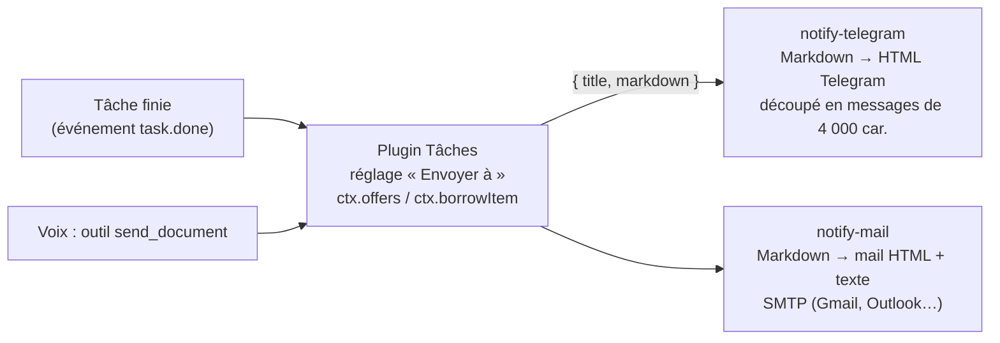

# Notifications : Telegram, mail (implémenté)

[← Retour à la spec](README.md)

État : **fait** le 6 novembre 2026. Code : contrat `notify` (`assistant\packages\contracts\src\notify.ts`), canaux `assistant\plugins\notify\telegram` et `assistant\plugins\notify\mail`, envoi des résultats dans `assistant\plugins\tasks\scheduler`.

## L'idée

Floppy peut **envoyer** un résultat hors de l'ordinateur : la veille du jour dans ton canal Telegram, ou dans ta boîte Gmail, avec tout le contenu dans le mail.

- **Un canal** = une destination réglée une fois (Réglages → **Notifications**) : « Telegram · Mon canal », « Gmail perso ».
- **Envoyer automatiquement** : dans la fiche d'une tâche (Réglages → Tâches), « Envoyer … à » : un ou plusieurs canaux. À la voix : « Floppy, envoie ma veille sur Telegram » (accord demandé : c'est un envoi).
- **Envoyer une fois** : « envoie la synthèse par mail » → outil `send_document` (niveau `send` : accord à chaque fois).



## Le contrat

```ts
interface NotifyService { label?: string; cloud?: boolean; send(msg: { title: string; markdown: string }, opts?): Promise<void> }
```

Un plugin canal **offre** `notify` élément par élément (une destination = un élément). Un plugin qui envoie liste tous les canaux (`ctx.offers("notify")`, nouveau) et en emprunte un le temps d'un envoi (`ctx.borrowItem`, nouveau). Rien ne tourne entre deux envois.

## Régler les canaux

| Canal | Ce qu'il faut |
|---|---|
| Telegram | Un bot (créé avec **@BotFather**, qui donne un jeton) **ajouté comme administrateur** du canal. Canal public : `@nomducanal` ; privé : l'id qui commence par `-100`. « Essayer » envoie un message de test. |
| Gmail | Ton adresse et un **mot de passe d'application** (Compte Google → Sécurité → Validation en deux étapes → Mots de passe des applications). Ton vrai mot de passe ne marche pas. « Essayer » vérifie la connexion sans envoyer. |
| Autre mail | Serveur, port et sécurité (SSL ou STARTTLS) dans « Avancé ». |

Les jetons et mots de passe vont dans le coffre de Windows, jamais dans un fichier.

## Discuter avec Floppy sur Telegram

C'est fait par un **corps** à part, `body-telegram` (un canal envoie seulement, un corps reçoit aussi) : voir [Parler à Floppy sur Telegram](telegram.md). Prends un bot pour la conversation et un autre pour ce canal : un seul programme peut lire les messages d'un bot.

## Sécurité

- Choisir un canal pour une tâche **à la voix** demande l'accord (risque `ask`) ; arrêter d'envoyer est libre. Un clic dans la fenêtre vaut accord.
- L'outil `send_document` est de niveau `send` : accord à chaque envoi.
- Chaque envoi est noté dans le journal (`kind: notify`). Un envoi raté est signalé par une notification.
