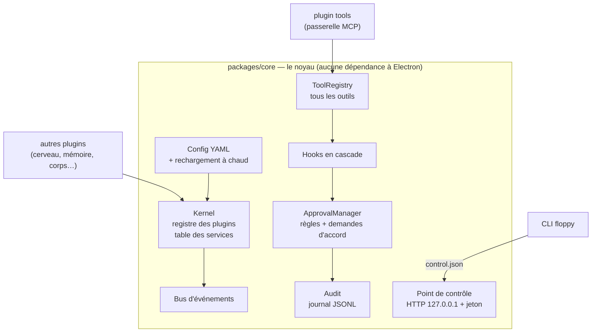
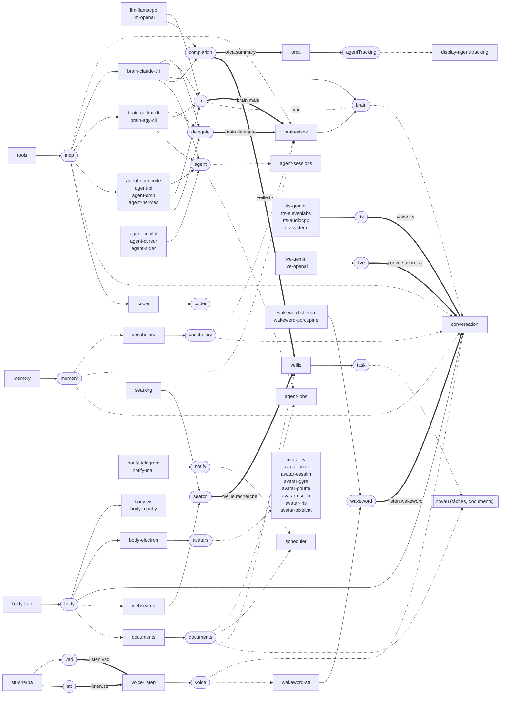
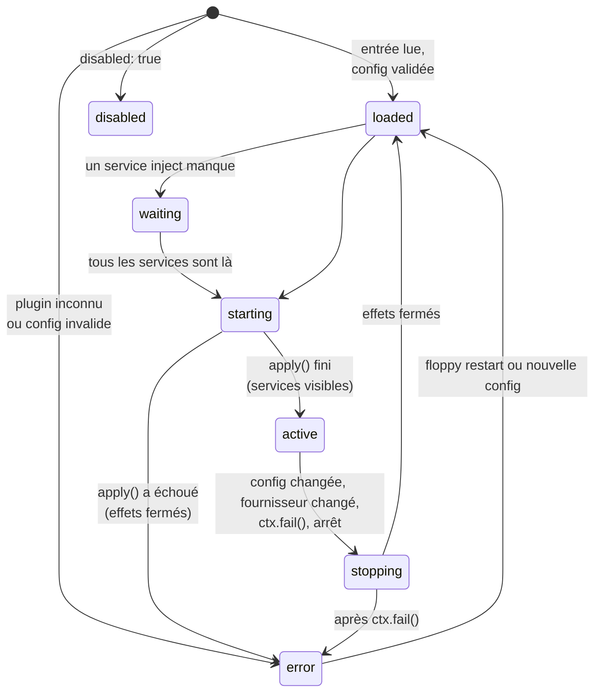
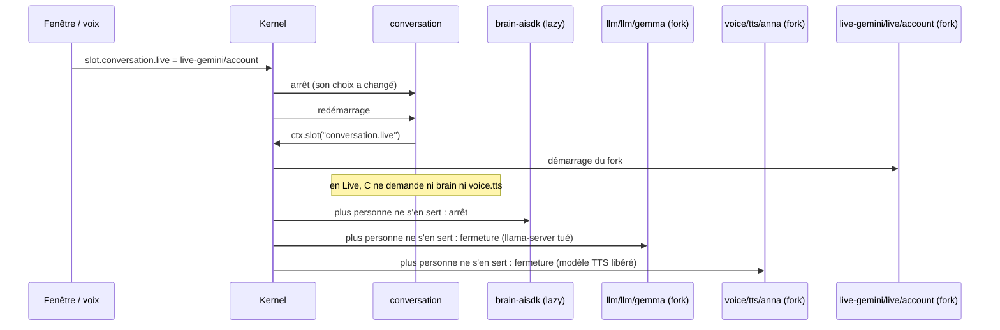
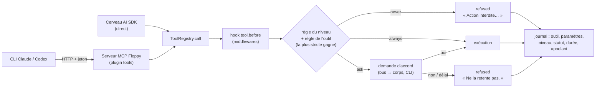
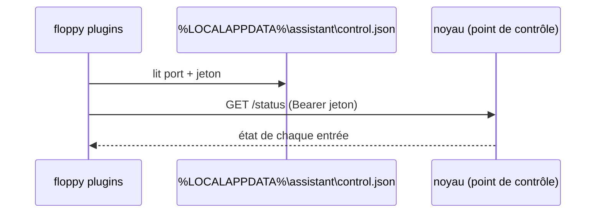

# Le noyau (implémenté)

[← Retour à la spec](README.md)

État : **fait** (phases P0 à P2 du plan du proto, 5 novembre 2026). Code : `assistant\packages\core`, `assistant\plugins\tools`, `assistant\apps\cli`.

Cette page décrit ce qui **existe dans le code**. [Architecture](architecture.md) décrit la cible.

## Vue d'ensemble



## Les plugins, rangés par famille

```
assistant/plugins/
  brain/aisdk  brain/claude-cli     voice/listen      memory/local     conversation/default
  body/hub  body/electron  body/ws  body/reachy       llm/llamacpp  llm/openai
  tools/mcp  tools/orca  tools/browser  tools/websearch  tools/m365
  avatar/tv  avatar/pixel           assistant/coder   dev/bench-api
```

**Règle de frontière** : un plugin ne parle aux autres que par les contrats de services (`@floppy/contracts`, et `@floppy/core` pour ceux du noyau). Il n'importe **jamais** un autre paquet de plugin (ni par son nom, ni par un chemin relatif, pas même un type). Testé : `packages/core/test/boundaries.test.ts`. C'est pourquoi les contrats `mcp`, `body` et `avatars` (et `defineAvatar`) vivent dans `packages/contracts`, et pas dans le plugin qui les fournit.

Le nom du paquet ne dépend pas du dossier (`@floppy/plugin-brain-aisdk`…). Une entrée de la config choisit un plugin par l'id de son manifeste (`plugin: brain-aisdk`). **Découverte des plugins livrés.** Aucune liste à tenir : un paquet est un plugin livré quand son `package.json` porte `"floppy": { "plugin": true }` (`apps/cli/src/catalog.ts`, `discoverPackages`). Le noyau tourne toujours depuis les sources (l'app Electron lance `electron .` dans le dépôt, la CLI `node`, sans étape de paquetage) : `boot()` (CLI et `utilityProcess` de l'app) cherche ces paquets dans `node_modules/@floppy` (les workspaces `plugins/*/*` y sont liés par `npm install`, c'est aussi ce que l'import dynamique résout), puis fait `import(<nom du paquet>)` pour chacun. Ajouter un plugin = créer son dossier avec ce champ, `npm install` une fois pour lier le workspace, et l'ajouter à `floppy.example.yml` s'il doit tourner par défaut. Chaque paquet est chargé à part (`loadCatalog`) : un module qui plante au chargement ne bloque pas le démarrage, il est écrit au journal et rappelé dans l'erreur des entrées dont le plugin manque ; un champ `floppy` invalide est traité de même. Un plugin de développement (`"dev": true` : `bench-api`) n'est chargé qu'avec `FLOPPY_DEV=1`. `apps/cli/test/catalog-discovery.test.ts` vérifie que tout paquet de `plugins/*/*` porte le champ et est trouvé.

**Qui fournit un service par défaut.** Ni l'ordre du catalogue ni `order` ne le décident. À défaut d'un slot (`slot.<id>`) et d'un choix `services: { nom: entrée }` de la config, le fournisseur d'un service est la **première entrée active de la config** (`floppy.yml`) qui le fournit (`Kernel.providerOf`, règle 4 plus bas). Pour la config d'exemple, chaque défaut est épinglé par `apps/cli/test/default-providers.test.ts` (lancé sur le vrai noyau). Les services où plusieurs plugins livrés se disputent le rôle sans slot : `brain` (`brain-aisdk`, `brain-claude-cli` si `as` contient `brain`), `agent` (dix plugins, lu par `agent-sessions` et `agent-jobs`), `notify` (`notify-telegram`, `notify-mail`, lu par `scheduler`). Les autres services à plusieurs fournisseurs (`llm`, `completion`, `delegate`, `tts`, `live`, `wakeword`, `search`) sont choisis par un slot ; leur « défaut » ne sert qu'à celui qui n'a pas de slot. Pour imposer un choix, utiliser un slot ou `services:`, jamais la place d'un plugin.

**`order`** (facultatif, dans le champ `floppy`) ne règle que l'ordre d'affichage du catalogue : types d'ajout d'une rubrique des réglages, rubriques fusionnées (le premier déclarant gagne champ par champ), carte des services. Sans `order`, le paquet vient après ceux qui en ont un, par nom : un nouveau plugin n'a rien à y écrire.

**L'hôte** (l'app de bureau) donne au noyau un canal (`boot({ host })`). Un plugin le lit par `ctx.host` (absent en ligne de commande), jamais par un objet global du processus ; ses écouteurs tournent à son nom et sont retirés à son arrêt. `body-electron` s'en sert (port de l'avatar, ouvrir les réglages, affichage).

Depuis le 6 novembre 2026 : `tasks/scheduler`, `display/documents`, `veille/digest`, `tools/searxng`. Voir [Tâches](taches.md), [Documents](documents.md), [Veille](veille.md).

## Les services (contrats)

Un plugin fournit ou utilise un service par son nom ; il ne connaît jamais le plugin d'en face. Les contrats sont rangés par domaine, comme dans Cordis :

- **Le noyau** (`packages/core/src/services.ts`) ne garde que les siens : `task` et `documents` (il lance les tâches et montre leur document), et l'interface `Services` elle-même.
- **Les domaines** (`packages/contracts/src/` : `brain.ts`, `voice.ts`, `body.ts`, `coder.ts`, `mcp.ts`, `search.ts`, `notify.ts`) ajoutent chacun leurs services à `Services` par une augmentation de module (`declare module "@floppy/core" { interface Services { … } }`). Un plugin importe les types d'ici (`import type { BrainService } from "@floppy/contracts"`).
- Ajouter un service ne touche donc pas au noyau : on complète le fichier du domaine, ou un plugin déclare le sien de la même façon. Le test des frontières vérifie que le noyau n'importe aucun contrat de domaine.

<!-- carte des services : début (généré par `npm run docs:services`, ne pas modifier à la main) -->


Lecture : plugin → service = il le fournit. Service → plugin : trait plein = `inject` (obligatoire), pointillé = `optional`, trait double = un slot (le choix d'un élément, nommé sur la flèche). « type » : un contrat cite le type d'un autre service. Les plugins aux mêmes liens partagent un nœud.

Sans service (outils seuls) : `browser`, `inbox`, `m365`.

| Service | Contrat | Ce qu'il fait | Fournisseurs | Utilisé par |
|---|---|---|---|---|
| `agent` | `AgentService` (`packages/contracts/src/agents.ts`) | — | `brain-claude-cli`, `brain-codex-cli`, `brain-agy-cli`, `agent-opencode`, `agent-pi`, `agent-omp`, `agent-hermes`, `agent-copilot`, `agent-cursor`, `agent-aider` | `agent-sessions` (facultatif), `agent-jobs` (facultatif) |
| `agentTracking` | `AgentTrackingService` (`packages/contracts/src/agents.ts`) | Le fournisseur conserve les observations ; une lecture ne commande jamais un agent | `orca` | `display-agent-tracking` (facultatif) |
| `avatars` | `AvatarRegistry` (`packages/contracts/src/body.ts`) | Les avatars de l'app de bureau | `body-electron` | `avatar-tv` (facultatif), `avatar-pixel` (facultatif), `avatar-essaim` (facultatif), `avatar-gyre` (facultatif), `avatar-goutte` (facultatif), `avatar-oscillo` (facultatif), `avatar-iris` (facultatif), `avatar-pixelcat` (facultatif) |
| `body` | `BodyHub` (`packages/contracts/src/body.ts`) | Le hub des corps (fenêtre, page web, robot) | `body-hub` | `body-ws`, `body-electron`, `body-reachy`, `conversation`, `websearch` (facultatif), `documents` (facultatif) |
| `brain` | `BrainService` (`packages/contracts/src/brain.ts`) | Un cerveau qui mène un tour | `brain-aisdk`, `brain-claude-cli` | `conversation` (facultatif) |
| `coder` | `CoderService` (`packages/contracts/src/coder.ts`) | L'assistant IA de la fenêtre des réglages | `coder` | — |
| `completion` | `CompletionService` (`packages/contracts/src/brain.ts`) | Un appel au modèle hors conversation | `llm-llamacpp`, `llm-openai`, `brain-claude-cli` | `orca` (slot `orca.summary`), `veille` (slot `veille.tri`) |
| `delegate` | `BrainService` (`packages/contracts/src/brain.ts`) | Un cerveau qui mène un tour | `brain-claude-cli`, `brain-codex-cli`, `brain-agy-cli`, `agent-opencode`, `agent-pi`, `agent-omp`, `agent-hermes` | `brain-aisdk` (slot `brain.delegate`) |
| `documents` | `DocumentsService` (`packages/core/src/services.ts`) | Les documents Markdown de Floppy (veille, résumés) | `documents` | `agent-jobs` (facultatif), `scheduler` (facultatif), `veille` (facultatif), noyau |
| `live` | `LiveService` (`packages/contracts/src/voice.ts`) | Un modèle « Live » qui écoute et parle lui-même (Gemini, GPT) ; les outils passent par lui ou par délégation | `live-gemini`, `live-openai` | `conversation` (slot `conversation.live`) |
| `llm` | `LlmService` (`packages/contracts/src/brain.ts`) ; cite `brain` | Un modèle de langage en service | `llm-llamacpp`, `llm-openai`, `brain-claude-cli`, `brain-codex-cli`, `brain-agy-cli`, `agent-opencode`, `agent-pi`, `agent-omp`, `agent-hermes` | `brain-aisdk` (slot `brain.main`) |
| `mcp` | `McpEndpoint` (`packages/contracts/src/mcp.ts`) | Le serveur MCP de Floppy | `tools` | `brain-claude-cli`, `brain-codex-cli`, `brain-agy-cli`, `agent-opencode`, `agent-pi`, `agent-omp`, `agent-hermes`, `coder`, `brain-aisdk` (facultatif), `conversation` (facultatif) |
| `memory` | `MemoryService` (`packages/contracts/src/memory.ts`) | Un adaptateur peut être local ou distant ; les appelants attendent toujours ses résultats | `memory` | `vocabulary` (facultatif), `brain-aisdk` (facultatif), `conversation` (facultatif) |
| `notify` | `NotifyService` (`packages/contracts/src/notify.ts`) | Un canal d'envoi configuré (ex. « Telegram · mon canal », « Gmail · perso ») | `notify-telegram`, `notify-mail` | `scheduler` (facultatif) |
| `search` | `SearchService` (`packages/contracts/src/search.ts`) | Recherche web en service, pour les autres plugins (la Veille) | `websearch`, `searxng` | `veille` (slot `veille.recherche`) |
| `stt` | `SttService` (`packages/contracts/src/voice.ts`) | Transcription en service (l'élément choisi dans le slot listen.stt) | `stt-sherpa` | `voice-listen` (slot `listen.stt`) |
| `task` | `TaskService` (`packages/core/src/services.ts`) | Un plugin qui a des tâches les déclare dans son manifeste (`tasks`) et fournit ce service | `veille` | noyau |
| `tts` | `TtsService` (`packages/contracts/src/voice.ts`) | Une voix en service (l'élément choisi dans le slot voice.tts) | `tts-gemini`, `tts-elevenlabs`, `tts-audiocpp`, `tts-system` | `conversation` (slot `voice.tts`) |
| `vad` | `VadService` (`packages/contracts/src/voice.ts`) | Détecteur de parole en service (l'élément choisi dans le slot listen.vad) | `stt-sherpa` | `voice-listen` (slot `listen.vad`) |
| `vocabulary` | `VocabularyService` (`packages/contracts/src/vocabulary.ts`) | Interprétation du vocabulaire personnel ; ne modifie jamais une transcription ni un message | `vocabulary` | `brain-aisdk` (facultatif), `conversation` (facultatif) |
| `voice` | `VoiceService` (`packages/contracts/src/voice.ts`) | Le flux voix d'un corps | `voice-listen` | `conversation` (facultatif), `wakeword-stt` (facultatif) |
| `wakeword` | `WakewordService` (`packages/contracts/src/voice.ts`) | Un détecteur du mot d'activation (« Floppy »), sur le son ou sur le texte transcrit | `wakeword-stt`, `wakeword-sherpa`, `wakeword-porcupine` | `conversation` (slot `listen.wakeword`) |
<!-- carte des services : fin -->

## Un plugin

Un plugin est un module avec un **manifeste** et une fonction `apply(ctx, config)`.

```ts
export default definePlugin({
  manifest: { id: "llm-llamacpp", version: "0.1.0", licence: "MIT", provides: ["llm"] },
  config: z.object({ port: z.number().default(8080) }),     // validé avant apply
  apply(ctx, cfg) {
    // Le plugin est léger : il offre `llm` modèle par modèle. Chaque modèle choisi tourne dans un fork.
    ctx.offer("llm", {
      max: 1,                                                 // un seul modèle dans la mémoire du GPU
      items: () => models().map((m) => ({ id: m.id, label: m.label })),
      renamed: { gemma: "gemma-4-12b" },                      // facultatif : un choix gardé sur un ancien id suit le nouveau
      async start(f, id) {
        f.spawn(exe, argsFor(id));                            // effet du fork : tué quand le fork se ferme
        await ready();
        f.provide("llm", { baseURL: `http://127.0.0.1:${cfg.port}/v1`, model: id });
      },
    });
  },
});

// Le consommateur déclare le choix (slot) et lit l'élément choisi pendant apply :
definePlugin({
  manifest: { id: "brain-aisdk", lazy: true, provides: ["brain"],
    slots: [{ id: "brain.main", service: "llm", section: "cerveau", label: "Cerveau principal" }] },
  async apply(ctx) { const llm = await ctx.slot("brain.main"); /* … */ },
});
```

| Champ du manifeste | Rôle |
|---|---|
| `provides` | services fournis par `ctx.provide` |
| `slots` | choix d'éléments dont le plugin a besoin (`{ id, service, section, label, none?, display?, step? }`). Le noyau en fait un réglage `slot.<id>` (fenêtre, voix, CLI). `none` : choix facultatif. `display: "mode"` : interrupteur en haut de la rubrique. `step` : place dans la chaîne de la rubrique (voir [elements.md](elements.md)) |
| `lazy` | le plugin tourne seulement quand un plugin actif s'en sert (`inject` ou `ctx.use`), et s'arrête ensuite |
| `inject` | services obligatoires : sans eux, le plugin attend (état `waiting`). Un fournisseur `lazy` est démarré pour eux |
| `optional` | services facultatifs. Lus avec `ctx.maybe` : lien faible (jamais un plugin `lazy`, le plugin redémarre quand ils arrivent ou changent). Lus avec `ctx.use` : besoin réel, le fournisseur est démarré |
| `permissions` | ce que le plugin veut toucher. `exec` est **imposé** par `ctx.spawn` ; `approvals: "respond"` est imposé par `ctx.approvals` ; `net` est **imposé** par `ctx.fetch` (hôte absent = refusé) ; le reste (`fs.*`, `cloud`) est déclaratif (voir [Sécurité](securite.md#garde-fous-du-code)) |
| `sections` | rubriques de la fenêtre des réglages que le plugin apporte (voir [elements.md](elements.md#les-rubriques-déclarées-par-les-plugins)) |
| `addable` | le plugin est une « application » que l'utilisateur ajoute ou retire (voir [elements.md](elements.md)) |

Le manifeste est validé par un schéma zod au chargement (`ManifestSchema`, `packages/core/src/plugin/manifest.ts`). Le schéma décrit **tous** les champs de `Manifest`, y compris `sections` (`SectionDef`), `addable` (dont les champs de formulaire `FieldDef` et le `Logo`), `slots`, `tasks` et `permissions`, et **refuse tout champ inconnu, à tous les niveaux** : `optionnal` ou `injects` ne sont plus ignorés en silence. Invalide : l'entrée démarre en **erreur visible**, qui nomme le champ et propose le plus proche (`manifeste invalide : optionnal : champ inconnu (voulais-tu « optional » ?)`, dans les deux langues). Le schéma valide la **forme** ; les contrôles de fond (clés de formulaire, rubriques fusionnées) restent dans leurs registres. Le type `Manifest` et le schéma ne peuvent pas dériver : `ManifestSchemaMatchesInterface` (même fichier) échoue à `npm run typecheck` si l'un a un champ, ou un type de champ, que l'autre n'a pas ; `apps/cli/test/example-config.test.ts` vérifie que chaque plugin livré passe le schéma. Deux champs ont été **retirés** (10 novembre 2026) : `serviceSelection` (voir « Choisir un fournisseur ») et `runtime` (une étiquette `in-process` / `out-of-process` que rien ne lisait). Un manifeste qui les porte est refusé comme tout champ inconnu, y compris celui du code d'un plugin tiers (`manifestMismatch`).

### Choisir un fournisseur : deux voies, pas trois

1. **Un élément** (modèle, voix, moteur Live, détecteur de mot d'activation, cerveau délégué…) : le plugin fournisseur l'offre avec `ctx.offer`, le consommateur déclare un **slot** (`manifest.slots`), le noyau pose le réglage `slot.<id>` (fenêtre, voix, CLI) et la clé `slots:` de la config donne le choix de départ. C'est le cas de tous les services à plusieurs fournisseurs livrés qui demandent un choix, mot d'activation compris (`listen.wakeword`, déclaré par `conversation` ; `wakeword-stt`, `wakeword-sherpa` et `wakeword-porcupine` offrent leurs détecteurs).
2. **Une entrée fournisseur**, sans slot : la clé `services: { nom: entrée }` de la config ; à défaut, la première entrée active dans l'ordre de la config (règle 4).

L'ancien sélecteur `manifest.serviceSelection` (réglage `service.<nom>`, `ctx.selectedProvider`) a été **retiré** : aucun plugin ne le déclarait plus (les détecteurs de mot d'activation sont passés aux slots), donc aucun réglage `service.*` n'était plus lu. Une clé `service.*` restée dans un `settings.json` d'une ancienne version est ignorée sans effet (le choix vit dans `slot.<id>`) ; testé dans `packages/core/test/speech.test.ts`.

Le `ctx` est la seule porte vers le noyau :

| Méthode | Rôle |
|---|---|
| `provide`, `get`, `maybe` | fournir un service, lire un service déclaré (refus sinon). Le nom est vérifié par le compilateur (voir « Noms vérifiés ») : `ctx.get("ttts")` ne compile pas |
| `use(service)` | pendant `apply` : demander un service déclaré ; le démarre s'il est en veille (`lazy`). Ne pas l'appeler = ne pas en avoir besoin |
| `slot(id)` | pendant `apply` : service de l'élément choisi pour un slot du manifeste ; son fork démarre à la demande. `undefined` : « aucun », ou élément indisponible |
| `offer(service, { items, max?, start })` | offrir un service élément par élément. `start(f, item)` tourne dans un **fork** (son propre `ctx`, ses effets) et doit appeler `f.provide` |
| `effect`, `spawn`, `interval`, `timeout` | tout ce qui est ouvert est fermé au déchargement, dans l'ordre inverse |
| `on`, `emit` | bus d'événements, nom et charge utile typés par `CoreEvents` (désabonnement automatique) ; les événements du noyau (accords, état, services, tâches, relance) sont refusés à `emit` |
| `fetch` | `fetch` avec un délai (30 s par défaut, `timeoutMs` le change ; il couvre la **réponse entière**, corps compris : pour un flux ou une synthèse longue, donner une borne plus grande). L'hôte est vérifié : la boucle locale (`localhost`, `127.0.0.1`, `::1`) est toujours permise ; sinon l'hôte doit figurer dans `permissions.net` (nom exact, `*.domaine` pour le domaine et ses sous-domaines, ou `*` quand l'utilisateur choisit l'adresse, comme `exec: ["*"]`). Un autre hôte est **refusé** : `TextError` bilingue qui nomme le plugin et l'hôte, une ligne au journal et un enregistrement d'audit `plugin.net.refused` (une fois par hôte). Une redirection vers un autre hôte n'est pas revérifiée |
| `hook`, `runHook` | middlewares en cascade avec `next()`. Le nom est une clé de `HookTypes` : l'entrée et la sortie en sont déduites (aucun type à donner à l'appel) |
| `tools.register / list / call` | registre d'outils du noyau ; `register` rend une fonction pour retirer ces outils plus tôt (un corps qui se débranche) ; tout est retiré au déchargement |
| `settings.declare / saved` | réglages modifiables à la voix ou par la CLI (voir [Réglages à la voix](reglages.md)) |
| `items.declare / store / status…` | éléments de la fenêtre des réglages (voir [elements.md](elements.md)) |
| `secrets` | coffre des secrets, **cloisonné** : seuls les noms `<id du manifeste>/…` |
| `home` | dossier de données (`%LOCALAPPDATA%assistant`) |
| `approvals` | `check` pour tous ; `respond` et `pending` seulement avec `permissions.approvals: "respond"` |
| `audit` | journal |
| `spawn` | refuse un programme absent de `permissions.exec` ; `keep: true` : programme ouvert pour l'utilisateur (navigateur, terminal), détaché, laissé ouvert |
| `exec` | commande courte (`permissions.exec`), délai de 30 s par défaut, arrêtée avec le plugin ; rend `{ stdout, stderr, code }` |
| `workspace(nom)` | espace de travail du plugin dans le répertoire de travail (voir plus bas) |
| `fail(raison)` | panne : le plugin s'arrête et passe en erreur visible (une seule erreur, même pendant `apply`) |

## Noms vérifiés

Un nom de service, de hook ou d'événement mal écrit ne compile pas : `Services`, `HookTypes` et `CoreEvents` n'ont **aucune signature d'index**, et tout ce qui nomme un service est typé par `ServiceName` (`keyof Services`) : `provides`, `inject`, `optional`, `slots[].service`, `ctx.provide/use/get/maybe/offer/offers/borrowItem/restartOffers`. À l'exécution rien ne change.

| Registre | Rôle | Qui le déclare |
|---|---|---|
| `Services` | nom -> contrat du service | `task`, `documents` : le noyau (`services.ts`). Les autres : `packages/contracts/src/<domaine>.ts` |
| `HookTypes` | nom -> `{ input, output }` d'un hook | `tool.before` : le noyau (`plugin/hooks.ts`). `conversation.command` : `contracts/src/brain.ts`. `initiative.presented` et `initiative.delivery` : `contracts/src/body.ts` |
| `CoreEvents` | nom -> charge utile d'un événement | le noyau (`bus.ts`) |

Chaque registre est une interface qu'on complète par augmentation de module, depuis le fichier qui possède le contrat :

```ts
declare module "@floppy/core" {
  interface Services { moncontrat: MonService }
  interface HookTypes { "mon.hook": { input: MonEntree; output: MaSortie } }
}
```

Le propriétaire d'un hook (celui qui lance `ctx.runHook`) le déclare ; ceux qui y ajoutent un middleware (`ctx.hook`) n'ont rien à répéter : deux plugins ne peuvent plus se contredire sur les types d'un hook. Un plugin personnel déclare ses propres noms dans les interfaces du SDK (voir [Plugins tiers](plugins-tiers.md#noms-à-soi)). Les tests du noyau déclarent les leurs dans `packages/core/test/names.fixture.ts` ; `packages/core/test/typed-names.test.ts` vérifie, par `@ts-expect-error`, qu'un nom mal écrit ne compile pas et que les types sont déduits.

## Cycle de vie



Règles (toutes testées dans `packages/core/test/kernel.test.ts`) :

1. Une entrée démarre quand tous ses services `inject` ont un fournisseur **actif**. L'ordre dans la config ne compte pas.
2. Un service est visible seulement **après** la fin de `apply()`.
3. Arrêter un fournisseur arrête **d'abord** ses dépendants. Ils repassent en attente, puis redémarrent dès qu'un fournisseur revient.
4. Si le fournisseur choisi change (`services: { brain: … }`), seuls ses dépendants redémarrent.
5. Changer la config d'une entrée redémarre cette entrée et ses dépendants, rien d'autre.
6. Un service manquant, une config invalide ou une panne sont **toujours visibles** (`floppy plugins`, événement `plugin.state`).
7. Toutes les opérations passent par une **file** : jamais deux changements d'état en même temps.
8. `ctx.provide` n'est permis que **pendant** `apply()`. Après, il lève une erreur (un service ne devient jamais visible en silence).
9. `ctx.fail()` pendant `apply()` ferme les effets et donne **une seule** erreur (la raison donnée). Après le démarrage, il arrête le plugin et le passe en erreur.

Règles « à la demande », comme dans Cordis (toutes testées dans `packages/core/test/on-demand.test.ts`) :

10. **Ce qui ne sert à personne ne tourne pas.** Un plugin `lazy` démarre quand un plugin actif en a besoin (`inject`, `ctx.use`) et s'arrête quand plus personne ne s'en sert.
11. **Un élément choisi tourne dans un fork.** Le fork (clé `<entrée>/<service>/<élément>`) démarre quand son consommateur lit le slot (`ctx.slot`), et se ferme quand plus personne ne s'en sert. Deux slots sur le même élément partagent un fork.
12. **Changer un choix redémarre le consommateur** sur le nouvel élément. Avec `max: 1`, l'ancien fork est fermé **avant** que le nouveau démarre (mémoire du GPU). Un élément qui ne démarre pas : le choix revient à l'ancien, et le refus est visible.
13. **Aucun plugin n'allume ni n'éteint un autre plugin.** Le noyau le fait, d'après les besoins déclarés. Exemple : il n'y a plus de `setActive` pour libérer le LLM local en mode Live.

Limite connue : deux slots qui choisissent deux éléments différents d'une offre `max: 1` se disputent la place (le noyau s'arrête après 1 000 tours avec une erreur claire).

Règles « le noyau ne se bloque jamais » (toutes testées dans `packages/core/test/resilience.test.ts`) :

14. **Délais.** `apply` a 60 s au plus (`manifest.startTimeout_s` le change), le `start` d'un fork 600 s (`OfferDef.startTimeout_s`). Le temps passé à attendre un autre plugin (`ctx.use`, `ctx.slot`) ne compte pas. Au-delà, l'entrée passe en erreur et ce qu'elle a ouvert est fermé. Chaque fermeture a 10 s au plus : au-delà, elle est abandonnée (une ligne au journal) et les suivantes tournent.
15. **Un démarrage annulé n'est plus attendu.** `ctx.fail` pendant `apply`, un délai dépassé, l'arrêt de Floppy ou un nouveau choix pour le même slot : le noyau cesse d'attendre `apply` (le code du plugin continue peut-être, mais son contexte est fermé). Choisir un autre élément pendant qu'un modèle charge annule donc ce chargement.
16. **Contexte fermé = contexte inerte.** Après l'arrêt, `emit` est ignoré ; `tools.call`, `settings.change`, `items.run`, `runHook`, `tasks.run` et `downloads.start` sont refusés ; `approvals.check` rend un refus. Chaque refus est écrit une fois au journal, au nom du plugin. Les demandes d'accord d'un plugin sont annulées à son arrêt.
17. **Pannes attribuées.** Le code d'un plugin (apply, start, écouteurs, middlewares, minuteries, outils) tourne au nom de son entrée (`AsyncLocalStorage`). Le filet global rend l'erreur à ce plugin : une exception non rattrapée le met en panne ; une promesse rejetée non suivie est seulement notée. Une minuterie (`ctx.interval`, `ctx.timeout`) qui plante est notée, sans panne. Le travail du noyau (la file) ne tourne au nom d'aucun plugin, même quand un plugin l'a demandé ; les fermetures d'un plugin tournent à son nom. Un middleware qui plante **avant** `next()` arrête la chaîne (un contrôle qui refuse bloque l'action) ; **après** un `next()` réussi, il est noté et le résultat de la suite est gardé.
18. **Reprise automatique.** Une entrée ou un fork en panne (pas une config invalide, pas un démarrage annulé exprès) repart après 5 s, 30 s, puis 2 min. Ensuite l'erreur reste visible jusqu'à une relance à la main ou un nouveau choix. Une entrée restée active plus d'une minute avant sa panne repart avec tous ses essais. Pour un fork, ceux qui le voulaient (slot) repartent pour le redemander.
19. **Emprunts.** Un élément emprunté (`ctx.borrow`, `ctx.borrowItem`) qui s'arrête prévient l'emprunteur (`lost`) et rend sa place. Exemple : l'écoute réemprunte le détecteur de parole et la transcription tombés en panne ; les flux ouverts passent au nouveau détecteur sans se fermer.
20. **L'arrêt est définitif.** Après `stopAll`, plus rien ne démarre (un emprunt rendu, une reprise, un rechargement en attente ne relancent rien) ; un démarrage annulé par l'arrêt repart normalement au `applyConfig` suivant. Un démarrage abandonné ne lie plus de service à l'entrée.

Les plugins qui lancent un serveur local (llama-server, audio.cpp) passent par `startLocalServer` (`packages/core/src/util/local-server.ts`) : il lance le programme par `ctx.spawn`, attend qu'il réponde sur `/health` (l'erreur donne la fin de son journal), puis le surveille (`watchHealth` : `/health` toutes les 30 s ; après 3 échecs d'affilée, il l'arrête et le signale). La reprise automatique le relance. Les éléments qui ont un secret (modèles distants, boîtes mail, canaux Telegram, connecteurs MCP) le rangent par `itemSecret` : une seule règle pour le formulaire (SECRET_SET ou rien = inchangé, vide = effacé). La conversation arrête un tour quand le cerveau se tait plus de `turn_idle_s` (300 s par défaut) et le dit. Une tâche qui ignore le signal d'arrêt n'est plus attendue 10 s après l'arrêt.

### Exemple : passer en mode Live



## La config

```yaml
assistant: { name: Floppy, language: fr, wake_words: [floppy, flopy] }
approvals: { read: always, write: ask, send: ask, delete: ask, physical: ask, timeout_s: 90 }
services: { brain: brain }          # facultatif : choix du fournisseur si plusieurs
plugins:
  - { id: tools, plugin: tools, config: { … } }
  - { id: brain, plugin: brain-aisdk, disabled: false, config: { … } }
```

- Validée par schéma (zod). Un id en double est refusé.
- Le fichier est **surveillé** : une nouvelle version valide est appliquée ; une version invalide est signalée et ignorée. Le noyau surveille le **dossier** du fichier (pas le fichier seul), pour survivre aux éditeurs qui remplacent le fichier à chaque enregistrement.
- Changer `assistant` (nom, langue, mots d'activation) redémarre tous les plugins.

## Outils, niveaux et accords

**Tout appel d'outil passe par `ToolRegistry.call`**, quel que soit le cerveau : agent AI SDK en direct, ou CLI Claude/Codex par le serveur MCP Floppy.



| Niveau | Règle par défaut |
|---|---|
| `read` | `always` |
| `write`, `send`, `delete`, `physical` | `ask` |

- Niveau d'un outil MCP : **config** (nom exact, puis motif `write_*`) > **annotations MCP** (`readOnlyHint` → read, seulement pour un serveur local ou un serveur distant avec `trust_annotations: true` ; `destructiveHint` → delete) > **inconnu = write**.
- `never` dans la config d'un serveur interdit l'outil sans même demander (exemple : `write_*` sur le coffre Obsidian).
- `approvals.toolRules` permet une autorisation utilisateur ciblée : `{ source, tool, level, rule }`, tous les identifiants comparés exactement. Cette règle remplace le défaut du niveau pour ce seul outil ; un niveau global `never` reste absolu. Les doublons prennent la règle la plus stricte, puis la règle de l'outil peut encore durcir (`rule` statique ou fonction). Le fournisseur vient du registre, jamais des paramètres du modèle. Exemple livré : mémoriser une correction explicite sans autoriser toutes les écritures. `ctx.approvals.check` fixe aussi la source à l'entrée appelante.
- Statuts d'un résultat : `done`, `unverified`, `failed`, `refused`.
- Chaque appel reçoit un `callId` neuf du registre. La session et le tour hôte (`session`, `turn`) sont repris dans l'accord et le résultat pour relier les événements. Un outil peut déclarer `auditArgs` pour réduire les paramètres journalisés ; son erreur brute est alors remplacée par `tool-failed`. Un filtre qui lève une erreur produit seulement `{ redacted: true }`, jamais les paramètres d'origine. Les détails utiles restent dans la réponse utilisateur de l'outil.
- Un plugin demande un accord par `ctx.approvals.check`. Seuls `body-hub`, `conversation` et `bench-api` (catalogue de développement, `FLOPPY_DEV=1`) peuvent répondre (`permissions.approvals: "respond"`) ; voir [Sécurité](securite.md#laccord).
- La demande d'accord a un **id secret** (UUID) et une durée de vie. Le modèle ne le voit jamais. Seuls les corps (bus) et la CLI répondent. **La première réponse gagne**, les suivantes sont ignorées.

Testé (`plugins/tools/test/tools.test.ts`) : une écriture refusée ou sans réponse **n'atteint jamais** le serveur MCP ; sans jeton, le serveur MCP Floppy répond 401 ; un serveur MCP cassé au démarrage n'empêche pas les autres.

## Le plugin `tools` (passerelle MCP)

- Lance chaque serveur MCP de l'utilisateur en **stdio, hors processus**, avec un environnement réduit.
- `exclude` masque des outils d'un serveur (exemple : le faux `ouvrir_url` du banc quand le plugin `browser` fournit le vrai).
- Ajoute ses outils au registre, avec leur niveau.
- Si un serveur s'arrête tout seul : **seul son connecteur** passe en erreur (« le serveur s'est arrêté : … »), avec une ligne au journal (`mcp.server_down`). Le plugin `tools` et les autres connecteurs continuent. Ce n'est pas un `ctx.fail()`.
- Connexion à un serveur : délai de 30 s. Les connecteurs se branchent **après** `apply`, en arrière-plan : le service `mcp` est visible tout de suite, et un connecteur lent ne retarde ni le démarrage ni les cerveaux CLI. `mcp.connected()` est tenue quand ils ont tous fini (réussis ou non).
- Ouvre le **serveur MCP Floppy** (`127.0.0.1`, port 8740 par défaut, jeton nouveau à chaque démarrage) et fournit le service `mcp` = `{ url, token }` pour les cerveaux CLI.
- `mcp.bindContext({ session, origin, turn, signal })` attache temporairement le tour hôte à ce jeton et rend une fermeture. Les jetons restreints possèdent leurs propres contextes : les cerveaux OpenCode/Pi/Oh My Pi/Hermes lient explicitement le leur avant le lancement, puis libèrent la liaison avant de révoquer le jeton (succès, erreur ou annulation). Une mission autonome ne déduit aucune identité vocale de ses paramètres. Plusieurs liaisons identiques sont possibles ; des sessions/origines/tours contradictoires ne transmettent aucun contexte. Les appels reçoivent le contexte hôte et son signal, jamais une session fournie dans les arguments MCP. La fermeture du tour annule les appels concernés.

## La CLI et le point de contrôle



| Commande | Rôle |
|---|---|
| `floppy start [--config f]` | démarre le noyau (Node 24) |
| `floppy plugins` | état de chaque entrée (● actif, ◌ attend, ✖ erreur, – désactivé) |
| `floppy log [n]` | journal d'audit |
| `floppy approvals`, `floppy approve <id> [--no]` | voir et répondre aux demandes d'accord |
| `floppy restart <id>`, `floppy reload` | relancer une entrée, relire la config |
| `floppy settings`, `floppy set <clé> <valeur>`, `floppy undo` | réglages |
| `floppy chat` | un corps texte au clavier, branché par `body-ws` (comme Telegram) |

## Résilience

Une pièce qui casse ne doit pas arrêter tout Floppy. Ce qui existe (testé dans `packages/core/test/files.test.ts`, `safety.test.ts`, `children.test.ts`, `audit.test.ts` et `apps/desktop/test/lifecycle.test.ts`) :

| Panne | Ce que fait Floppy |
|---|---|
| Plantage pendant l'écriture d'un fichier de l'utilisateur (`settings.json`, `items/*.json`, `tasks.json`, `onboarding.json`, préférences de la veille, `MEMORY.md`) | Écriture dans un fichier temporaire puis renommage (`writeFileAtomic`) : l'ancien fichier reste entier. |
| Fichier abîmé au démarrage | Il est renommé en `<nom>.corrupt-<date>` (ou copié, s'il est tenu) et signalé dans le journal (`readJsonFile`). Il n'est jamais écrasé par la sauvegarde suivante. Un fichier seulement tenu un instant (antivirus) est relu ; s'il reste illisible, la lecture lève une erreur au lieu de repartir de zéro. |
| Erreur asynchrone oubliée par un plugin | Le filet global (`installSafetyNet`, posé par `boot`) l'écrit au journal ; le noyau continue. Au-delà de 20 exceptions en 60 s, le noyau s'arrête et l'hôte le relance. |
| Noyau tué de force (llama-server ou la voix locale restent en vie) | `ctx.spawn` note chaque programme dans `<home>/children.json` (nom, heure de lancement, noyau). Au démarrage suivant, un programme est arrêté seulement s'il porte le même nom, a démarré au même moment (à 10 s près) et si son noyau ne tourne plus (une autre instance de Floppy n'est jamais touchée). La liste est ensuite vidée. Un programme fini tout seul est retiré de la liste et des fermetures du plugin. |
| Le noyau s'arrête dans l'app | Relance après 2 s, 5 s, 15 s puis 60 s. Au bout de 5 arrêts en 2 minutes, plus de relance : l'icône montre la raison (envoyée par le noyau quand le démarrage échoue, par exemple un `floppy.yml` invalide). « Relancer le noyau » repart de zéro. |
| Une fenêtre de l'app plante | Elle est rechargée après 1 s ; au-delà de 3 pannes en 5 minutes, elle est laissée. |
| Journaux | Chaque ligne du journal du noyau porte l'heure et le niveau. `kernel.log` et `audit.jsonl` passent à `*.1.*` au-delà de 20 Mo. Une écriture d'audit impossible (disque plein) est signalée, et l'action continue. |
| Démarrage lent | Le point de contrôle de la CLI s'ouvre avant la config : `floppy plugins` répond pendant qu'un modèle se charge. |

## Le répertoire de travail

Un seul dossier pour tout ce que Floppy garde : la config `floppy.yml`, les réglages, les éléments, les modèles téléchargés, les espaces de travail des agents (`workspaces/<plugin>/…`), les plugins tiers (`plugins/`), les journaux (`kernel.log`, `audit.jsonl`). Code : `packages/core/src/util/home.ts`, testé dans `packages/core/test/home.test.ts`.

- **Par défaut** : `%LOCALAPPDATA%\floppy` (ailleurs : `$XDG_DATA_HOME/floppy`, sinon `~/.local/share/floppy`). `FLOPPY_HOME` passe avant tout (tests, mode debug, `--home`).
- **Le choisir** : fenêtre « Bienvenue » (première page, « Changer… ») ou Réglages → Général → « Répertoire de travail » (réglage `dossier_floppy`, avec « Parcourir… » ; pas à la voix). Le choix est noté dans un fichier pointeur qui reste au même endroit : `<dossier par défaut>/home.json`.
- **Changer de dossier** relance le noyau (événement `floppy.restart` : l'app relance le noyau ; la CLI s'arrête et le dit). Au démarrage suivant, avant d'ouvrir quoi que ce soit, les programmes restés de l'ancien dossier sont arrêtés, puis les données sont déplacées **tout ou rien** : chaque élément passe par un dossier d'attente (`.floppy-move`), et au moindre échec tout revient à sa place. Tant que le déplacement n'est pas fait, Floppy reste dans l'ancien dossier (entier) et réessaie à chaque démarrage ; l'échec est dit par une carte. Un dossier qui contient déjà des données de Floppy est repris tel quel. Un chemin relatif, un dossier où l'on ne peut pas écrire, un dossier dans l'autre, ou un dossier personnel qui n'est pas vide sont refusés.
- **La config** est `<dossier>/floppy.yml`, créée depuis `floppy.example.yml`. Une ancienne config à la racine du dépôt est copiée une fois (l'originale n'est plus lue). `FLOPPY_CONFIG` ou `--config` imposent un autre fichier.
- **Plugins** : `ctx.home` est ce dossier ; `ctx.workspace(nom)` rend `<dossier>/workspaces/<id du plugin>/<nom>` (créé). Les cerveaux CLI (Claude, Codex, Antigravity), l'assistant IA des réglages, ses relectures, la recherche web et les sessions d'agents y travaillent.
- L'app Electron et le worker Orca lisent le même pointeur pour trouver ce dossier (journal, pont).

## Dette d'architecture restante (revue du 7 novembre 2026)

Ce qui reste de la revue d'architecture, par ordre d'intérêt :

1. **Réseau** : fait pour les appels HTTP des plugins du dépôt. Tous passent par `ctx.fetch`, qui refuse un hôte hors `permissions.net` ; `boundaries.test.ts` refuse le `fetch` global dans `plugins/*/*/src` (aucune exception). Plugins à adresse choisie par l'utilisateur : `net: ["*"]` (`llm-openai`, `brain-aisdk`, `mcp`, `body-reachy`, `searxng`, `veille`, `notify-mail`). Reste hors de `ctx.fetch` (non vérifié) : les WebSockets (`connectJsonSocket` pour `live-openai` / `live-gemini`, le client WebSocket de `agent-cli/hermes`), le SMTP de `nodemailer` (`notify-mail`), la clé Picovoice de `wakeword-porcupine` (bibliothèque), les téléchargements (`downloads.ts`, qui vérifient eux-mêmes `permissions.net` sans exception pour la boucle locale), le `fetch` de santé de `startLocalServer` (boucle locale seulement), le worker du plugin Orca (processus de l'app Orca, pas du noyau), et les CLI d'agents lancées par `ctx.spawn` (leur réseau est le leur). À faire : router ces transports, et revérifier l'hôte à chaque redirection.
2. **Code produit hors du noyau.** Premier lancement, lecture de la machine, bibliothèques de modèles et de programmes vivent dans `packages/core` ; cible : un paquet à part, ou des plugins.
3. **Fichiers encore gros.** Premier découpage fait le 7 novembre 2026 (voir ci-dessous) ; `apps/desktop/src/main.ts` découpé ensuite par métier (voir « App » ci-dessous : il ne reste que le point d'entrée, environ 130 lignes, et les plus gros modules font de 200 à 280 lignes). Prochaines coupes : les forks et les slots de `kernel.ts` (environ 1 080 lignes), le catalogue, la bibliothèque et l'éditeur de `renderer/settings*.ts` (environ 1 660), un tour de `plugins/conversation/default/src/index.ts` (environ 570).
4. **Doublons restants** : la normalisation de texte est regroupée dans `packages/protocol/src/text.ts` (sans dépendance, donc importable par le noyau, les plugins et les corps ; les plugins la prennent via `@floppy/core`, qui la ré-exporte). Briques : `stripAccents`, `fold` (minuscules puis sans accents), `foldTokens`, `wordsKey` (hors a-z0-9 devient une espace), `slugify`. Les 26 variantes de `normalize("NFD")` qui étaient strictement équivalentes s'écrivent avec elles (variantes avec apostrophes, espaces ou bornes : `fold(s).replace(…)`). `packages/protocol/test/text.test.ts` fige la sortie de chaque ancienne expression sur des entrées piégeuses et vérifie que les briques donnent la même chose. Restent à part, volontairement : `norm` de `plugins/tools/m365/src/util.ts` (retire `\p{Diacritic}`, donc aussi `^`, `` ` ``, `¨`…, avant les minuscules : sortie différente de `fold`), `norm` de `apps/desktop/src/renderer/settings-state.ts` (la fenêtre compilée à part ne peut pas importer un paquet nu ; même formule que `fold` avec `String(s ?? "")`), et `services/obsidian-mcp/server.mjs` (script autonome hors espace de travail). Un grand nettoyage des variantes « presque pareilles » (apostrophes, ponctuation) reste à faire plus tard, avec un changement de comportement assumé.

**Comment les gros fichiers sont découpés.** Un module sorti d'un fichier reçoit ce dont il a besoin, déclaré :

- **Noyau** : la fabrique du `ctx` (`plugin/context-factory.ts`), les réglages du noyau (`plugin/core-settings.ts`) et les réglages de choix `slot.<id>` (`plugin/selection-settings.ts`) lisent la classe `Kernel` par sa vue interne (`plugin/kernel-internals.ts`) : ses membres privés, typés, sans élargir son API publique.
- **Conversation** : `model.ts` (config, un tour, un corps), `initiatives.ts` et `voice-events.ts` reçoivent leurs dépendances par une interface (`InitiativeDeps`, `VoiceDeps`).
- **App** : `main.ts` ne fait que poser les réglages de départ, créer un module par métier et les relier (`apps/desktop/src/`). `kernel-process.ts` (cycle de vie du noyau : lancement, surveillance, relance avec attente qui grandit, raison affichée quand il abandonne ; son journal ; les demandes avec réponse ; le port du corps), `kernel-messages.ts` (ce que le noyau envoie : réglages, éléments, premier lancement, état des plugins), `tray.ts` (icône et menu, propriétaire des problèmes montrés), `avatar.ts` (fenêtre de l'avatar, place, masquage automatique, affichage), `app-windows.ts` (réglages, « Bienvenue », résultats, documents, saisie, langue de l'interface), `voice-controls.ts` (parler, dormir, raccourcis globaux), `dictation.ts` (dictée et pilule), `ipc.ts` (canaux des pages), `app-texts.ts` (langue et textes). Chaque état a un seul propriétaire (le noyau : `kernel-process.ts` ; la fenêtre de l'avatar et son état : `avatar.ts` ; les problèmes : `tray.ts` ; la langue : `app-texts.ts`…). Un module reçoit ce qu'il utilise des autres par une interface `*Deps` de fonctions lues à l'appel (pas d'import circulaire, pas de variable globale) ; `lifecycle.test.ts` met bout à bout les vrais fichiers et les exécute sans Electron. Déjà séparés avant : `windows.ts` (une seule recette de fenêtre secondaire sûre), `main-texts.ts`, `tray-icon.ts`, `placement.ts` ; côté réglages, `settings-texts.js`, `dom.js`, `fields.js` (branché par `configureFields`). Le processus principal de l'app est en TypeScript, vérifié par `npm run typecheck` ; les fenêtres restent du JavaScript (`names.test.ts` y vérifie que chaque nom utilisé existe).

## Le noyau dans l'app Electron (vérifié)

Spike `assistant\spikes\electron-utility` : Electron 45.2.3 embarque **Node 24.22.2**. Dans un `utilityProcess` : `node:sqlite` avec FTS5 marche, les processus enfants marchent, un fichier `.ts` est lancé directement, et le `MessagePort` avec le processus principal marche. Le même noyau tourne donc dans l'app et en ligne de commande.

## Licences

`npm run licences` : les dépendances **livrées** doivent être permissives (MIT, ISC, BSD, Apache-2.0…), sinon échec. Les outils de dev sont seulement signalés (exemple : `lightningcss`, MPL-2.0, tiré par vitest).

### Contributions desktop

Le noyau ne branche aucun service de suivi vers l'app. `@floppy/contracts` expose `registerDesktop` sur le canal générique `ctx.host` ; la déclaration et les abonnements appartiennent au plugin consommateur et à ses effets. Les états génériques `plugin.state` suffisent à révoquer ses vues côté hôte (y compris échec de démarrage et déconnexion), sans branche par service ou par fournisseur. `display-agent-tracking` lit `agentTracking` facultativement, reste actif hors ligne et suit les redémarrages normaux des liens faibles. `body-electron` déclare Réglages pour l'avatar ; l'hôte déclare la primitive locale Réglages pour le menu de l'icône dans le même registre, accessible même sans noyau ; voir [éléments : contributions de bureau](elements.md#contributions-de-bureau-déclarées-2026-11-08).
