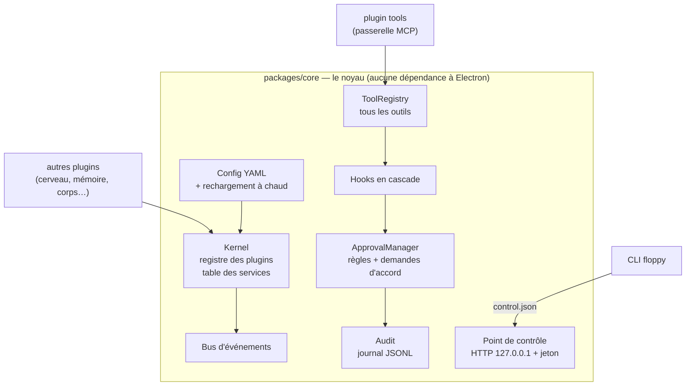
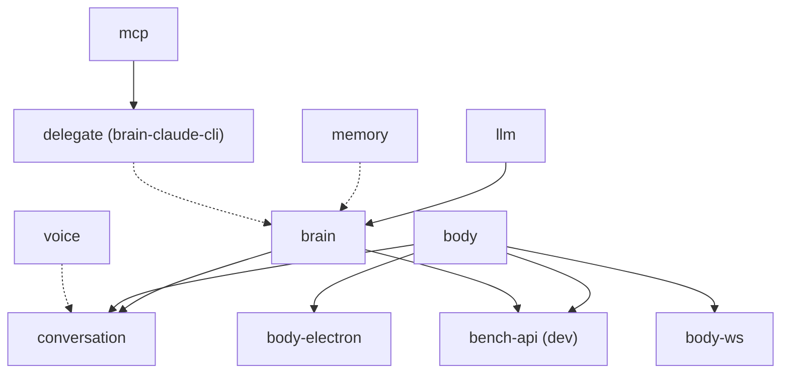
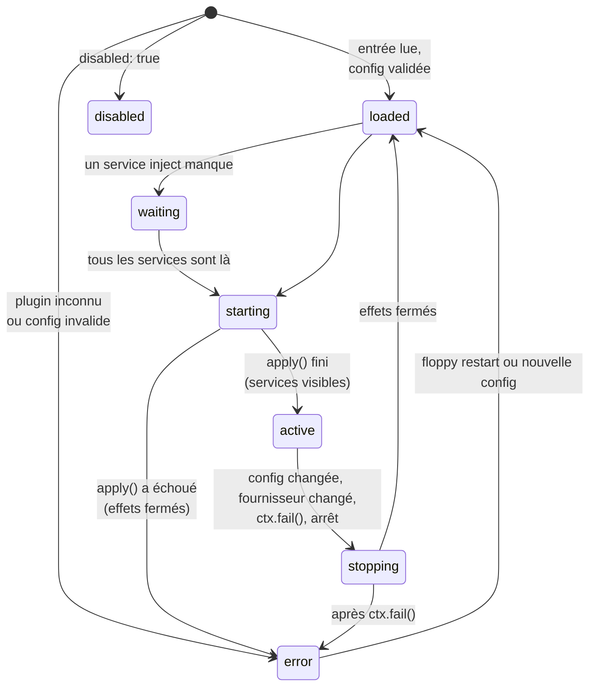
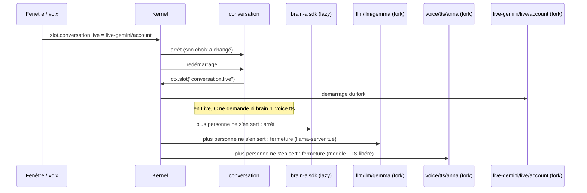
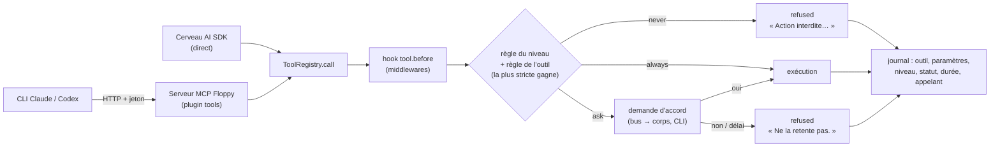
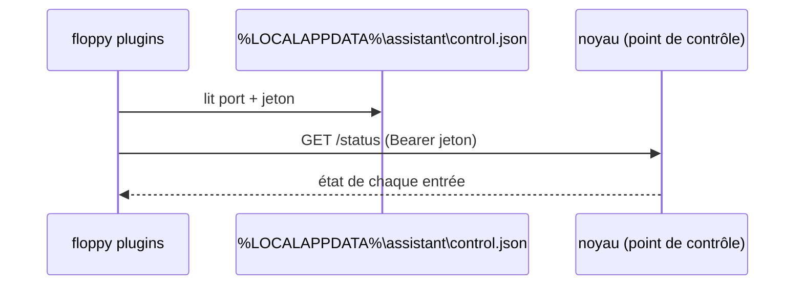

# Le noyau (implémenté)

[← Retour à la spec](README.md)

État : **fait** (phases P0 à P2 du plan du proto, 5 novembre 2026). Code : `assistant\packages\core`, `assistant\plugins\tools`, `assistant\apps\cli`.

Cette page décrit ce qui **existe dans le code**. [Architecture](architecture.md) décrit la cible.

## Vue d'ensemble



## Les plugins, rangés par famille

```
assistant/plugins/
  brain/aisdk  brain/claude-cli     voice/listen      memory/local     conversation/default
  body/hub  body/electron  body/ws  body/reachy       llm/llamacpp  llm/openai
  tools/mcp  tools/orca  tools/browser  tools/websearch  tools/m365
  avatar/tv  avatar/pixel           assistant/coder   dev/bench-api
```

**Règle de frontière** : un plugin ne parle aux autres que par les contrats de `packages/core`. Il n'importe **jamais** un autre paquet de plugin (ni par son nom, ni par un chemin relatif, pas même un type). Testé : `packages/core/test/boundaries.test.ts`. C'est pourquoi les contrats `mcp`, `body` et `avatars` (et `defineAvatar`) vivent dans le noyau (`services.ts`, `avatars.ts`).

Le nom du paquet ne dépend pas du dossier (`@floppy/plugin-brain-aisdk`…). Une entrée de la config choisit un plugin par l'id de son manifeste (`plugin: brain-aisdk`). La liste des plugins connus : `apps/cli/src/catalog.ts`.

Depuis le 6 novembre 2026 : `tasks/scheduler`, `display/documents`, `veille/digest`, `tools/searxng`. Voir [Tâches](taches.md), [Documents](documents.md), [Veille](veille.md).

## Les services (contrats)

Les contrats sont dans `packages/core/src/services.ts`. Un plugin fournit ou utilise un service par son nom ; il ne connaît jamais le plugin d'en face.

| Service | Contrat | Fournisseurs |
|---|---|---|
| `llm` | `{ baseURL, model }`, et si le fournisseur sait changer de modèle : `models`, `current`, `switch(id)` | `llm-llamacpp` |
| `llmRemote` | `models()` : modèles distants **actifs** (API au format OpenAI, clé lue à chaque appel dans le coffre) ; `onChange(fn)` | `llm-openai` |
| `brain` | `run({ texte, session, corps d'origine, voix/texte })` → flux d'événements (texte, émotion, outil, délégation, fin) ; `reset(session)` ; facultatifs : `label`, `aliases` (comment l'oral le désigne), `enabled()` | `brain-aisdk`, `brain-claude-cli` |
| `delegate` | même contrat que `brain` (avec `label` et `aliases` : « Claude Sonnet », « claude », « sonnet ») | `brain-claude-cli` |
| `memory` | `snapshot()`, `record()`, `search()` | `memory` |
| `voice` | `open(corps)` → flux : `pushAudio`, `speak` (facultatif), `cancel`, `setSpeaking`, `ptt`, événements (vad, transcript, merge, barge_in, audio…) | `voice-listen` |
| `vad` / `stt` | détecteur de parole (`open` → `push`) ; transcription (`transcribe`) — voir [ecoute.md](ecoute.md) | `stt-sherpa` |
| `tts` | `voices()`, `speak(texte, { voice, signal })` → flux PCM16 mono avec taux ; absent : voix locale | `tts-gemini`, `tts-elevenlabs` |
| `live` | `open({ corps, instructions, outils, signal, on })` → session audio, transcriptions, fonctions / délégation ; `close()` | `live-gemini`, `live-openai` |
| `body` | `attach(transport, { id, name, managed })`, `sessions`, `has`, `send`, `sendAudio`, `broadcast`, `on` | `body-hub` |
| `avatars` | `register(avatar)` (rend de quoi le retirer), `list()` | `body-electron` |
| `mcp` | `{ url, token }` du serveur MCP Floppy ; `scoped({ tools })` : accès restreint à quelques outils | `tools` |
| `coder` | `agents()` (Claude, Codex : disponibles ou pas), `start`, `send`, `cancel`, `answerPermission`, `close`, `onEvent` : l'assistant IA de la fenêtre des réglages (voir [assistant-ia.md](assistant-ia.md)) | `coder` |



Trait plein : `inject` (obligatoire). Pointillé : `optional`.

## Un plugin

Un plugin est un module avec un **manifeste** et une fonction `apply(ctx, config)`.

```ts
export default definePlugin({
  manifest: { id: "llm-llamacpp", version: "0.1.0", licence: "MIT", provides: ["llm"] },
  config: z.object({ port: z.number().default(8080) }),     // validé avant apply
  apply(ctx, cfg) {
    // Le plugin est léger : il offre `llm` modèle par modèle. Chaque modèle choisi tourne dans un fork.
    ctx.offer("llm", {
      max: 1,                                                 // un seul modèle dans la mémoire du GPU
      items: () => models().map((m) => ({ id: m.id, label: m.label })),
      renamed: { gemma: "gemma-4-12b" },                      // facultatif : un choix gardé sur un ancien id suit le nouveau
      async start(f, id) {
        f.spawn(exe, argsFor(id));                            // effet du fork : tué quand le fork se ferme
        await ready();
        f.provide("llm", { baseURL: `http://127.0.0.1:${cfg.port}/v1`, model: id });
      },
    });
  },
});

// Le consommateur déclare le choix (slot) et lit l'élément choisi pendant apply :
definePlugin({
  manifest: { id: "brain-aisdk", lazy: true, provides: ["brain"],
    slots: [{ id: "brain.main", service: "llm", section: "cerveau", label: "Cerveau principal" }] },
  async apply(ctx) { const llm = await ctx.slot("brain.main"); /* … */ },
});
```

| Champ du manifeste | Rôle |
|---|---|
| `provides` | services fournis par `ctx.provide` |
| `slots` | choix d'éléments dont le plugin a besoin (`{ id, service, section, label, none?, display?, step? }`). Le noyau en fait un réglage `slot.<id>` (fenêtre, voix, CLI). `none` : choix facultatif. `display: "mode"` : interrupteur en haut de la rubrique. `step` : place dans la chaîne de la rubrique (voir [elements.md](elements.md)) |
| `lazy` | le plugin tourne seulement quand un plugin actif s'en sert (`inject` ou `ctx.use`), et s'arrête ensuite |
| `serviceSelection` | sélecteur d'une **entrée** fournisseur (`service.<nom>`), gardé pour les détecteurs de mot d'activation. Pour choisir un élément (modèle, voix, moteur Live), utiliser `slots` |
| `inject` | services obligatoires : sans eux, le plugin attend (état `waiting`). Un fournisseur `lazy` est démarré pour eux |
| `optional` | services facultatifs. Lus avec `ctx.maybe` : lien faible (jamais un plugin `lazy`, le plugin redémarre quand ils arrivent ou changent). Lus avec `ctx.use` : besoin réel, le fournisseur est démarré |
| `permissions` | ce que le plugin veut toucher. `exec` est **imposé** par `ctx.spawn` ; `approvals: "respond"` est imposé par `ctx.approvals` ; le reste (`fs.*`, `net`, `cloud`) est déclaratif (voir [Sécurité](securite.md#garde-fous-du-code)) |
| `sections` | rubriques de la fenêtre des réglages que le plugin apporte (voir [elements.md](elements.md#les-rubriques-déclarées-par-les-plugins)) |
| `addable` | le plugin est une « application » que l'utilisateur ajoute ou retire (voir [elements.md](elements.md)) |

Le manifeste est validé par un schéma zod au chargement. Invalide : l'entrée démarre en **erreur visible** (`manifeste invalide : …`).

Le `ctx` est la seule porte vers le noyau :

| Méthode | Rôle |
|---|---|
| `provide`, `get`, `maybe` | fournir un service, lire un service déclaré (refus sinon) |
| `use(service)` | pendant `apply` : demander un service déclaré ; le démarre s'il est en veille (`lazy`). Ne pas l'appeler = ne pas en avoir besoin |
| `slot(id)` | pendant `apply` : service de l'élément choisi pour un slot du manifeste ; son fork démarre à la demande. `undefined` : « aucun », ou élément indisponible |
| `offer(service, { items, max?, start })` | offrir un service élément par élément. `start(f, item)` tourne dans un **fork** (son propre `ctx`, ses effets) et doit appeler `f.provide` |
| `effect`, `spawn`, `interval`, `timeout` | tout ce qui est ouvert est fermé au déchargement, dans l'ordre inverse |
| `on`, `emit` | bus d'événements (désabonnement automatique) |
| `hook`, `runHook` | middlewares en cascade avec `next()` |
| `tools.register / list / call` | registre d'outils du noyau ; `register` rend une fonction pour retirer ces outils plus tôt (un corps qui se débranche) ; tout est retiré au déchargement |
| `settings.declare / saved` | réglages modifiables à la voix ou par la CLI (voir [Réglages à la voix](reglages.md)) |
| `items.declare / store / status…` | éléments de la fenêtre des réglages (voir [elements.md](elements.md)) |
| `secrets` | coffre des secrets, **cloisonné** : seuls les noms `<id du manifeste>/…` |
| `home` | dossier de données (`%LOCALAPPDATA%assistant`) |
| `approvals` | `check` pour tous ; `respond` et `pending` seulement avec `permissions.approvals: "respond"` |
| `audit` | journal |
| `spawn` | refuse un programme absent de `permissions.exec` |
| `fail(raison)` | panne : le plugin s'arrête et passe en erreur visible (une seule erreur, même pendant `apply`) |

## Cycle de vie



Règles (toutes testées dans `packages/core/test/kernel.test.ts`) :

1. Une entrée démarre quand tous ses services `inject` ont un fournisseur **actif**. L'ordre dans la config ne compte pas.
2. Un service est visible seulement **après** la fin de `apply()`.
3. Arrêter un fournisseur arrête **d'abord** ses dépendants. Ils repassent en attente, puis redémarrent dès qu'un fournisseur revient.
4. Si le fournisseur choisi change (`services: { brain: … }`), seuls ses dépendants redémarrent.
5. Changer la config d'une entrée redémarre cette entrée et ses dépendants, rien d'autre.
6. Un service manquant, une config invalide ou une panne sont **toujours visibles** (`floppy plugins`, événement `plugin.state`).
7. Toutes les opérations passent par une **file** : jamais deux changements d'état en même temps.
8. `ctx.provide` n'est permis que **pendant** `apply()`. Après, il lève une erreur (un service ne devient jamais visible en silence).
9. `ctx.fail()` pendant `apply()` ferme les effets et donne **une seule** erreur (la raison donnée). Après le démarrage, il arrête le plugin et le passe en erreur.

Règles « à la demande », comme dans Cordis (toutes testées dans `packages/core/test/on-demand.test.ts`) :

10. **Ce qui ne sert à personne ne tourne pas.** Un plugin `lazy` démarre quand un plugin actif en a besoin (`inject`, `ctx.use`) et s'arrête quand plus personne ne s'en sert.
11. **Un élément choisi tourne dans un fork.** Le fork (clé `<entrée>/<service>/<élément>`) démarre quand son consommateur lit le slot (`ctx.slot`), et se ferme quand plus personne ne s'en sert. Deux slots sur le même élément partagent un fork.
12. **Changer un choix redémarre le consommateur** sur le nouvel élément. Avec `max: 1`, l'ancien fork est fermé **avant** que le nouveau démarre (mémoire du GPU). Un élément qui ne démarre pas : le choix revient à l'ancien, et le refus est visible.
13. **Aucun plugin n'allume ni n'éteint un autre plugin.** Le noyau le fait, d'après les besoins déclarés. Exemple : il n'y a plus de `setActive` pour libérer le LLM local en mode Live.

Limite connue : deux slots qui choisissent deux éléments différents d'une offre `max: 1` se disputent la place (le noyau s'arrête après 1 000 tours avec une erreur claire).

Règles « le noyau ne se bloque jamais » (toutes testées dans `packages/core/test/resilience.test.ts`) :

14. **Délais.** `apply` a 60 s au plus (`manifest.startTimeout_s` le change), le `start` d'un fork 600 s (`OfferDef.startTimeout_s`). Le temps passé à attendre un autre plugin (`ctx.use`, `ctx.slot`) ne compte pas. Au-delà, l'entrée passe en erreur et ce qu'elle a ouvert est fermé. Chaque fermeture a 10 s au plus : au-delà, elle est abandonnée (une ligne au journal) et les suivantes tournent.
15. **Un démarrage annulé n'est plus attendu.** `ctx.fail` pendant `apply`, un délai dépassé, l'arrêt de Floppy ou un nouveau choix pour le même slot : le noyau cesse d'attendre `apply` (le code du plugin continue peut-être, mais son contexte est fermé). Choisir un autre élément pendant qu'un modèle charge annule donc ce chargement.
16. **Contexte fermé = contexte inerte.** Après l'arrêt, `emit` est ignoré ; `tools.call`, `settings.change`, `items.run`, `runHook`, `tasks.run` et `downloads.start` sont refusés ; `approvals.check` rend un refus. Chaque refus est écrit une fois au journal, au nom du plugin. Les demandes d'accord d'un plugin sont annulées à son arrêt.
17. **Pannes attribuées.** Le code d'un plugin (apply, start, écouteurs, middlewares, minuteries, outils) tourne au nom de son entrée (`AsyncLocalStorage`). Le filet global rend l'erreur à ce plugin : une exception non rattrapée le met en panne ; une promesse rejetée non suivie est seulement notée. Une minuterie (`ctx.interval`, `ctx.timeout`) qui plante est notée, sans panne. Un middleware qui plante est sauté et noté ; la chaîne continue.
18. **Reprise automatique.** Une entrée ou un fork en panne (pas une config invalide, pas un démarrage annulé exprès) repart après 5 s, 30 s, puis 2 min. Ensuite l'erreur reste visible jusqu'à une relance à la main ou un nouveau choix. Une entrée restée active plus d'une minute avant sa panne repart avec tous ses essais. Pour un fork, ceux qui le voulaient (slot) repartent pour le redemander.
19. **Emprunts.** Un élément emprunté (`ctx.borrow`, `ctx.borrowItem`) qui s'arrête prévient l'emprunteur (`lost`) et rend sa place. Exemple : l'écoute réemprunte la transcription tombée en panne, sans fermer les flux ouverts.

Les plugins qui lancent un serveur local (llama-server, audio.cpp) le surveillent une fois prêt (`watchHealth` : `/health` toutes les 30 s ; après 3 échecs d'affilée, `ctx.fail`), et la reprise automatique le relance. La conversation arrête un tour quand le cerveau se tait plus de `turn_idle_s` (300 s par défaut) et le dit. Une tâche qui ignore le signal d'arrêt n'est plus attendue 10 s après l'arrêt.

### Exemple : passer en mode Live



## La config

```yaml
assistant: { name: Floppy, language: fr, wake_words: [floppy, flopy] }
approvals: { read: always, write: ask, send: ask, delete: ask, physical: ask, timeout_s: 90 }
services: { brain: brain }          # facultatif : choix du fournisseur si plusieurs
plugins:
  - { id: tools, plugin: tools, config: { … } }
  - { id: brain, plugin: brain-aisdk, disabled: false, config: { … } }
```

- Validée par schéma (zod). Un id en double est refusé.
- Le fichier est **surveillé** : une nouvelle version valide est appliquée ; une version invalide est signalée et ignorée. Le noyau surveille le **dossier** du fichier (pas le fichier seul), pour survivre aux éditeurs qui remplacent le fichier à chaque enregistrement.
- Changer `assistant` (nom, langue, mots d'activation) redémarre tous les plugins.

## Outils, niveaux et accords

**Tout appel d'outil passe par `ToolRegistry.call`**, quel que soit le cerveau : agent AI SDK en direct, ou CLI Claude/Codex par le serveur MCP Floppy.



| Niveau | Règle par défaut |
|---|---|
| `read` | `always` |
| `write`, `send`, `delete`, `physical` | `ask` |

- Niveau d'un outil MCP : **config** (nom exact, puis motif `write_*`) > **annotations MCP** (`readOnlyHint` → read, `destructiveHint` → delete) > **inconnu = write**.
- `never` dans la config d'un serveur interdit l'outil sans même demander (exemple : `write_*` sur le coffre Obsidian).
- Statuts d'un résultat : `done`, `unverified`, `failed`, `refused`.
- Un plugin demande un accord par `ctx.approvals.check`. Seuls `body-hub`, `conversation` et `bench-api` peuvent répondre (`permissions.approvals: "respond"`) ; voir [Sécurité](securite.md#laccord).
- La demande d'accord a un **id secret** (UUID) et une durée de vie. Le modèle ne le voit jamais. Seuls les corps (bus) et la CLI répondent. **La première réponse gagne**, les suivantes sont ignorées.

Testé (`plugins/tools/test/tools.test.ts`) : une écriture refusée ou sans réponse **n'atteint jamais** le serveur MCP ; sans jeton, le serveur MCP Floppy répond 401 ; un serveur MCP cassé au démarrage n'empêche pas les autres.

## Le plugin `tools` (passerelle MCP)

- Lance chaque serveur MCP de l'utilisateur en **stdio, hors processus**, avec un environnement réduit.
- `exclude` masque des outils d'un serveur (exemple : le faux `ouvrir_url` du banc quand le plugin `browser` fournit le vrai).
- Ajoute ses outils au registre, avec leur niveau.
- Si un serveur s'arrête tout seul : **seul son connecteur** passe en erreur (« le serveur s'est arrêté : … »), avec une ligne au journal (`mcp.server_down`). Le plugin `tools` et les autres connecteurs continuent. Ce n'est pas un `ctx.fail()`.
- Connexion à un serveur : délai de 30 s. Les connecteurs se branchent **après** `apply`, en arrière-plan : le service `mcp` est visible tout de suite, et un connecteur lent ne retarde ni le démarrage ni les cerveaux CLI. `mcp.connected()` est tenue quand ils ont tous fini (réussis ou non).
- Ouvre le **serveur MCP Floppy** (`127.0.0.1`, port 8740 par défaut, jeton nouveau à chaque démarrage) et fournit le service `mcp` = `{ url, token }` pour les cerveaux CLI.

## La CLI et le point de contrôle



| Commande | Rôle |
|---|---|
| `floppy start [--config f]` | démarre le noyau (Node 24) |
| `floppy plugins` | état de chaque entrée (● actif, ◌ attend, ✖ erreur, – désactivé) |
| `floppy log [n]` | journal d'audit |
| `floppy approvals`, `floppy approve <id> [--no]` | voir et répondre aux demandes d'accord |
| `floppy restart <id>`, `floppy reload` | relancer une entrée, relire la config |
| `floppy settings`, `floppy set <clé> <valeur>`, `floppy undo` | réglages |
| `floppy chat` | un corps texte au clavier, branché par `body-ws` (comme Telegram) |

## Résilience

Une pièce qui casse ne doit pas arrêter tout Floppy. Ce qui existe (testé dans `packages/core/test/files.test.ts`, `safety.test.ts`, `children.test.ts`, `audit.test.ts` et `apps/desktop/test/lifecycle.test.ts`) :

| Panne | Ce que fait Floppy |
|---|---|
| Plantage pendant l'écriture d'un fichier de l'utilisateur (`settings.json`, `items/*.json`, `tasks.json`, `onboarding.json`, préférences de la veille, `MEMORY.md`) | Écriture dans un fichier temporaire puis renommage (`writeFileAtomic`) : l'ancien fichier reste entier. |
| Fichier illisible au démarrage | Il est renommé en `<nom>.corrupt-<date>` et signalé dans le journal (`readJsonFile`). Il n'est jamais écrasé par la sauvegarde suivante. |
| Erreur asynchrone oubliée par un plugin | Le filet global (`installSafetyNet`, posé par `boot`) l'écrit au journal ; le noyau continue. Au-delà de 20 exceptions en 60 s, le noyau s'arrête et l'hôte le relance. |
| Noyau tué de force (llama-server ou la voix locale restent en vie) | `ctx.spawn` note chaque programme dans `<home>/children.json`. Au démarrage suivant, ceux qui tournent encore **sous le même nom** sont arrêtés. Un programme fini tout seul est retiré de la liste et des fermetures du plugin. |
| Le noyau s'arrête dans l'app | Relance après 2 s, 5 s, 15 s puis 60 s. Au bout de 5 arrêts en 2 minutes, plus de relance : l'icône montre la raison (envoyée par le noyau quand le démarrage échoue, par exemple un `floppy.yml` invalide). « Relancer le noyau » repart de zéro. |
| Une fenêtre de l'app plante | Elle est rechargée après 1 s ; au-delà de 3 pannes en 5 minutes, elle est laissée. |
| Journaux | Chaque ligne du journal du noyau porte l'heure et le niveau. `kernel.log` et `audit.jsonl` passent à `*.1.*` au-delà de 20 Mo. Une écriture d'audit impossible (disque plein) est signalée, et l'action continue. |
| Démarrage lent | Le point de contrôle de la CLI s'ouvre avant la config : `floppy plugins` répond pendant qu'un modèle se charge. |

## Le répertoire de travail

Un seul dossier pour tout ce que Floppy garde : la config `floppy.yml`, les réglages, les éléments, les modèles téléchargés, les espaces de travail des agents (`workspaces/<plugin>/…`), les plugins tiers (`plugins/`), les journaux (`kernel.log`, `audit.jsonl`). Code : `packages/core/src/util/home.ts`, testé dans `packages/core/test/home.test.ts`.

- **Par défaut** : `%LOCALAPPDATA%\floppy` (ailleurs : `$XDG_DATA_HOME/floppy`, sinon `~/.local/share/floppy`). `FLOPPY_HOME` passe avant tout (tests, mode debug, `--home`).
- **Le choisir** : fenêtre « Bienvenue » (première page, « Changer… ») ou Réglages → Général → « Répertoire de travail » (réglage `dossier_floppy`, avec « Parcourir… » ; pas à la voix). Le choix est noté dans un fichier pointeur qui reste au même endroit : `<dossier par défaut>/home.json`.
- **Changer de dossier** relance le noyau (événement `floppy.restart` : l'app relance le noyau ; la CLI s'arrête et le dit). Au démarrage suivant, avant d'ouvrir quoi que ce soit, les données sont déplacées (renommées sur le même disque, copiées puis effacées sur un autre). Un dossier qui contient déjà des données de Floppy est repris tel quel. Un chemin relatif, un dossier où l'on ne peut pas écrire, ou un dossier dans l'autre sont refusés.
- **La config** est `<dossier>/floppy.yml`, créée depuis `floppy.example.yml`. Une ancienne config à la racine du dépôt est copiée une fois (l'originale n'est plus lue). `FLOPPY_CONFIG` ou `--config` imposent un autre fichier.
- **Plugins** : `ctx.home` est ce dossier ; `ctx.workspace(nom)` rend `<dossier>/workspaces/<id du plugin>/<nom>` (créé). Les cerveaux CLI (Claude, Codex, Antigravity), l'assistant IA des réglages, ses relectures, la recherche web et les sessions d'agents y travaillent.
- L'app Electron et le worker Orca lisent le même pointeur pour trouver ce dossier (journal, pont).

## Le noyau dans l'app Electron (vérifié)

Spike `assistant\spikes\electron-utility` : Electron 45.2.3 embarque **Node 24.22.2**. Dans un `utilityProcess` : `node:sqlite` avec FTS5 marche, les processus enfants marchent, un fichier `.ts` est lancé directement, et le `MessagePort` avec le processus principal marche. Le même noyau tourne donc dans l'app et en ligne de commande.

## Licences

`npm run licences` : les dépendances **livrées** doivent être permissives (MIT, ISC, BSD, Apache-2.0…), sinon échec. Les outils de dev sont seulement signalés (exemple : `lightningcss`, MPL-2.0, tiré par vitest).
