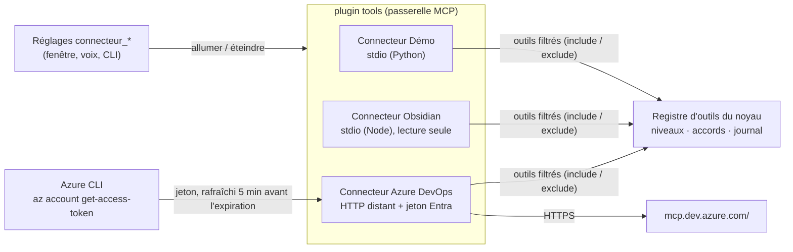
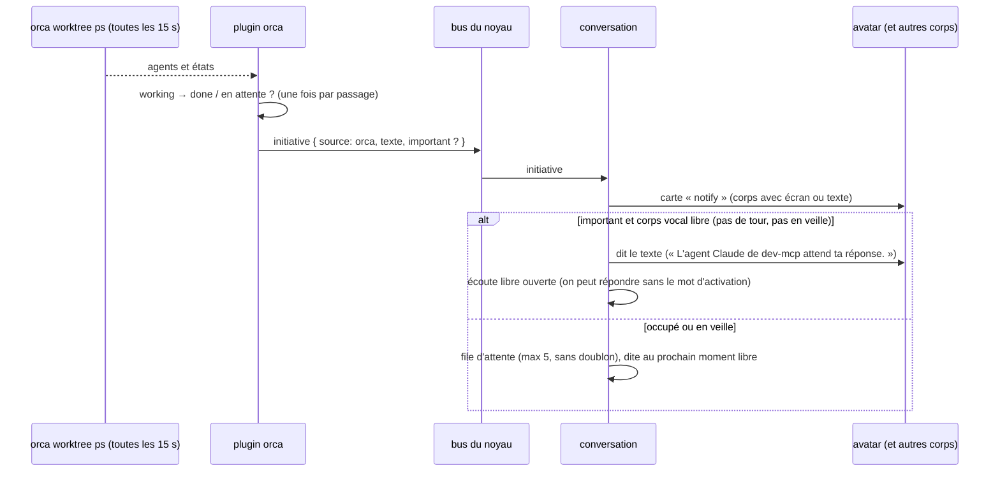
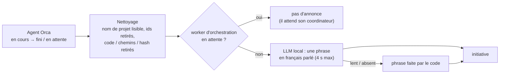

# Vrais outils : connecteurs, Azure DevOps, Orca, initiatives (implémenté)

[← Retour à la spec](README.md)

État : **fait** (5 novembre 2026). Code : `assistant\plugins\tools\mcp`, `assistant\plugins\tools\orca`, `assistant\plugins\conversation\default`.

## Les connecteurs (plugin `tools`)

Chaque serveur MCP est un **connecteur** qu'on allume ou éteint **sans redémarrer** (fenêtre des réglages, CLI, ou à la voix).

| Champ de config | Rôle |
|---|---|
| `command`, `args`, `env`, `cwd` | serveur local (stdio), lancé et arrêté par le noyau |
| `url`, `headers`, `auth: { type: azcli, resource }` | serveur distant (HTTP streamable) ; `azcli` prend un jeton Entra à Azure CLI, jamais écrit dans un fichier ni dans le journal |
| `label`, `cloud` | nom affiché ; `cloud: true` = l'allumer à la voix demande l'accord |
| `include`, `exclude` | outils exposés (noms ou motifs `*`) : garder le prompt de Gemma court |
| `levels` | niveau par outil (sinon : annotations MCP, sinon write) |

- Un serveur qui tombe met **seulement son connecteur** en erreur (ses outils sortent du registre, journal `mcp.server_down`) : les autres continuent.
- La description du réglage montre l'état réel : « connecté, 5 outils », « erreur : … », « éteint ».

### Azure DevOps distant

- Serveur MCP **distant** de Microsoft : `https://mcp.dev.azure.com/<organisation>`. Il demande un jeton Microsoft Entra (portée `https://mcp.dev.azure.com/.default`) ; Entra n'accepte pas l'inscription automatique d'un client, donc le jeton vient d'**Azure CLI** (`az login` déjà fait par l'utilisateur).
- 43 outils, bien annotés (26 lecture, 14 suppression, 3 écriture). Le proto en garde 5 (`include`) : `core_list_projects`, `repo_pull_request`, `pipelines_build`, `wit_work_item`, `search_workitem` (~3 700 jetons de descriptions, au lieu de ~12 000 pour les 43). llama.cpp les garde en cache d'un tour à l'autre.
- Testé : « sur Azure DevOps, quels sont les projets de l'organisation ? » → la vraie liste.

## Orca (plugin `orca`)

Orca gère les worktrees et les agents de code (Claude Code, Codex). Le plugin lit son état par la CLI `orca worktree ps --json` (lecture seule ; aucune commande qui crée, envoie ou modifie).

| Outil | Niveau | Rôle |
|---|---|---|
| `orca_agents(filtre)` | read | agents par espace de travail : en cours / terminé / en attente / interrompu, tâche, depuis quand, extrait du dernier message (≤ 1 500 caractères en tout) |
| `orca_detail(nom)` | read | dernier message complet d'un agent (recherche floue sur le nom, le dépôt, la tâche) |

- Testé : « fais-moi une synthèse de mes jobs Orca » → 3 phrases justes en 4,2 s (Gemma résume lui-même, sans délégation).

### Surveillance → initiatives

- Premier passage : on note seulement les états (pas d'annonce pour les jobs déjà finis au démarrage).
- Réglage `orca_notifications` : `toutes` (chaque fin est dite), `importantes` (par défaut : dite seulement si l'agent attend une réponse, sinon carte), `aucune`.
- Si l'utilisateur pose une question juste après (moins de 2 min), le cerveau reçoit la dernière annonce en contexte (« c'est quoi ce job ? »).
- Si Orca ne tourne pas : un seul avertissement au journal, puis le plugin réessaie sans bruit.
- **Pas encore vérifié en vrai** : aucun job Orca n'a fini pendant les essais. La logique est couverte par les tests (`plugins/tools/orca/test`, `plugins/conversation/default/test`).

### Annonces en langage parlé (`plugins/tools/orca/src/speech.ts`)

Les données d'Orca sont pleines de jargon : noms de worktree (`master-differendum`, `env-stg`), ids
(`worker-task_1bb07be677c3`), titres codés (`fo: bug SSR … + PR env-stg`), derniers messages en anglais avec hash de
commit et chemins.

| Avant | Après (Gemma, données réelles, ~0,5 s) |
|---|---|
| « L'agent Claude de master-differendum a terminé : Réponse aux commentaires dans les PR. » | « L'agent a fini de publier Differendum 1.0.19 et a validé toutes les étapes du déploiement. » |
| « L'agent Claude de env-stg attend ta réponse : fo: bug SSR bloc Custom Entity + PR env-stg. » | (worker d'orchestration : pas d'annonce) |
| « L'agent Claude de master-agents a terminé : Job 59776 en erreur. » | « Sur le projet Agents, le job 59776 est terminé et la version K8S est prête dans le code. » |

Le prompt interdit d'inventer : seulement ce qui est dans les informations données. Sans LLM : « Sur Differendum, ton
agent a fini : réponse aux commentaires dans les PR. »

## Initiatives en général

N'importe quel plugin peut émettre `initiative { source, text, importance, key }` sur le bus : rappels, build cassé, réunion proche… La conversation applique toujours les mêmes règles (voir [Fonctionnement → Initiatives](fonctionnement.md#initiatives)).
