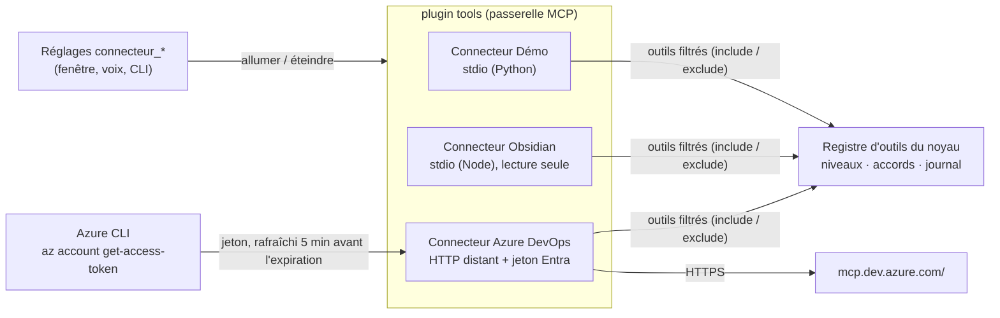
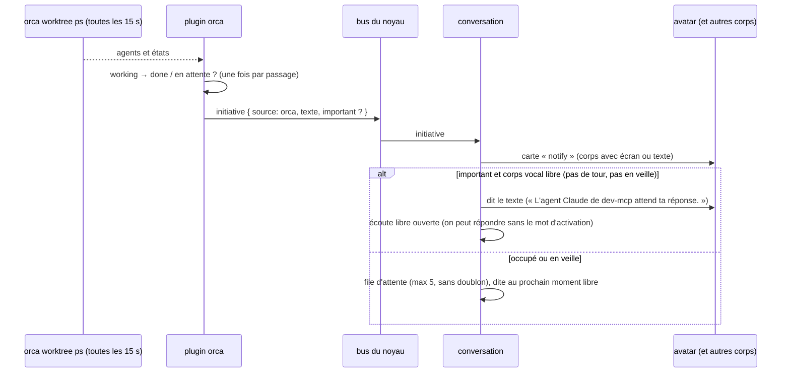
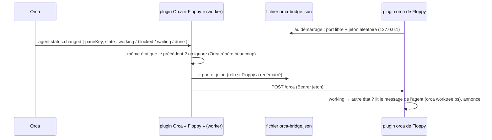
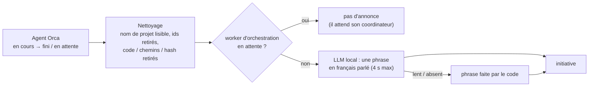

# Vrais outils : connecteurs, Azure DevOps, Orca, initiatives (implémenté)

[← Retour à la spec](README.md)

État : **fait** (5 novembre 2026). Code : `assistant\plugins\tools\mcp`, `assistant\plugins\tools\orca`, `assistant\plugins\conversation\default`.

## Les connecteurs (plugin `tools`)

Chaque serveur MCP est un **connecteur** qu'on allume ou éteint **sans redémarrer** (fenêtre des réglages, CLI, ou à la voix).

| Champ de config | Rôle |
|---|---|
| `command`, `args`, `env`, `cwd` | serveur local (stdio), lancé et arrêté par le noyau |
| `url`, `headers`, `auth: { type: azcli, resource }` | serveur distant (HTTP streamable) ; `azcli` prend un jeton Entra à Azure CLI, jamais écrit dans un fichier ni dans le journal |
| `label`, `cloud` | nom affiché ; `cloud: true` = l'allumer à la voix demande l'accord |
| `include`, `exclude` | outils exposés (noms ou motifs `*`) : garder le prompt de Gemma court |
| `levels` | niveau par outil (sinon : annotations MCP, sinon write) |

- Un serveur qui tombe met **seulement son connecteur** en erreur (ses outils sortent du registre, journal `mcp.server_down`) : les autres continuent.
- La description du réglage montre l'état réel : « connecté, 5 outils », « erreur : … », « éteint ».

### Azure DevOps distant

- Serveur MCP **distant** de Microsoft : `https://mcp.dev.azure.com/<organisation>`. Il demande un jeton Microsoft Entra (portée `https://mcp.dev.azure.com/.default`) ; Entra n'accepte pas l'inscription automatique d'un client, donc le jeton vient d'**Azure CLI** (`az login` déjà fait par l'utilisateur).
- 43 outils, bien annotés (26 lecture, 14 suppression, 3 écriture). Le proto en garde 5 (`include`) : `core_list_projects`, `repo_pull_request`, `pipelines_build`, `wit_work_item`, `search_workitem` (~3 700 jetons de descriptions, au lieu de ~12 000 pour les 43). llama.cpp les garde en cache d'un tour à l'autre.
- Testé : « sur Azure DevOps, quels sont les projets de l'organisation ? » → la vraie liste.

## Orca (plugin `orca`)

Orca gère les worktrees et les agents de code (Claude Code, Codex). Le plugin lit son état par la CLI `orca worktree ps --json`, `orca terminal list --json` et `orca terminal read --screen --json` (lecture seule ; aucune commande qui crée, envoie, modifie ou change l'affichage d'Orca).

**But : informer sans changer de contexte.** Floppy ne répond pas aux agents et ne bascule pas l'affichage d'Orca. Il donne assez de détails pour que l'utilisateur décide (oui ou non) sans quitter ce qu'il fait.

| Outil | Niveau | Rôle |
|---|---|---|
| `orca_agents(filtre)` | read | agents par espace de travail : en cours / terminé / en attente / interrompu, tâche, depuis quand, extrait du dernier message (≤ 1 500 caractères en tout) |
| `orca_detail(nom?)` | read | fiche d'un agent : état, branche, PR liée, note du worktree, demande, action en cours (outil et commande), dernier message complet. Recherche floue sur le worktree, le dépôt, la branche, la tâche ; les agents qui attendent passent en premier |
| `orca_ecran(nom?)` | read | ce que montre le terminal de l'agent (60 lignes de l'écran rendu, sans lignes de cadre, ≤ 2 000 caractères) : question exacte, permission demandée, choix proposés |
| `orca_recherche(texte, recent?)` | read | recherche plein texte dans les conversations des agents (tous projets, `orca search --scope conversation`, 5 résultats) : titre, agent, projet, branche, date, extrait et qui parle (l'utilisateur ou l'agent). `recent` : les plus récentes d'abord |

- **Sans nom**, `orca_detail` et `orca_ecran` visent l'agent annoncé en dernier ; sinon le seul agent qui attend (hors workers d'orchestration) ; sinon ils demandent lequel. Exemple : « Sur Differendum, ton agent attend » → « qu'est-ce qu'il demande exactement ? ».
- **Terminal d'un agent** : le `paneKey` d'un agent vaut `tabId:leafId` d'un terminal ; à défaut, un terminal du même worktree. L'identifiant de terminal rendu par Orca est le seul argument variable d'une commande ; il doit ressembler à `term_…` (lettres, chiffres, tirets), sinon il est ignoré. Le texte de l'utilisateur n'entre jamais dans une commande.
- **Noms dictés** : la reconnaissance vocale déforme les noms techniques (« différend dom » pour `differendum`, « dev m c p » pour `dev-mcp`). La recherche d'agent compare sans espaces ni tirets, puis tolère quelques fautes (distance d'édition ≤ un quart du mot). Elle compare aussi les mots que Floppy a dits dans l'annonce (nom de projet lisible, tâche nettoyée). Une correspondance exacte passe avant une ressemblance. Le cerveau passe le nom tel qu'il l'a entendu, sans le corriger.
- **Recherche** (`orca_recherche`, `src/search.ts`) : Orca indexe les conversations seulement si l'utilisateur l'a allumé dans Orca (Réglages → « Agent Session History » ; pas de commande pour l'allumer). Éteinte : l'outil dit où l'allumer. Index en cours (`orca search --index-status`, phase `indexing`) : l'outil prévient qu'il peut manquer des résultats.
  - Recherche plein texte, sans tolérance aux fautes : la description demande au cerveau d'écrire les termes techniques dans leur orthographe probable (« réacte » → « React »), à l'inverse des noms d'agents.
  - Le texte de l'utilisateur est **un seul argument** de `orca.exe` (`--query <texte>`), jamais dans un shell : une ligne, sans tiret en tête (il serait lu comme une option), 200 caractères au plus. Si le programme trouvé est un `.cmd` (lancé par `cmd.exe`), l'outil refuse.
  - Vérifié en vrai (7 novembre 2026) : réponse en 0,26 s.

- Testé : « fais-moi une synthèse de mes jobs Orca » → 3 phrases justes en 4,2 s (Gemma résume lui-même, sans délégation).

### Surveillance → initiatives

- Premier passage : on note seulement les états (pas d'annonce pour les jobs déjà finis au démarrage).
- Réglage unique `orca_notifications` (« Annonces des agents Orca ») : `toutes` « Tout dire » (chaque fin est dite), `importantes` « Si un agent attend » (par défaut : dite seulement si l'agent attend une réponse, sinon carte écrite), `aucune` « Rien » (plus de surveillance du tout : ni vérification, ni pont ; les outils restent). L'ancien réglage `orca_surveillance` (et `surveillance: false` dans la config) n'est plus montré : coupé, il vaut « Rien » tant que l'utilisateur n'a rien choisi dans le nouveau réglage.
- Si l'utilisateur pose une question juste après (moins de 2 min), le cerveau reçoit la dernière annonce en contexte (« c'est quoi ce job ? »).
- Si Orca ne tourne pas : un seul avertissement au journal, puis le plugin réessaie sans bruit.
- **Pas encore vérifié en vrai** : aucun job Orca n'a fini pendant les essais. La logique est couverte par les tests (`plugins/tools/orca/test`, `plugins/conversation/default/test`).

### Pont : Orca prévient Floppy aussitôt (`plugins/tools/orca/orca-plugin`)

La vérification régulière annonce une fin avec jusqu'à 15 s de retard. Un plugin Orca (« Floppy », worker Node) reçoit
chaque changement d'état d'un agent (`agent.status.changed`) et le transmet aussitôt à Floppy.

- **Installation : bouton « Installer dans Orca »** (Réglages → Connecteurs → Orca ; `src/install.ts`). Guide utilisateur : [docs/guide/orca.md](../guide/orca.md).
  1. Orca doit répondre (`orca plugin list`), sinon : « Ouvre Orca ».
  2. Met `orca-plugin/` dans `<dossier de Floppy>/orca-plugin` (un chemin stable, hors du dépôt), après le `dev unload` : fichier par fichier, sans supprimer le dossier. Sous Windows, un dossier surveillé par Orca ne se supprime pas (`EIO`), mais ses fichiers se remplacent. Les anciens fichiers sont retirés ; `.orca/` (typages d'Orca) est gardé. Échec de copie : message clair (« Ferme Orca, puis réessaie »).
  3. (fait avant la copie) `orca plugin dev unload local.floppy` : retire le dossier de dev de même clé (la copie actuelle ou celui du dépôt), Orca lâche le dossier.
  4. `orca plugin dev load <copie>`. Orca répond `approval_required` avec l'empreinte et l'accès demandé.
  5. Le clic vaut accord, **seulement si** l'accès est exactement celui prévu : clé `local.floppy`, `trusted-worker`, une seule capacité `agent:read`, seule contribution l'événement `agent.status.changed`. Sinon rien n'est autorisé et le bouton le dit. Puis `dev load <copie> --approve <empreinte>`.
  - Libellé : « Installer » (pas de copie), « Mettre à jour » (copie différente du plugin livré : empreinte SHA-256 des fichiers, hors `.orca/` où Orca écrit ses typages), sinon « Réinstaller ». Pont pas en direct et pas de copie : l'état dit « plugin Orca à installer ».
  - Bouton : clic seulement (une demande à la voix est refusée par le noyau). Le chemin de la copie passe dans une ligne de commande : refusé s'il contient `" % ! ^` ou un retour à la ligne.
  - À la main (développement) : `orca plugin dev load plugins/tools/orca/orca-plugin`, puis la même commande avec `--approve <empreinte>`. Orca recharge un dossier de dev quand ses fichiers changent, sans nouvel accord tant que l'accès ne change pas.
- **Dossier de Floppy vu d'Orca** : `FLOPPY_HOME`, sinon `LOCALAPPDATA/floppy`, sinon (Windows) `~/AppData/Local/floppy`, sinon `~/.local/share/floppy`. Orca lance ses workers **sans** `LOCALAPPDATA` : d'où le chemin Windows écrit en dur à partir du dossier personnel.
- **Orca démarre le worker au premier événement**, pas au lancement. Floppy passe « en direct » au premier message reçu.
- **Pont en direct** (un message depuis moins de 10 min) : la vérification régulière tombe à une par minute (filet de sécurité). État affiché : « prévenu tout de suite (plugin Orca actif) » ; sinon « vérifie toutes les N s » (+ « installe le plugin Orca… » si pas de copie) ; « annonces coupées » si le réglage vaut « Rien ».
- **Pont et vérification tiennent le même tableau d'états** ; le premier qui voit une fin l'annonce. Un état reçu du pont gagne 30 s sur la vérification, qui peut lire un état plus ancien. La clé d'annonce est le type d'état (`orca:<worktree>:<pane>:termines`), donc la même fin vue deux fois n'est dite qu'une fois (anti-doublon de la conversation, 10 min).
- **États** : `working` → en cours ; `blocked`, `waiting` → en attente (annonce importante) ; `done` → terminé, ou interrompu si `outcome` vaut `interruption` / `cancellation`.
- **Sécurité** : 127.0.0.1 seulement, jeton comparé en temps constant, corps ≤ 64 Kio, JSON objet, chaque champ vérifié. Le contenu reste une donnée (jamais une consigne).
- **Floppy arrêté** : le worker échoue sans bruit et écrit une seule ligne au journal d'Orca, avec les fichiers essayés (`orca plugin logs local.floppy`). Un fichier `orca-bridge.json` oublié est sans danger : le worker relit le fichier à chaque échec.
- **Vérifié en vrai** (6 novembre 2026) : un événement « bloqué » envoyé par Orca (`orca plugin dev emit`) devient une annonce importante dans Floppy en environ 0,5 s, lancement de la commande compris.

### Annonces en langage parlé (`plugins/tools/orca/src/speech.ts`)

Les données d'Orca sont pleines de jargon : noms de worktree (`master-differendum`, `env-stg`), ids
(`worker-task_1bb07be677c3`), titres codés (`fo: bug SSR … + PR env-stg`), derniers messages en anglais avec hash de
commit et chemins.

| Avant | Après (Gemma, données réelles, ~0,5 s) |
|---|---|
| « L'agent Claude de master-differendum a terminé : Réponse aux commentaires dans les PR. » | « L'agent a fini de publier Differendum 1.0.19 et a validé toutes les étapes du déploiement. » |
| « L'agent Claude de env-stg attend ta réponse : fo: bug SSR bloc Custom Entity + PR env-stg. » | (worker d'orchestration : pas d'annonce) |
| « L'agent Claude de master-agents a terminé : Job 59776 en erreur. » | « Sur le projet Agents, le job 59776 est terminé et la version K8S est prête dans le code. » |

Le prompt interdit d'inventer : seulement ce qui est dans les informations données. Sans LLM : « Sur Differendum, ton
agent a fini : réponse aux commentaires dans les PR. »

## Initiatives en général

N'importe quel plugin peut émettre `initiative { source, text, importance, key }` sur le bus : rappels, build cassé, réunion proche… La conversation applique toujours les mêmes règles (voir [Fonctionnement → Initiatives](fonctionnement.md#initiatives)).
