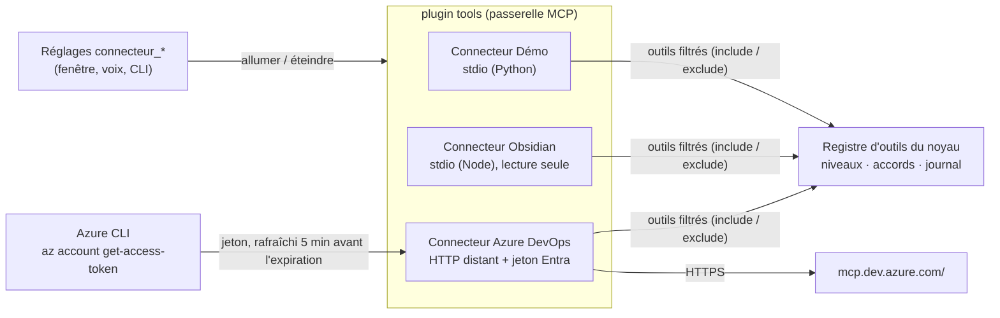
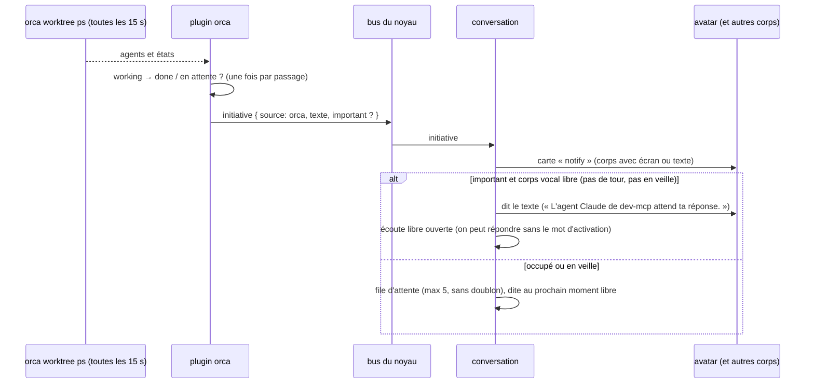
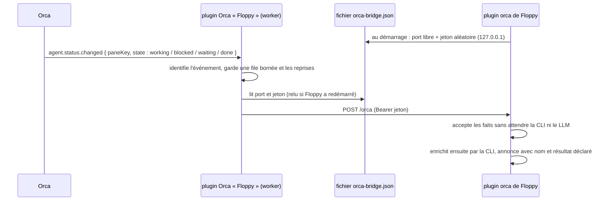
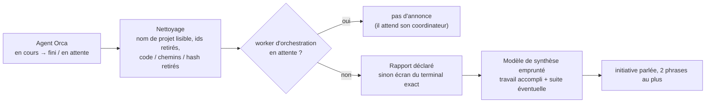

# Vrais outils : connecteurs, Azure DevOps, Orca, initiatives (implémenté)

[← Retour à la spec](README.md)

État : **fait** (5 novembre 2026). Code : `assistant\plugins\tools\mcp`, `assistant\plugins\tools\orca`, `assistant\plugins\conversation\default`.

## Les connecteurs (plugin `tools`)

Chaque serveur MCP est un **connecteur** qu'on allume ou éteint **sans redémarrer** (fenêtre des réglages, CLI, ou à la voix).

| Champ de config | Rôle |
|---|---|
| `command`, `args`, `env`, `cwd` | serveur local (stdio), lancé et arrêté par le noyau |
| `url`, `headers`, `auth: { type: azcli, resource }` | serveur distant (HTTP streamable) ; `azcli` prend un jeton Entra à Azure CLI, jamais écrit dans un fichier ni dans le journal |
| `label`, `cloud` | nom affiché ; `cloud: true` = l'allumer à la voix demande l'accord |
| `include`, `exclude` | outils exposés (noms ou motifs `*`) : garder le prompt de Gemma court |
| `levels` | niveau par outil (sinon : annotations MCP, sinon write) |

- Un serveur qui tombe met **seulement son connecteur** en erreur (ses outils sortent du registre, journal `mcp.server_down`) : les autres continuent.
- La description du réglage montre l'état réel : « connecté, 5 outils », « erreur : … », « éteint ».

### Azure DevOps distant

- Serveur MCP **distant** de Microsoft : `https://mcp.dev.azure.com/<organisation>`. Il demande un jeton Microsoft Entra (portée `https://mcp.dev.azure.com/.default`) ; Entra n'accepte pas l'inscription automatique d'un client, donc le jeton vient d'**Azure CLI** (`az login` déjà fait par l'utilisateur).
- 43 outils, bien annotés (26 lecture, 14 suppression, 3 écriture). Le proto en garde 5 (`include`) : `core_list_projects`, `repo_pull_request`, `pipelines_build`, `wit_work_item`, `search_workitem` (~3 700 jetons de descriptions, au lieu de ~12 000 pour les 43). llama.cpp les garde en cache d'un tour à l'autre.
- Testé : « sur Azure DevOps, quels sont les projets de l'organisation ? » → la vraie liste.

## Orca (plugin `orca`)

Orca gère les worktrees et les agents de code (Claude Code, Codex). Le plugin lit son état par la CLI `orca worktree ps --json`, `orca terminal list --json` et `orca terminal read --screen --json`. Il peut aussi transmettre une consigne à un agent ouvert par `orca terminal send --text … --enter --json`, après le contrôle d'accord du noyau.

**But : suivre et relancer ses agents sans changer de contexte.** Floppy informe l'utilisateur et transmet les consignes qu'il demande, sans basculer l'affichage d'Orca.

| Outil | Niveau | Rôle |
|---|---|---|
| `orca_agents(filtre?, projet?, depuis?, offset?, limite?)` | read | liste individuelle nommée, ordonnée et paginée ; activité, résultat déclaré et présence séparés ; texte borné à environ 1 500 caractères, références typées et prochaine page en `raw` |
| `orca_detail(nom?/id?)` | read | fiche d'un agent : mission, activité, présence, résultat déclaré borné, branche, PR, action en cours, date d'observation et provenance ; noms dictés, identifiants, ordinaux et pronoms par conversation |
| `orca_ecran(nom?)` | read | ce que montre le terminal de l'agent (60 lignes de l'écran rendu, sans lignes de cadre, ≤ 2 000 caractères) : question exacte, permission demandée, choix proposés |
| `orca_recherche(texte, recent?, chemin?, depuis?, agent?, cursor?)` | read | recherche plein texte sur l'hôte Orca sélectionné, 5 résultats par page ; filtres CLI `--path`, `--since`, `--agent`, `--cursor`, lacunes et curseur conservés |
| `orca_historique(nom?/id?, projet?, depuis?, limite?)` | read | changements observés nommés, y compris les agents sortis du relevé ; 48 h / 500 événements maximum, 30 rendus par appel |
| `orca_diagnostic()` | read | connexion, fraîcheur, couverture, traces structurées bornées, files et erreurs ; sans prompt, message complet, jeton ou chemin |
| `orca_envoyer(message, nom?)` | send | consigne à l'agent discuté ou réellement présenté dans cette conversation, ou nommé explicitement ; cible et terminal figés avant accord |
| `orca_envoyer_groupe(message, nom?, filtre?)` | send | groupe nommé ou dernier groupe présenté, figé avant un accord collectif ; plans suivis sans renvoi automatique |
| `orca_envois(plan?)`, `orca_annuler_envoi(plan)` | read / write | suivi nommé d'un plan et annulation de ce qui n'a pas encore été transmis ; identifiants techniques uniquement dans `raw` |

- **Références** (`src/references.ts`, `src/runtime.ts`) : identité opaque distincte du libellé de tâche ; origine et session viennent de `ToolCallMeta`, jamais du modèle. Une liste présentée garde son ordre : « le deuxième », « second », « 2nd » visent le même membre même après un détail sur un autre agent. Une requête nommée établit le focus ; « lui » le conserve, « eux » reprend le groupe figé. « Floppy » seul reste ambigu si plusieurs agents partagent ce projet. Nom ambigu, référence expirée ou agent absent : clarification bilingue, jamais de repli vers le seul agent qui attend. Contexte non persisté, TTL d'inactivité de 30 min, 64 sessions et 64 références par groupe au maximum.
- **Terminal d'un agent** : le `paneKey` vaut `tabId:leafId` ; un unique terminal du même espace et du même volet est exigé, en lecture comme en envoi. Aucun voisin ne le remplace. L'identifiant doit ressembler à `term_…` (lettres, chiffres, tirets). Recherche et envoi passent les textes comme arguments d'un exécutable direct, jamais dans un shell.
- **Envoyer une consigne** (`src/send.ts`) : « dis-lui de commit » vise l'agent discuté dans cette conversation. Le hook `tool.before` fige la cible et son terminal avant l'accord. Une autre annonce pendant l'accord ne les change pas ; session, incarnation du terminal et état sont revérifiés ensuite. Plusieurs correspondances, agent disparu, worker d'orchestration ou terminal non identifiable : refus explicite. Les chats sans terminal ne sont pas pris en charge.
  - La consigne fait de 1 à 4 000 caractères sur une ligne, sans caractères de contrôle ni tiret initial ; les shims `.cmd` / `.bat` sont refusés. Le plugin ne simule pas de touches pour valider les menus de permissions.
  - `accepted: true` confirme seulement la transmission, jamais l'exécution du travail. Une réponse incertaine ou une erreur de transport donne `unverified`, sans nouvel envoi automatique. Les envois individuels et groupés partagent le même registre de protection de dossier (`src/checkout-protection.ts`) : chaque transport acquiert sa protection atomiquement après revalidation, puis l'enregistre avant de transmettre. Aucun outil ni autre plan ne contourne une protection active ou incertaine, même vers le même agent ; les dossiers indépendants restent disponibles. Une consigne individuelle à un agent déjà au travail reste permise si aucun envoi Floppy ne protège son dossier ; le simple retour au repos de ce travail antérieur ne suffit alors pas à prouver la fin de la nouvelle consigne. Avant l'accord, les destinataires dont le dossier attend encore une preuve sont nommés comme tels ; cet avertissement ne libère rien, et la revalidation après accord reste obligatoire. Les collectes indépendantes peuvent entre-temps libérer une protection sur preuve. Tests avec réponses Orca simulées ; aucun envoi réel à un agent pendant la validation.
  - Les envois groupés (`src/group-send.ts`) figent les destinataires avant accord. Les agents d'un même dossier passent successivement : la fin observée du nouveau cycle doit être prouvée avant le suivant. Les dossiers indépendants peuvent avancer séparément. Transmission acceptée, nouveau tour démarré et fin observée restent trois étapes distinctes ; aucun silence ne déclenche de renvoi. Les résumés de plans sont bornés et ne conservent pas la consigne.
  - Après la mise en file approuvée, interrompre le tour vocal ne retire pas le plan : seules son annulation explicite ou l'arrêt du plugin annulent les destinataires encore en attente, sans interrompre les agents déjà servis. Les collectes existantes du runtime alimentent le même registre pour les seuls dossiers effectivement protégés, avec une seule liste de terminaux bornée mutualisée par collecte ; aucun sondage permanent supplémentaire ni liste de terminaux à vide n'est ajouté. Les transitions du pont sont gardées brièvement puis confrontées aux générations de la prochaine collecte fraîche et au terminal exact : une identité mise en cache ne suffit pas. Les observations sont attachées à leur opération avant les attentes asynchrones ; leur ordre et leurs dates de source sont conservés, sans réutiliser un ancien état pour le cycle suivant. `mainAgent.stateStartedAt` (sinon `stateStartedAt`) date le début de l'état courant, pas un tour ni un succès. Un début `working` strictement après l'envoi suivi d'une fin plus récente prouve le cycle observé pour un agent initialement au repos. Si l'agent travaillait déjà, une fin `done`/`idle` datée après l'envoi doit d'abord être observée, puis un nouveau début `working` strictement après cette fin et sa propre fin : `waiting`, `blocked` ou une permission ne coupent pas l'ancien tour. Un ancien `working` livré tardivement, `updatedAt` seul ou un `done` tardif d'un travail déjà en cours ne suffisent pas. Un cycle rapide initialement au repos peut être confirmé sans observation de `working` seulement avec un reçu durable `turn_started`, un repos initial daté et un nouveau début de `done` strictement après l'envoi et le repos initial. Les champs optionnels de fin identifiée restent compatibles, sans être nécessaires au chemin normal de la CLI. Si le pont et les collectes ont manqué le travail et que seul `input_accepted` est connu, ce cycle rapide reste non prouvé : aucun début de tour n'est inventé à partir d'une date de fin.
  - Un dossier dont le tour reste incertain conserve des preuves indépendantes des vingt résumés de plans. Le fichier atomique `orca-checkout-protection.json` conserve au plus 800 protections actives : uniquement des hashes de dossier, d'agent, de terminal et d'opération, des dates et des indicateurs de preuve, sans consigne, prompt ni chemin. Les dates du cycle observé, le fait que l'agent travaillait à l'envoi et la fin observée de l'ancien tour sont conservés au redémarrage. Les anciens verrous sans repos initial daté abandonnent toute preuve de reprise ambiguë à la restauration, sans être libérés. Ce fichier est un état de sûreté sans historique : aucune ancienneté, notamment 48 h, n'efface un verrou ; seule sa libération prouvée le retire. Sa restauration ne transmet rien. Un ancien fichier de résumés présent sans registre de protection ne permet pas de reconstruire les identités verrouillées : la migration bloque alors les envois plutôt que de supposer ces dossiers libres. Une disparition, un remplacement, un redémarrage, un délai ou un état au repos inchangé ne suffisent pas. Un transport toujours en cours à l'arrêt garde sa clôture après restauration : une fin apparente ne prouve pas l'absence d'un envoi tardif. Un état corrompu ou illisible bloque les envois, de même qu'une écriture de protection impossible avant transport ; une écriture ultérieure échouée conserve la dernière clôture durable et bloque les transports suivants. Ces situations restent explicitement incertaines, sans accès de récupération qui effacerait les preuves. Les libérations sont auditées avec des hashes et une raison bornée. Les anciens destinataires différés ne sont jamais rejoués : la libération autorise seulement un nouvel envoi approuvé. Les plans terminés ne sont pas sondés indéfiniment.
- **Noms dictés** : la reconnaissance vocale déforme les noms techniques (« différend dom » pour `differendum`, « dev m c p » pour `dev-mcp`). La recherche d'agent compare sans espaces ni tirets, puis tolère quelques fautes (distance d'édition ≤ un quart du mot). Elle compare aussi les mots que Floppy a dits dans l'annonce (nom de projet lisible, tâche nettoyée). Une correspondance exacte passe avant une ressemblance. Le cerveau passe le nom tel qu'il l'a entendu, sans le corriger.
- **Recherche** (`orca_recherche`, `src/search.ts`) : Orca indexe les conversations seulement si l'utilisateur l'a allumé dans Orca (Réglages → « Agent Session History » ; pas de commande pour l'allumer). Éteinte : l'outil dit où l'allumer. Index en cours (`orca search --index-status`, phase `indexing`) : l'outil prévient qu'il peut manquer des résultats.
  - Recherche plein texte, sans tolérance aux fautes : la description demande au cerveau d'écrire les termes techniques dans leur orthographe probable (« réacte » → « React »), à l'inverse des noms d'agents.
  - Le texte de l'utilisateur est **un seul argument** de `orca.exe` (`--query <texte>`), jamais dans un shell : une ligne, sans tiret en tête (il serait lu comme une option), 200 caractères au plus. Si le programme trouvé est un `.cmd` (lancé par `cmd.exe`), l'outil refuse.
  - La recherche reste limitée à un hôte ; une page tronquée, une indexation incomplète ou aucun résultat ne permettent pas d'affirmer qu'aucun travail n'a eu lieu. `depuis` est une date ISO avec fuseau, `chemin` un chemin littéral de cet hôte. Les paramètres du journal d'outils sont expurgés par `auditArgs`.
  - Vérifié en vrai (7 novembre 2026) : réponse en 0,26 s.

- Testé : « fais-moi une synthèse de mes jobs Orca » → 3 phrases justes en 4,2 s (Gemma résume lui-même, sans délégation).

### Faits durables et interface de suivi (8 novembre 2026)

`src/activity.ts` sépare activité (`working`, `waiting`, `finished`, `idle`, `unknown`), résultat (`success`, `failure`, `interruption`, `unconfirmed`, `unknown`) et présence (`live`, `absent`, `unknown`). `done` sans résultat reste inconnu ; un terminal vivant ne prouve pas un succès. Seul `hasLivePty: true` confirme la présence, et une absence de preuve reste inconnue.

Les observations et transmissions sont conservées atomiquement dans `<home>/orca-activity.json`, 48 h et 500 événements au maximum. Le premier relevé ne transforme pas une ancienne fin en nouvelle annonce. Les faits courants expirent après une heure sans observation ; une ancienne preuve de présence devient inconnue après deux minutes. Les récapitulatifs historiques peuvent encore nommer un agent disparu du relevé courant.

L'identité d'un agent reste stable lorsque sa mission change. Son nom courant suit le dernier titre significatif ; un événement sans titre ou portant seulement un nom générique conserve ce titre. Sans mission connue, le nom utilise le type d'agent et le projet disponibles, sans identifiant technique. Les collisions sont désambiguïsées. Un changement de nom seul crée une observation historique et ne déclenche aucune nouvelle annonce de fin ; les ordinaux déjà présentés restent liés aux identités.

La collecte conserve `hostScope` (dont `hostIds` et `omittedHostIds`), `truncated`, `totalCount` et l'identité de runtime de l'enveloppe CLI. Un relevé partiel ou une panne n'établit jamais l'absence des agents manquants. L'heure de collecte est distincte de l'heure source des états : un ancien poll ne remplace pas un push plus récent par le seul fait d'être lu plus tard.

Le service de domaine `agentTracking` (`@floppy/contracts`, `agents.ts`) expose `snapshot()`, `subscribe(listener)` et `refresh(signal?)`. Son snapshot donne les agents nommés, événements bornés, connexion/couverture et diagnostics. Mission, résultat déclaré et action proviennent des sources ; progression et raison d'attente sont omises si elles ne sont pas connues. La fenêtre de bureau utilise uniquement ce contrat, sans import d'Orca dans le noyau.

Les diagnostics (`src/diagnostics.ts`) conservent au maximum 300 entrées pendant 48 h dans cette exécution ; l'outil en rend 100 au maximum. Les vérifications périodiques, doublons d'observations inchangées et battements routiniers du pont utilisent des compteurs bornés (huit agrégats au maximum) : seule leur première occurrence est écrite dans l'audit persistant. Pour le pont, seuls la réception d'un `heartbeat` et son acquittement de transport corrélé sont agrégés ; les acquittements d'événements d'agent, changements de session, rejets, abandons et erreurs restent tracés individuellement. Les rejets d'observations anciennes, transitions, résolutions, sélections et transmissions restent également consultables individuellement. Les paramètres de recherche et d'envoi, chemins, messages complets et prompts ne sont pas ajoutés à ces traces.

### Surveillance → initiatives

- Premier passage : on note seulement les états (pas d'annonce pour les jobs déjà finis au démarrage).
- Une annonce de fin exige un passage observé depuis le travail ou l'attente. Ouvrir ou restaurer un thread au repos, renouveler sa date d'état ou préciser son résultat sans travail observé ne déclenche aucune annonce ; ces observations restent consultables dans le suivi et l'historique. Cette règle vaut pour le pont comme pour la collecte périodique.
- Le démarrage du programme peut lui-même produire `working → done`. Après relecture fraîche de l'agent, une fin sans résultat connu est silencieuse si Orca indique explicitement `activity.listed: false`, un prompt vide, aucun message de réponse et aucun outil. Une donnée absente, une collecte échouée, une attente, un échec ou une interruption ne suffisent pas à ce filtrage. Le travail ultérieur du même thread reste annoncé normalement.
- `stateStartedAt` date un état, pas un tour : le connecteur ne l'utilise pas comme clé de dédoublonnage des annonces. Sans identifiant de tour explicite, chaque nouvelle entrée observée dans le travail crée un cycle local, conservé jusqu'à sa fin ; deux travaux successifs restent annoncés même si la source conserve une ancienne date.
- Réglage unique `orca_notifications` : `toutes` dit chaque fin ; `importantes` dit les attentes et montre les autres fins ; `aucune` n'émet aucune annonce, mais **continue la collecte et le pont**. L'ancien `orca_surveillance: false` / `surveillance: false` vaut ce mode silencieux tant qu'aucun choix plus récent n'existe. Éteindre le connecteur arrête aussi la collecte, les timers, le pont, le service et les outils.
- Les producteurs d'événements ne modifient jamais le focus. La conversation appelle le hook générique `initiative.presented` avec `origin`, `session`, `source`, `key` et `stage`. `scheduled`, `completed` et `interrupted` concernent la voix ; `display-scheduled` signale une demande d'affichage transmise sans exception à un corps présent et activé avec capacité display/text, uniquement pour une notification normale. Ce stade ne prouve ni affichage effectif, ni lecture, ni écoute : le protocole ne fournit aucun accusé du renderer. Une bulle ne crée, ne remplace et ne prolonge jamais le contexte de conversation : groupe, ordre présenté et focus utilisateur restent inchangés, dans chaque origine/session. L'agent de la bulle reste accessible par son nom dans les données courantes. Une file en attente n'établit aucun contexte. Une interruption révoque seulement le contexte encore détenu par sa propre annonce vocale dans la même origine/session ; elle conserve toute sélection explicite ou autre annonce plus récente. Sans preuve du segment réellement entendu, aucune durée ou position supposée de synthèse ne permet de conserver ce focus : un pronom sans cible certaine demande une précision, et l'agent reste accessible par son nom. Les clés d'annonce restent liées à l'identité et au tour ; deux événements distincts de même texte ne sont pas dédupliqués par ce texte. Sans clé explicite, le dédoublonnage historique par texte reste conservé.
- `initiative.delivery` décrit séparément `queued`, `dropped`, `deduped` et la taille de file, sans établir de cible. Le mode Live partage les références par origine, mais son API ne donne pas de reçu d'écoute d'une annonce : seule la programmation est déclarée. Une programmation ou une lecture terminée ne certifie jamais que l'utilisateur a entendu.
- Si Orca ne tourne pas : les derniers faits restent consultables avec la mention de panne et leur date ; le plugin réessaie en arrière-plan. Les outils qui ont besoin d'un terminal actuel échouent explicitement.
- **Pas encore vérifié en vrai** : aucun job Orca n'a fini pendant les essais. La logique est couverte par les tests (`plugins/tools/orca/test`, `plugins/conversation/default/test`).

### Pont : Orca prévient Floppy aussitôt (`plugins/tools/orca/orca-plugin`)

La vérification régulière annonce une fin avec jusqu'à 15 s de retard. Un plugin Orca (« Floppy », worker Node) reçoit
chaque changement d'état d'un agent (`agent.status.changed`) et le transmet aussitôt à Floppy.

- **Installation : bouton « Installer dans Orca »** (Réglages → Connecteurs → Orca ; `src/install.ts`). Guide utilisateur : [docs/guide/orca.md](../guide/orca.md).
  1. Orca doit répondre (`orca plugin list`), sinon : « Ouvre Orca ».
  2. Met `orca-plugin/` dans `<dossier de Floppy>/orca-plugin` (un chemin stable, hors du dépôt), après le `dev unload` : fichier par fichier, sans supprimer le dossier. Sous Windows, un dossier surveillé par Orca ne se supprime pas (`EIO`), mais ses fichiers se remplacent. Les anciens fichiers sont retirés ; `.orca/` (typages d'Orca) est gardé. Échec de copie : message clair (« Ferme Orca, puis réessaie »).
  3. (fait avant la copie) `orca plugin dev unload local.floppy` : retire le dossier de dev de même clé (la copie actuelle ou celui du dépôt), Orca lâche le dossier.
  4. `orca plugin dev load <copie>`. Orca répond `approval_required` avec l'empreinte et l'accès demandé.
  5. Le clic vaut accord, **seulement si** l'accès est exactement celui prévu : clé `local.floppy`, `trusted-worker`, une seule capacité `agent:read`, seule contribution l'événement `agent.status.changed`. Sinon rien n'est autorisé et le bouton le dit. Puis `dev load <copie> --approve <empreinte>`.
  - Libellé : « Installer » (pas de copie), « Mettre à jour » (copie différente du plugin livré : empreinte SHA-256 des fichiers, hors `.orca/` où Orca écrit ses typages), sinon « Réinstaller ». Pont pas en direct et pas de copie : l'état dit « plugin Orca à installer ».
  - Bouton : clic seulement (une demande à la voix est refusée par le noyau). Le chemin de la copie passe dans une ligne de commande : refusé s'il contient `" % ! ^` ou un retour à la ligne.
  - À la main (développement) : `orca plugin dev load plugins/tools/orca/orca-plugin`, puis la même commande avec `--approve <empreinte>`. Orca recharge un dossier de dev quand ses fichiers changent, sans nouvel accord tant que l'accès ne change pas.
- **Dossier de Floppy vu d'Orca** : `FLOPPY_HOME`, sinon `LOCALAPPDATA/floppy`, sinon (Windows) `~/AppData/Local/floppy`, sinon `~/.local/share/floppy`. Orca lance ses workers **sans** `LOCALAPPDATA` : d'où le chemin Windows écrit en dur à partir du dossier personnel.
- **Orca démarre le worker au premier événement**, pas au lancement. Floppy passe « en direct » au premier message reçu.
- **Pont en direct** (un message depuis moins de 10 min) : la vérification régulière tombe à une par minute (filet de sécurité). État affiché : « prévenu tout de suite (plugin Orca actif) » ; sinon « vérifie toutes les N s » (+ « installe le plugin Orca… » si pas de copie) ; « annonces coupées » si le réglage vaut « Rien ».
- **Pont et vérification alimentent le même magasin**. `hello` et `heartbeat` prouvent uniquement la liaison, pas la présence ou la fraîcheur d'un agent. Une nouvelle session de pont déclenche une réconciliation CLI. Les événements portent `eventId`, `bridgeId`, `sequence`, `receivedAt`, `sentAt` et le `mainAgent` brut ; les événements périmés ou désordonnés sont tracés et rejetés. L'acquittement HTTP suit l'acceptation synchrone, jamais une reformulation lente.
- **États et résultats** : `working` → en cours ; `blocked`, `waiting` → en attente ; `done` → fin observée. `failure`, `unconfirmed`, `interruption` / `cancellation` sont conservés et présentés distinctement ; l'absence d'outcome reste inconnue. Le nom individuel et le projet sont toujours présents dans l'annonce, même si le LLM les omet.
- **Sécurité** : 127.0.0.1 seulement, jeton comparé en temps constant, corps ≤ 64 Kio, JSON objet, chaque champ vérifié. Le contenu reste une donnée (jamais une consigne).
- **Floppy arrêté** : le worker échoue sans bruit et écrit une seule ligne au journal d'Orca, avec les fichiers essayés (`orca plugin logs local.floppy`). Un fichier `orca-bridge.json` oublié est sans danger : le worker relit le fichier à chaque échec.
- **Vérifié en vrai** (6 novembre 2026) : un événement « bloqué » envoyé par Orca (`orca plugin dev emit`) devient une annonce importante dans Floppy en environ 0,5 s, lancement de la commande compris.

### Annonces en langage parlé (`plugins/tools/orca/src/speech.ts`)

Les données d'Orca sont pleines de jargon : noms de worktree (`master-differendum`, `env-stg`), ids
(`worker-task_1bb07be677c3`), titres codés (`fo: bug SSR … + PR env-stg`), derniers messages en anglais avec hash de
commit et chemins.

| Avant | Après (Gemma, données réelles, ~0,5 s) |
|---|---|
| « L'agent Claude de master-differendum a terminé : Réponse aux commentaires dans les PR. » | « L'agent a fini de publier Differendum 1.0.19 et a validé toutes les étapes du déploiement. » |
| « L'agent Claude de env-stg attend ta réponse : fo: bug SSR bloc Custom Entity + PR env-stg. » | (worker d'orchestration : pas d'annonce) |
| « L'agent Claude de master-agents a terminé : Job 59776 en erreur. » | « Sur le projet Agents, le job 59776 est terminé et la version K8S est prête dans le code. » |

Le titre du thread est conservé pour l'identifier. L'annonce nomme l'action principale en une phrase courte (16 mots au plus), par exemple « L'agent a restructuré les notes ». Une seconde phrase, de 10 mots au plus, indique seulement une réponse, une validation ou une action explicitement demandée pour la suite. La synthèse complète est limitée à 30 mots et 220 caractères ; l'ajout éventuel du titre ne dépasse pas 35 mots et 260 caractères. Pas d'introduction, d'inventaire ni d'explication détaillée. Un tour terminé peut encore poser une question : `done` ne force pas à omettre cette demande. Le rapport n'est jamais relu en entier, et la demande initiale ne prouve pas que le travail a été fait. Le contexte conserve le début et la fin des longs rapports ; si le dernier message n'est pas fourni par Orca, le connecteur lit au plus 60 lignes de l'écran du terminal exactement identifié, sans repli sur un voisin.

Le slot `orca.summary` (service `completion`, réglage « Synthèse des agents Orca ») choisit le modèle emprunté uniquement pour cette synthèse, sans outils ni historique de conversation, puis rendu. Le modèle peut être local ou distant selon le fournisseur choisi. L'ensemble de la préparation de synthèse est borné à 10 secondes, indépendant de l'acquittement du pont. Une erreur, une absence de contexte ou de modèle, un texte trop long ou plus de deux phrases utilise une annonce courte de l'état connu, jamais le rapport brut. Un échec ou une interruption explicite ne devient pas une réussite dans la reformulation. Français et anglais sont pris en charge. Les annonces importantes sont lues par la conversation quand la voix est prête et libre ; cacher l'avatar ne les rend pas muettes.

L'absence de suite attendue reste implicite : aucune formule comme « Rien n'est attendu de vous » ou « Aucune action requise » n'est annoncée. La consigne du modèle l'interdit et les phrases explicites d'absence d'action sont retirées avant l'annonce, en français et en anglais, sans supprimer les faits négatifs utiles du rapport.

## Initiatives en général

N'importe quel plugin peut émettre `initiative { source, text, importance, key }` sur le bus : rappels, build cassé, réunion proche… La conversation applique toujours les mêmes règles (voir [Fonctionnement → Initiatives](fonctionnement.md#initiatives)).
