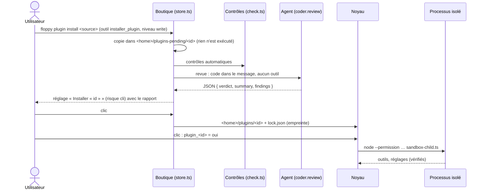

# Plugins tiers (implémenté)

Installer un plugin écrit par quelqu'un d'autre, depuis un dossier, une archive zip ou un dépôt git.
Le plugin est contrôlé, relu par un agent IA, installé sur un clic, puis exécuté dans un processus isolé.

Guide pour les auteurs : [docs/guide/plugins](../guide/plugins/README.md). Plugins personnels (écrits dans `<home>/plugins`) : [assistant-ia.md](assistant-ia.md).

## En bref

## Format

Un plugin distribué est un dossier avec `floppy-plugin.json` et `index.ts` (`apps/cli/src/plugins/format.ts`).

- `floppy-plugin.json` : `id`, `version`, `licence`, `api` (aujourd'hui `1`), `description`, `permissions`, `homepage`, `sections`. Il est lu **sans exécuter de code**.
- Permissions permises : `net` (hôtes) et `cloud`. `fs.read`, `fs.write`, `exec` et `approvals` sont refusés : le processus isolé n'a ni fichiers, ni programmes, ni accords.
- Le manifeste du code doit avoir les mêmes `id`, `version` et `permissions`. `provides`, `inject`, `slots`, `tasks`, `addable`, `lazy` et `runtime` sont refusés. C'est vérifié au chargement, dans le processus isolé (`manifestMismatch`).
- Les types sont dans le SDK, `packages/sdk/floppy-plugin.d.ts`, source unique. Le kit des plugins personnels (`coder`) le copie aussi.

## Contrôles automatiques

`apps/cli/src/plugins/check.ts`. Ils lisent le texte, sans rien exécuter. Un modèle ne peut pas les contourner. Ce sont aussi ceux de `floppy plugin check`.

| Bloquant | Exemples |
|---|---|
| Import à l'exécution | tout `import … from` sauf `import type` et les `.ts` du plugin ; `import "x"` ; `import { type A } from "x"` (le module est chargé quand même) |
| Chargement dynamique | `require(`, `import(` |
| Construction de code | `eval(`, `Function(`, `new Function`, `WebAssembly` |
| Accès internes | `process.getBuiltinModule`, `process.binding`, `process.dlopen`, `process.kill`, `process[…]`, `globalThis[…]`, `constructor.constructor` |
| Modules Node cités | `node:`, `child_process`, `worker_threads` |
| Réseau | `fetch(` sans `permissions.net` ; `WebSocket`, `EventSource` |
| Code masqué | ligne de plus de 1 000 caractères ; caractères invisibles ou bidirectionnels |
| Fichiers | autre chose que `.ts`, `.md`, `.json`, `.txt`, images, LICENSE/README… (donc pas de `.js`) ; liens symboliques ; `node_modules`, `.git` ; `package.json` avec `dependencies`, `scripts` ou `bin` |
| Tailles | plus de 200 fichiers, plus de 512 Ko au total, plus de 200 Ko par fichier |

À signaler (sans blocage) : `process.env`, décodage base64, longue chaîne codée.

Les commentaires sont retirés avant la recherche des motifs (les chaînes restent). L'empreinte (`hash`) est le sha256 des chemins et contenus, dans l'ordre des chemins.

## Sources

`apps/cli/src/plugins/source.ts` et `zip.ts`.

- **Dossier** : copié sans `.git`, `node_modules`, `.floppy-dev`.
- **Zip** (fichier ou `https://…zip`) : lecteur intégré, sans dépendance. Il refuse les chemins qui sortent (`..`, absolu, lecteur), les liens symboliques, le chiffrement, le zip64, plus de 500 fichiers, plus de 5 Mo décompressés. Il retire le dossier commun du haut (archive d'un dépôt).
- **Git** (`https://…`, `git+https://…`, `git+file://…`, avec `#branche`, `#étiquette` ou `#commit`) : `git init`, puis `fetch --depth 1` d'un seul commit, puis `checkout`. Aucune question d'identifiants, aucun hook, aucun sous-module, aucun LFS. Le commit exact est gardé, puis `.git` est supprimé.
- Seul `https://` est accepté pour une adresse. Une adresse avec des identifiants est refusée.

## Revue par un agent IA

`apps/cli/src/plugins/review.ts` et `plugins/assistant/coder/src/review.ts`.

- **Obligatoire.** Sans agent de code (Claude Code, Codex ou Antigravity), `installer_plugin` échoue. Rien n'est mis en attente.
- Le relecteur est le service `coder`, méthode `review`. Le réglage `plugins_tiers_relecteur` (`auto`, `claude`, `codex`, `agy`, risque cli) choisit l'agent.
- **Un tour, sans outil.** Le code est dans le message, entre deux bornes aléatoires (`FLOPPY-<24 hex>`) : il ne peut pas « fermer » le bloc. Le dossier de travail est vide et temporaire.
  - Claude : `-p --tools "" --strict-mcp-config --permission-mode dontAsk`.
  - Codex : `exec --sandbox read-only`, réponse lue dans le fichier `-o`.
  - Antigravity : flux JSON, une seule question.
- La consigne nomme ce qu'il faut chercher : données envoyées ailleurs, niveau d'outil trop bas, code masqué, comportement caché, description d'outil qui manipule le modèle, écart entre la description et le code. Une instruction adressée au relecteur dans le code est elle-même un constat bloquant.
- Réponse attendue : `{ verdict: ok|doute|refus, summary, capabilities[], findings[] }`, dans la langue de l'assistant.
  - Réponse illisible : `doute`, avec l'erreur.
  - `ok` avec un constat bloquant : `doute`.
- **Les contrôles automatiques restent souverains** : un verdict `ok` n'efface pas un blocage.

## Installation

`apps/cli/src/plugins/store.ts`, `lock.ts`.

- Quarantaine : `<home>/plugins-pending/<id>/files` et `report.json` (source, commit, contrôles, revue).
- Un réglage par plugin en attente, `plugin_installer_<id>` (booléen, risque **cli**, rubrique Plugins). Sa description est le rapport. Oui → installation.
- L'installation est refusée si :
  - les contrôles bloquent ;
  - la revue dit `refus` ;
  - les fichiers ont changé depuis la revue (empreinte recalculée) ;
  - un plugin personnel du même nom existe.
- Copie dans `<id>.new`, vérification de l'empreinte, puis échange : jamais de plugin à moitié copié.
- `<home>/plugins/lock.json` garde, par plugin : source, type, ref, commit, empreinte, date, verdict, agent, résumé.
- Le plugin installé est **désactivé**. L'activation est le réglage `plugin_<id>` habituel.
- Une mise à jour est une nouvelle installation : nouvelle source ou nouveau commit, donc nouvelle empreinte et nouvelle revue.
- `desinstaller_plugin` (niveau delete) :
  - éteint d'abord `plugin_<id>`, pour qu'une réinstallation ne le rallume pas toute seule ;
  - supprime le dossier et l'entrée du verrou ;
  - retire aussi un plugin en attente.
- Journal d'audit : `plugin.staged`, `plugin.installed`, `plugin.removed`, `coder.review`.

## Exécution isolée

`apps/cli/src/plugins/sandbox.ts` (côté noyau) et `sandbox-child.ts` (processus du plugin).

- Tout dossier avec `floppy-plugin.json` tourne isolé : installé, copié à la main, ou en mode debug. Il n'est **jamais importé** dans le noyau.
- Le noyau voit un `PluginDef` mandataire (`runtime: "out-of-process"`). Il ne change pas.
- Processus : `node --permission --allow-fs-read=<dossier du plugin> --allow-fs-read=<sandbox-child.ts>`.
  - Pas d'écriture, pas de programme, pas de worker, pas de module natif.
  - Chemins réels (noms courts de Windows résolus).
  - Dossier courant hors du plugin.
  - **Aucune variable d'environnement.**
- Dans le processus, avant le chargement du plugin :
  - un hook de résolution refuse tout import qui sort du dossier du plugin, donc tout module Node ;
  - `process.getBuiltinModule`, `binding`, `dlopen`, `kill` sont retirés ;
  - `WebSocket` et `EventSource` sont retirés ;
  - `fetch` est remplacé par une requête au noyau.
- **Le processus est la frontière.** Tout message du processus est vérifié par le noyau :
  - outils : nom `^[a-z][a-z0-9_]{0,63}$`, niveau `read|write|send|delete`, schéma `type: "object"`, phrase d'accord standard (« Plugin tiers « id » : outil {args} ») ;
  - réglages : clé préfixée `<id>_`, type et risque connus, libellés présents ; les valeurs suivent le processus (renvoyées après chaque appel) ;
  - bus : n'émet que `initiative` (source forcée à l'id, `key` préfixée) ; n'écoute que `plugin.state` et `service.changed` ;
  - journal d'audit : `kind` préfixé `plugin.` ;
  - réseau : fait par le noyau, seulement vers `permissions.net` (`hostAllowed`), en `http`/`https`. Les redirections sont suivies une à une et revérifiées. Réponse de 5 Mo au plus, sans `set-cookie`. Chaque requête est journalisée (`plugin.net`).
- Empreinte : un plugin du verrou ne démarre pas si ses fichiers ne correspondent plus (« ses fichiers ont changé depuis l'installation »).
- Valeurs gardées : le processus reçoit au démarrage les réglages gardés de son préfixe (`ctx.settings.savedEntries`).
- Arrêt : message `stop` (nettoyage des effets), puis déconnexion, puis `kill`. Un processus qui meurt seul met le plugin en erreur visible.
- Node : celui qui fait tourner le noyau. Dans l'app de bureau, c'est `node` du PATH, ou `FLOPPY_NODE`.

## Mode debug

`floppy dev <dossier>` (`apps/cli/src/main.ts`, `boot.ts`, `user-plugins.ts`).

- Le dossier est chargé en plus de `<home>/plugins` : isolé s'il a un `floppy-plugin.json`, importé sinon. Il est activé d'office (le réglage ne l'éteint pas).
- `fs.watch` récursif sur le dossier : après 250 ms de calme, le plugin est relu et redémarré (`replacePlugin`). Le résultat s'affiche dans le terminal.
- Données à part : `<dossier>/.floppy-dev` (sauf `--home` ou `FLOPPY_HOME`). Config : `--config`, `./floppy.yml`, celle du dépôt, sinon vide.
- `--inspect` : débogueur de Node sur le processus du plugin. Node refuse `--inspect` avec `--permission` : l'isolation des fichiers est levée, et le terminal le dit.
- App de bureau : `npm start -- --dev-plugin <dossier>` → variable `FLOPPY_DEV_PLUGINS`, lue par `boot`.
- `floppy tool <outil> '<json>'` : point de contrôle `POST /tool`, même chemin que le modèle (accord compris). La CLI pose la question d'accord dans le terminal.
- `floppy plugin new|check|test` : gabarit du SDK, contrôles, noyau jetable.

## Limites connues

- **Réseau** : Node 24 ne limite pas le réseau par `--permission`. Le blocage vient du retrait des modules (hook), de `fetch` remplacé et des contrôles statiques. Un trou dans ces trois couches à la fois donnerait le réseau.
- **Interface** : un plugin tiers n'a que les réglages déclarés. Pas de formulaire `providerConfig`, pas d'éléments, pas de secrets (`ctx.secrets`). Une clé d'API se met aujourd'hui dans un réglage `text` : ce n'est pas un coffre.
- **Déni de service** : un plugin peut consommer du processeur ou envoyer beaucoup de messages. Les appels ont un délai (2 min) ; il n'y a pas de quota.
- **Revue** : elle aide, elle ne prouve rien. La sécurité repose sur l'isolation et les contrôles ; la revue attrape surtout ce qui est trompeur (données envoyées sans le dire, niveau d'outil trop bas).

## Testé

- `apps/cli/test/sandbox.test.ts` : outils, réglages, valeurs gardées ; modules Node refusés même par contournement ; environnement vide ; fetch limité et redirection vers un autre hôte refusée ; manifeste différent ; empreinte changée ; clé sans préfixe ; plantage → erreur.
- `apps/cli/test/plugin-check.test.ts` : format, chaque motif bloquant, commentaires, fichiers, zip (chemins, liens, bombe), sources (dossier, zip, adresse, git à un commit).
- `apps/cli/test/plugin-store.test.ts` : attente → clic (refusé à la voix) → verrou → activation isolée ; fichier modifié ; refus de la revue ; contrôles bloquants ; sans agent ; plugin personnel du même nom ; désinstallation ; outils ; message de revue borné ; lecture de la réponse.
- `apps/cli/test/plugin-dev.test.ts` : mode debug (actif sans clic, `POST /tool`, rechargement à la sauvegarde, erreur puis correction).
- `apps/cli/test/plugin-sdk.test.ts`, `packages/sdk/test/types.test.ts` : exemples et gabarit valides et démarrés ; types du SDK compatibles avec le noyau.
- `plugins/assistant/coder/test/review.test.ts` : arguments sans outil et lecture de la réponse pour les trois agents (faux CLI).
