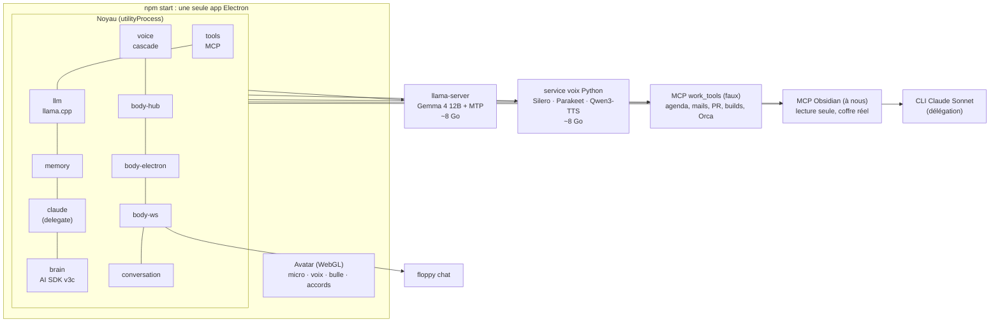
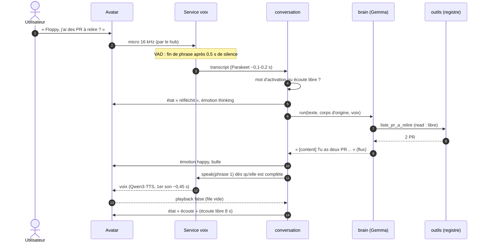
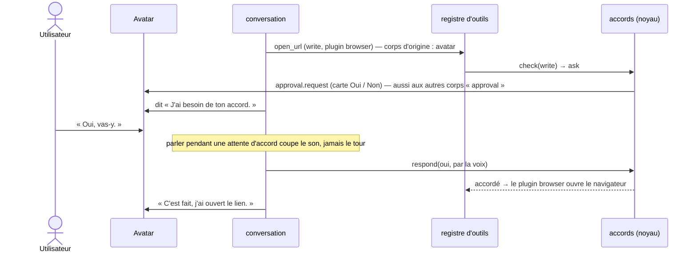

# Le premier proto (implémenté)

[← Retour à la spec](README.md)

État : **opérationnel** le 5 novembre 2026. Code : ce dépôt. Voir aussi [Le noyau](noyau.md) et [Corps, émotions et avatar](corps-et-avatar.md).

## Lancer

```powershell
cd floppy
npm install
npm start            # l'app : noyau + llama-server + voix + avatar (≈ 30 s au premier démarrage)
npx floppy plugins   # dans un autre terminal : état des plugins
npx floppy chat      # un 2ᵉ corps, en texte (comme Telegram)
```

Dire « **Floppy**, est-ce que j'ai des PR à relire ? ». Ou `Ctrl+Alt+F` pour parler sans le mot d'activation.

## Ce qui tourne



| Famille | Plugin (`plugins/<famille>/<nom>`) | Rôle |
|---|---|---|
| tools | `tools/mcp` | serveurs MCP de l'utilisateur, niveaux, serveur MCP Floppy |
| tools | `tools/browser`, `tools/orca`, `tools/websearch`, `tools/m365` | applications : ouvrir une page (`open_url`), Orca, recherche web, Microsoft 365 (voir [elements.md](elements.md)) |
| llm | `llm/llamacpp`, `llm/openai` | llama-server (réutilisé s'il tourne déjà, sinon lancé et surveillé) ; modèles distants au format OpenAI |
| memory | `memory/local` | `USER.md`, `MEMORY.md`, historique SQLite FTS5, outils `remember` et `search_history` |
| brain | `brain/aisdk` | cerveau Gemma, prompt v3c, délégation |
| brain | `brain/claude-cli` | CLI Claude : service `delegate` (ou `brain` sans GPU) |
| voice | `voice/listen` | écoute (Silero + Parakeet par sherpa-onnx) ; la voix vient des plugins `tts` (le service Python `voice/cascade` est archivé le 6 novembre 2026, voir [ecoute.md](ecoute.md)) |
| body | `body/hub`, `body/electron`, `body/ws`, `body/reachy` | plusieurs corps, transports MessagePort et WebSocket, robot Reachy |
| avatar | `avatar/tv`, `avatar/pixel` | les dessins de l'avatar, inscrits auprès de `body-electron` |
| assistant | `assistant/coder` | l'assistant IA de la fenêtre des réglages (CLI Claude ou Codex) |
| conversation | `conversation/default` | les tours ; réglage `free_listen_s` |
| dev | `dev/bench-api` | le cerveau en API OpenAI pour le banc |

Services natifs : `services/obsidian-mcp/server.mjs`, serveur audio.cpp (voix). Plus de service Python depuis le 6 novembre 2026.

## Un tour vocal



Règles de la conversation (`plugins/conversation/default`) :

- **Mot d'activation** cherché dans la transcription (mots, sans accents). Sans lui, la phrase est ignorée, sauf pendant l'**écoute libre** (8 s après une réponse) ou avec `Ctrl+Alt+F`.
- **« Floppy, dors »** : veille ; seul « Floppy » réveille.
- **Phrase reprise** : si l'utilisateur reprend moins de 2 s après la fin, avant toute réponse parlée, le tour est annulé et les 2 morceaux sont recollés.
- **Interruption** : si l'utilisateur parle plus de 300 ms pendant la voix, tout s'arrête (cerveau, synthèse, lecture).
- **Un tour à la fois** pour tous les corps ; les autres attendent.

### Accord à la voix



## Le cerveau : variante v3c du prototype 4

Le prompt et la délégation reprennent la variante **v3c** retenue par le prototype 4 (`prototypes\ambiguity\`) :

- 3 chemins dans le prompt : **demander** (ambigu avant une écriture), **déléguer** (calcul en plusieurs étapes, rédaction longue, code, analyse, synthèse), **faire** (le reste), avec des exemples courts. Pas d'outil `demander_precision`.
- **Règle du noyau** : dès que le **nom** de l'outil `delegate` arrive dans le flux de Gemma, le noyau dit « Je regarde ça, une seconde. ». La réponse de Claude est lue **en direct**, telle quelle ; la boucle s'arrête (Gemma ne la répète pas). Elle est gardée dans l'historique de la conversation.
- Le CLI Claude n'a que le serveur MCP Floppy ; sa liste d'outils est vérifiée à chaque lancement (un outil inconnu = arrêt + journal). Un processus de réserve est prêt à l'avance.

## Mesures

Banc des 40 demandes des prototypes 3 à 5 (même notation, `bench/eval.py`), passé à travers le noyau (`dev/bench-api`) :

| Config | Justes | anciennes / nouvelles | 1er mot sans outil | Total avec un outil |
|---|---|---|---|---|
| Noyau, prompt v2 + émotions | **90 %** | 95 / 85 | 0,27 s | 1,16 s |
| Noyau, v3c + délégation Claude Sonnet | **90 %** | 90 / 90 | 0,18 s | **0,91 s** |
| **Après la revue : prompt généré depuis les outils visibles** | **90 %** | 90 / 90 | 0,22 s | 1,01 s |

- Délégation : phrase d'attente à ~0,2 s, puis la réponse de Claude (exemple : « merge ou rebase ? »).
- Après la revue (5/11/2026), les lignes d'outils du prompt sont **générées à partir des outils visibles** (`ctx.tools.list()`, sans les outils cachés ou désactivés), au lieu de connecteurs écrits en dur. Banc relancé (`eval.py run revue`) : même score, 90 %. Accords : 1 écriture acceptée, 1 refusée bloquée.
- Échecs v3c : des demandes ambiguës où Gemma lit d'abord avant de demander (permis par le prototype 4, compté en « outil en trop » par l'ancienne notation).

Bout en bout dans l'app (phrases dites par une voix de synthèse Windows, envoyées comme un micro) :

| Demande | Fin de la phrase → 1er son de la réponse |
|---|---|
| « Floppy, est-ce que j'ai des PR à relire ? » (1 outil) | **1,35 s** (dont 0,5 s d'attente du VAD) |
| « Floppy, ouvre le site… » → phrase d'accord | 1,8 s |
| « Oui, vas-y. » → « C'est fait… » | 0,7 s |
| Phrase sans « Floppy » | ignorée |

Service voix seul : transcription ~0,1 s (Parakeet), 1er son du TTS ~0,45 s (Qwen3-TTS 1.7B, voix clonée). VRAM de toute la pile : ~18 Go sur 24 (Gemma ~8, voix ~6,5, bureau ~3,5).

Coffre Obsidian réel (241 notes) : « dans mes notes, c'est quoi le context engineering ? » → réponse juste en 3,2 s (2 outils). Un chemin hors du coffre est refusé.

## Tests

`npm run check` : typage, **265 tests** (41 fichiers), licences des dépendances livrées. Les tests couvrent : cycle de vie des plugins, config à chaud, accords (délai, première réponse, refus jamais exécuté, qui peut répondre), sécurité (secrets cloisonnés, `permissions.exec`, manifestes), frontières entre plugins, rubriques et éléments des réglages, serveur MCP Floppy (jeton), passerelle MCP, conversation à 2 corps (routage, accord à la voix, veille, interruption, débranchement), et chaque plugin.

## Corrigé après le premier essai (5/11/2026)

- `Ctrl+Alt+Espace` est déjà pris par Claude desktop : le raccourci « parler » est maintenant **`Ctrl+Alt+F`**. Un raccourci déjà pris est signalé (journal, icône en rouge).
- L'avatar n'entendait rien : (1) Chromium créait les `AudioContext` en pause sans clic (règle de lecture automatique levée, contexte relancé) ; (2) l'audio du micro était envoyé en **transférant** son tampon, et Electron abandonne ces messages en silence entre la page et le `utilityProcess` (envoi d'une copie). L'état du micro est maintenant écrit dans le journal toutes les 10 s.

- La bulle était écrasée (fenêtre redimensionnée à chaque message) : la fenêtre a maintenant une taille fixe et transparente, les clics traversent les zones vides ; la bulle est une bulle de BD au-dessus de la tête, avec tout le texte.
- La voix : 6 voix au choix, changeables à la voix sans redémarrer (voir [Réglages à la voix](reglages.md)). Par défaut : la voix d'homme clonée.

- Vrais outils : Azure DevOps distant, Orca (synthèse et annonces de fin de job), connecteurs allumables à chaud : voir [Vrais outils](outils-reels.md).
- Fenêtre des réglages (icône ou « Floppy, ouvre les réglages »), ton, mot d'activation, affichage : voir [Réglages](reglages.md).

## Limites connues du proto

- Le mot d'activation passe par la transcription (pas de détecteur dédié) : tout ce qui est dit est transcrit.
- Arrêt brutal de l'app (gestionnaire des tâches) : llama-server et le service voix peuvent rester lancés. « Quitter » dans le menu de l'icône demande au noyau de tout arrêter proprement (pas encore testé automatiquement).
- Pas de sandbox Windows pour les serveurs MCP. Certains plugins lancent encore un processus sans passer par `ctx.spawn` (voir [Sécurité](securite.md#limite-connue--lancements-directs)). Les secrets saisis dans la fenêtre des réglages vont dans le Gestionnaire d'identification Windows, cloisonnés par plugin.
- Pas encore : mode live (Gemini Live), skills, tâches planifiées, Telegram. (Faits depuis : Microsoft 365 réel, corps Reachy, fenêtre A2UI ; voir [elements.md](elements.md) et [corps-et-avatar.md](corps-et-avatar.md).)
