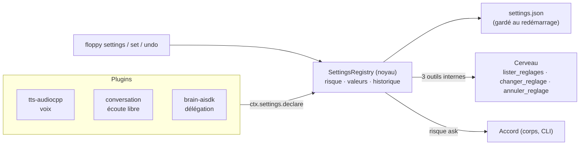
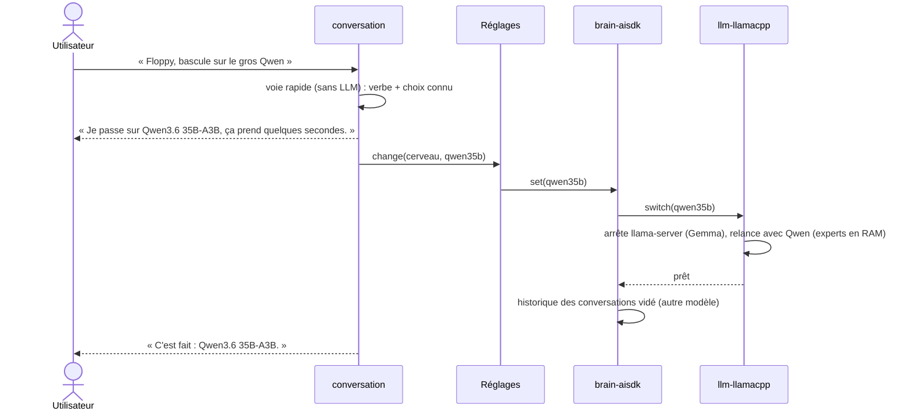
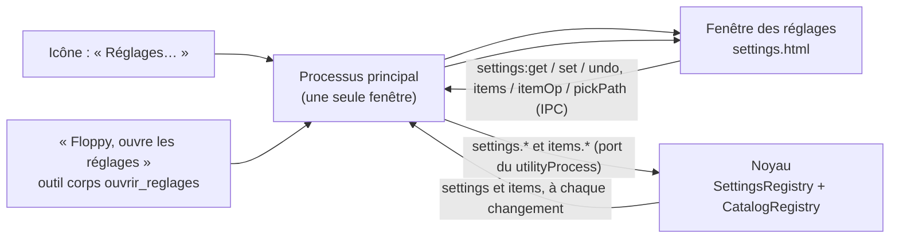
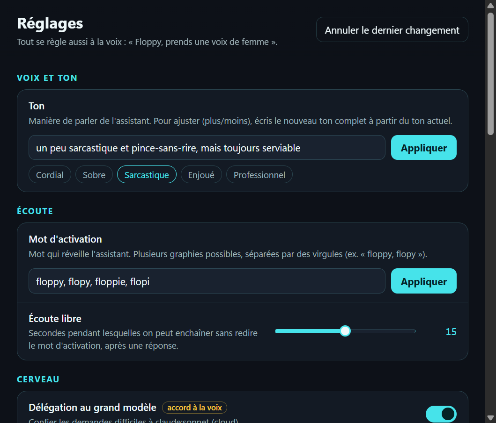

# Réglages à la voix (implémenté)

[← Retour à la spec](README.md)

État : **fait** (5 novembre 2026). Code : `assistant\packages\core\src\settings.ts`, `settings-tools.ts`. Règles : [Fonctionnement → Config à la voix](fonctionnement.md#config-à-la-voix).

On règle l'assistant **en lui parlant** : « Floppy, prends une voix de femme », « écoute-moi plus longtemps, quinze secondes », « annule ». Ou par la CLI.

## Le mécanisme



- Chaque plugin **déclare** ses réglages : clé, libellé, type (choix, nombre, oui/non), valeurs possibles avec des mots de l'oral (« femme », « féminine »), **risque**, et comment l'appliquer **à chaud** (sans redémarrer).
- Le cerveau reçoit 3 outils. La description de `changer_reglage` liste chaque réglage, sa valeur actuelle et les choix : le cerveau sait quoi proposer. Elle est mise à jour quand un plugin arrive ou part.
- **Le risque est contrôlé par le code** du registre, jamais par le modèle :

| Risque | À la voix | Exemple |
|---|---|---|
| `free` | appliqué tout de suite, annulable (« Floppy, annule ») | voix, écoute libre |
| `ask` | demande d'accord avant (carte Oui / Non, « oui » à la voix) | activer la délégation au cloud |
| `cli` | **refusé** à la voix : « utilise la CLI » | tout ce qui touche aux droits |

- Un réglage de risque `ask` demande **toujours** l'accord (règle forcée `ask`) : même avec `approvals.write: always` dans la config.
- **« Annule » suit les mêmes règles de risque** : à la voix, annuler un réglage `cli` est refusé, et annuler un réglage `ask` redemande l'accord. Si un autre changement a eu lieu entre-temps, rien n'est annulé.
- Les droits d'accès (dossiers, comptes) ne sont **pas** des réglages : ils ne se donnent jamais à la voix.
- Chaque changement, refus et annulation est inscrit au journal (`setting`, `setting.refused`, `setting.undo`).
- Les valeurs choisies sont gardées dans `%LOCALAPPDATA%\assistant\settings.json` et reprises au démarrage (elles passent avant `floppy.yml`).

```mermaid
sequenceDiagram
  actor U as Utilisateur
  participant B as Cerveau
  participant R as Réglages (noyau)
  participant V as Service voix
  U->>B: « Floppy, prends une voix de femme »
  B->>R: changer_reglage(voix, « voix de femme »)
  R->>R: « femme » → valeur femme ; risque free
  R->>V: POST /voice femme (même modèle : instantané)
  R->>R: historique + settings.json + journal
  R-->>B: « Voix : voix de femme. »
  B-->>U: « C'est fait, j'ai changé ma voix. » (déjà dit avec la nouvelle voix)
```

## Réglages du proto

| Rubrique | Clé | Plugin | Risque | Valeurs |
|---|---|---|---|---|
| Voix et ton | slot `voice.tts` | tts-audiocpp, tts-system, tts cloud | free | les voix offertes par les plugins `tts` (ex. Anna, Floppy) |
| Voix et ton | `ton` | brain-aisdk | free | texte libre ; préréglages cordial, sobre, sarcastique, enjoué, professionnel |
| Écoute | `mot_activation` | conversation | free | texte : graphies séparées par des virgules (au moins un mot de 3 lettres) |
| Écoute | `ecoute_libre` | conversation | free | 0 à 30 s |
| Cerveau | `cerveau` | brain-aisdk + llm-llamacpp | free ; Claude (cloud) = ask | Gemma 4 12B · Qwen3.5 9B · Qwen3.6 35B-A3B · Claude (cloud) |
| Cerveau | `delegation` | brain-aisdk | ask | oui / non (Claude Sonnet, cloud) |
| Connecteurs | (éléments, plus de réglage `connecteur_<serveur>` : repris une fois puis supprimés) | tools | allumer un connecteur **cloud** = accord (toujours) ; éteindre = libre | voir [elements.md](elements.md) : l'état réel s'affiche sur l'élément (« connecté, 5 outils », « erreur : … ») |
| Orca | `orca_notifications` | orca | free | toutes · importantes · aucune |
| Orca | `orca_surveillance` | orca | free | oui / non |
| Affichage | `avatar_visible` | body-electron | free | oui / non (l'avatar revient quand on lui parle) |
| Affichage | `masquer_apres` | body-electron | free | 0 à 120 min d'inactivité (0 = jamais) |
| Affichage | `bulle` | body-electron | free | oui / non (les cartes d'accord restent toujours visibles) |
| Affichage | `toujours_devant` | body-electron | free | oui / non |
| Système | `demarrage_windows` | body-electron (appliqué par l'app) | free | oui / non : entrée « Floppy » dans le démarrage de la session Windows (clé `Run` de l'utilisateur). Testé : oui → entrée créée, non → entrée retirée. Piège Electron : le vrai état est `executableWillLaunchAtLogin`, pas `openAtLogin`. |

Un réglage peut avoir un risque **selon la valeur** (`riskFor`) : allumer un connecteur cloud demande l'accord, l'éteindre non.

### Changer de cerveau



| Modèle | Où | Mémoire | Changement mesuré |
|---|---|---|---|
| Gemma 4 12B + MTP (défaut) | GPU | ~8 Go | 6,7 à 8,4 s |
| Qwen3.5 9B Q6 | GPU | ~7,9 Go | ~11 s |
| Qwen3.6 35B-A3B (MoE) | GPU ~9,6 Go + RAM ~13 Go (`--n-cpu-moe 26`) | | ~11 s ; 1re réponse ~10 s à froid |
| Claude (cloud, CLI) | — | — | immédiat ; l'activer à la voix demande l'accord |

- **Un seul modèle local chargé à la fois** : l'ancien est arrêté avant de charger le nouveau (GPU 17,9 à 18,9 Go avec toute la pile).
- Catalogue dans `floppy.yml` (`llm.config.models`) : libellé, mots de l'oral (« petit qwen », « gros qwen »), fichier, arguments propres (ex. experts MoE en RAM). Le dernier choix est repris au démarrage.
- En mode Claude, toute la demande va au CLI Claude (mêmes outils par le serveur MCP Floppy, même accord). Limite : pas d'historique de conversation dans ce mode pour l'instant.

### La voie rapide (sans LLM)

Un modèle faible peut mal comprendre « reviens sur Gemma » (essai : Qwen 9B ne l'a pas compris et a prétendu avoir changé). Pour **ne jamais rester bloqué**, la conversation reconnaît d'abord, **par le code**, les ordres courts de réglage : une phrase de 9 mots au plus, qui commence par un verbe de changement (passe, bascule, reviens, mets, prends, utilise…) et nomme un choix connu d'un réglage à choix (libellé ou mot de l'oral). Elle applique le changement directement (même contrôle du risque), puis répond « C'est fait : … ». Sinon, ou en cas de doute entre 2 réglages, la phrase va au cerveau comme d'habitude. Marche pour tous les réglages à choix (cerveau, voix, notifications Orca…).

### Le ton

- Texte libre, appliqué au tour suivant, sans redémarrer : une ligne « Ton : … Le ton change seulement tes mots, jamais ce que tu fais (outils, accords). » dans le prompt.
- « Sois un peu sarcastique » → préréglage sarcastique. « Un peu plus », « moins » : le cerveau écrit le nouveau ton complet à partir du ton actuel (la description du réglage le lui dit).
- Testé : « sois un peu sarcastique », puis « salut, ça va ? » → réponse sarcastique ; le ton est gardé au redémarrage.

## La fenêtre des réglages



- **Bandeau de rubriques à gauche** : il vient des déclarations des plugins (`manifest.sections`), pas d'une liste
  en dur. Aujourd'hui : Général et Plugins (noyau), Cerveau, Voix, Écoute, Connecteurs, Corps et affichage,
  Assistant IA, Système (plugins). Voir [elements.md](elements.md#les-rubriques-déclarées-par-les-plugins). Recherche dans l'en-tête.
- Chaque rubrique montre (a) les réglages dont la `section` (obligatoire) correspond, groupés par `group`, et (b) les
  **éléments** des plugins de la rubrique, avec ajout, modification, désactivation et suppression (voir
  [elements.md](elements.md)). Rien n'est en dur : un nouveau plugin apparaît tout seul.
- Formulaires générés depuis les champs déclarés par les plugins : 1) choisir le type, 2) remplir, 3) « Essayer ».
  Bouton « Parcourir » pour les fichiers (dialogue de Windows).
- Français et anglais (réglage `langue_interface`), menus de l'icône compris.
- Mise à jour en direct : un réglage changé à la voix se voit tout de suite dans la fenêtre.
- **Ouvrir sur un élément** : `ouvrir_reglages` accepte `element`, le nom entendu (« ouvre les réglages d'Orca »).
  Le corps cherche l'élément dans le catalogue (`plugins/body/electron/src/settings-target.ts`) : nom exact, nom contenu,
  puis nom proche (fautes de dictée) ; les bibliothèques de modèles sont ignorées (trop d'homonymes). Le message
  `settings.open` porte alors `target: { section, provider, id }` ; le processus principal le vérifie (textes courts) et
  l'envoie à la fenêtre (`settings:focus`), qui ouvre la page de l'élément dès que le catalogue la connaît (10 s au plus).
  La réponse cite les boutons de l'élément (« Boutons : « Installer dans Orca » »). Élément introuvable : la fenêtre s'ouvre
  quand même et la réponse le dit.
- **Boutons à la voix** : un bouton d'élément (installer le plugin Orca, se connecter à Microsoft 365…) ne se lance pas à
  la voix (le catalogue refuse `via: "voice"`). La description de `ouvrir_reglages` dit au cerveau d'ouvrir les réglages
  sur l'élément et de dire sur quel bouton cliquer. Vérifié dans l'app (7 novembre 2026) : « orka » ouvre la page Orca.
- Un clic dans la fenêtre compte comme un geste de confiance (`via: "ui"`) : pas de demande d'accord, même pour les réglages `cli`.
- « Annuler le dernier changement ».
- Maquette : [maquette-reglages/](maquette-reglages/).



## Les voix

Toutes passent par le service voix (`services\voice\server.py`), sans le redémarrer.

| Voix | Moteur | Changement |
|---|---|---|
| voix d'homme (défaut), autre voix d'homme | Qwen3-TTS 1.7B **Base**, clonage (ICL) de `cascadeoices
ef_fr.wav` / `ref_fr_homme.wav` | **instantané** (même modèle) |
| voix de femme | même modèle, clonage par **empreinte seule** (x-vector) de `ref_fr_femme.wav` : plus stable pour elle | **instantané** |
| Anna | Qwen3-TTS 1.7B **CustomVoice**, voix intégrée `ono_anna` + consigne de ton, température 0,5 | ~7 à 10 s (autre modèle chargé, l'ancien libéré) |
| Kokoro | Kokoro-82M, voix `ff_siwis` | ~2 s, le plus léger |

Mesuré : « passe à la voix d'Anna » → 7,2 s, VRAM inchangée (~18 Go). Un changement de voix attend la fin de la phrase en cours.

### Stabilité des voix (`services\voice\check_voices.py`, 4 phrases × 2 passages)

| Voix | Hauteur médiane (min–max) | Phrases ratées |
|---|---|---|
| voix d'homme (clone) | 126 Hz (105–148) | 0/8 |
| autre voix d'homme (clone) | 119 Hz (98–147) | 0/8 |
| voix de femme, clone ICL | 210 Hz (185–233) | 1/8 |
| **voix de femme, x-vector** (retenue) | 212 Hz (205–245) | 0/8 |
| Anna (intégrée) | 291 Hz (242–353) | 0/8, mais hauteur qui varie beaucoup |
| Ryan + consigne FR (intégrée, non retenue) | 174 Hz (137–247) | 0/8, hauteur très variable |

Sohee est retirée (peu fiable en français d'après les essais de `cascade`).

### Comportement du cerveau pour un réglage

Gemma appelle `changer_reglage` **tout de suite, sans rien dire avant et sans demander de confirmation** ; si la valeur manque (« change de voix »), il en choisit une autre lui-même ; l'utilisateur peut dire « annule ». Sans cette règle, il demandait « Quelle voix ? » (prompt v3c : « demander si ambigu »), et une phrase dite avant l'outil partait avec l'ancienne voix (mélange de voix dans la même réponse).

## CLI

```powershell
npx floppy settings              # réglages, valeur, risque, choix
npx floppy set voix femme        # tous les réglages, même « cli »
npx floppy undo                  # annule le dernier changement
```

## Testé

`packages/core/test/settings.test.ts` : libre appliqué sans accord, annulable, gardé au redémarrage ; `ask` refusé = rien ne change ; `cli` refusé à la voix et accepté par la CLI ; la description de l'outil suit les réglages.
