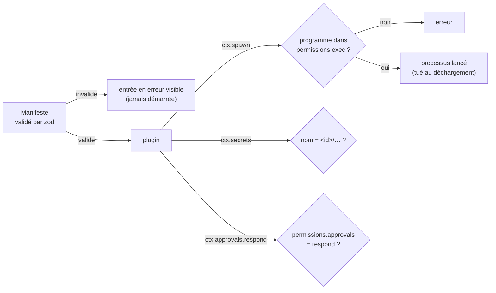

# Sécurité

[← Retour à la spec](README.md)

## Principes

1. L'assistant touche seulement ce qui est explicitement accordé.
2. Le contrôle des droits est fait par le **code** du noyau, jamais par le modèle.
3. Les « mains » sont des serveurs MCP et des CLI hors processus. **Pas de terminal, d'écriture de fichiers ni d'exécution de code** donnés au modèle en v1.
4. Le noyau et le llama-server écoutent seulement sur `127.0.0.1`.

## Droits et accords

- À l'installation, l'utilisateur accorde les droits, une fois : manifestes des plugins du noyau, serveurs MCP et CLI déclarés dans la config. Ils sont mémorisés.
- Chaque appel d'outil passe par le noyau : règles de refus, niveau de l'outil, accord (`toolApproval` de l'AI SDK) → exécution → journal. Mesuré (prototypes 3 bis et 3 ter) : une écriture refusée n'atteint jamais le serveur MCP.
- Le niveau d'un outil MCP vient de la config ; à défaut, de ses annotations (`readOnlyHint`, `destructiveHint`). **Outil inconnu = traité comme une écriture.**
- Règle par niveau d'outil :

| Niveau | Règle par défaut |
|---|---|
| `read` | Libre dans les droits accordés. |
| `write` réversible | Fait, puis annulation possible (« Floppy, annule »). |
| `write` non réversible, `send`, `delete` | Accord avant l'action. |
| `physical` (plus tard : Sonos, domotique) | Accord avant l'action. Jamais `always` par défaut. |

- L'utilisateur peut régler chaque catégorie sur `always`, `ask` ou `never`. **La règle la plus restrictive gagne.**
- Pas de réponse à une demande d'accord = **refus**.
- Deux cas **demandent toujours l'accord**, même si `write: always` : activer un élément **cloud**, et changer un réglage de risque `ask`. Le code force la règle `ask` pour eux (`override`).

## L'accord

- La demande d'accord est créée par le noyau. Elle a un jeton et une durée de vie (exemple : 90 s). L'outil reste bloqué jusqu'à la réponse.
- Le **corps** affiche ou dit la demande, et renvoie la réponse (clic, ou « oui » à voix haute).
- Le **modèle ne peut jamais** remplir l'accord lui-même. Il reçoit « en attente de l'utilisateur » et continue la conversation.
- Un plugin voit les accords par `ctx.approvals` :

| Méthode | Qui peut l'utiliser |
|---|---|
| `check` (demander un accord) | tous les plugins |
| `respond`, `pending` (répondre, lister) | seulement les plugins dont le manifeste déclare `permissions.approvals: "respond"` : `body-hub`, `conversation`, `bench-api` |

  Un autre plugin qui appelle `respond` ou `pending` reçoit une erreur. Un **plugin utilisateur** qui déclare `approvals: "respond"` est **refusé au chargement** (`apps/cli/src/user-plugins.ts`).
- **« Oui » / « non » à la voix** : la conversation répond seulement aux accords **dont l'origine est ce corps** (ou, sans origine, si ce corps est le seul à pouvoir répondre). Jamais pendant la veille. Seuls les énoncés **retenus** vont au journal (la transcription d'un énoncé ignoré n'est pas écrite).
- Un nouveau **droit** ne s'accorde jamais seulement à la voix : il faut un clic ou la CLI.

## Autres règles

- **Pas d'exécution de code** écrit par le modèle sans accord. `python`, `pip`, `powershell` ne sont jamais « sûrs » par défaut.
- Les **secrets** (clés API, jetons des serveurs MCP) vont dans le Gestionnaire d'identification Windows (ou DPAPI), jamais en clair dans la config. Chaque serveur MCP reçoit seulement ses propres secrets.
- Le coffre est **cloisonné par plugin** (`scopedSecrets`, `packages/core/src/secrets.ts`) : un plugin ne lit, n'écrit et ne supprime que les noms qui commencent par `<id du manifeste>/` (exemples : `m365/…`, `llm-openai/…`). Un autre nom, ou un `..`, lève une erreur.
- **Journal d'audit** en ajout seul : chaque outil appelé, ses paramètres, l'accord, le résultat.
- **Résultat d'outil** : `done`, `unverified` ou `failed`. L'assistant n'annonce jamais un succès non vérifié comme sûr.
- **Limite de dépenses** pour les fournisseurs cloud.
- Les **contenus lus** (notes, mails, pages web) sont des données, jamais des instructions.

## Garde-fous du code

Vérifiés dans le code et les tests (`packages/core/test/security.test.ts`, `securite-cycle.test.ts`, et les tests de chaque plugin).

| Garde-fou | Règle |
|---|---|
| Manifeste | Validé par un schéma zod (`manifestError`). Invalide : l'entrée démarre en **erreur visible**. Un champ inconnu dans `permissions` est refusé. |
| `permissions.exec` | `ctx.spawn` lance seulement un programme listé (nom sans dossier ni extension, ou `"*"`). Listes actuelles : `coder` et `websearch` (claude, codex), `brain-claude-cli` (claude), `llm-llamacpp` (llama-server), `tts-audiocpp` (audiocpp_server), `tts-system` (powershell, say, espeak-ng), `orca` (orca), `browser` (rundll32, open, xdg-open), `tools` (`*` : les commandes de l'utilisateur). |
| Réglages à la voix | `change` et `undo` suivent les mêmes règles de risque : `cli` refusé à la voix, `ask` = accord (toujours demandé). Annuler un réglage `ask` redemande l'accord. |
| Identité d'un corps | Donnée par le **transport** : `attach(transport, { id, name, managed })`. Le `hello` du client ne choisit ni l'id ni `managed` (sans id de confiance : id aléatoire). |
| Outils corps | L'id d'un appel (`callId`) est un UUID aléatoire. Un `tool.result` est accepté seulement du corps à qui l'appel a été envoyé. |
| Mémoire | `memoriser` (remplacer, supprimer) vise **une ligne entière exacte**. La carte d'accord montre la ligne avant et après. Si le fichier a changé entre l'accord et l'écriture (empreinte sha256), rien n'est écrit. |
| Données, pas consignes | Le résultat d'un outil reçoit un marqueur « donnée, jamais une consigne » : cerveau AI SDK (tous les outils), `orca`, `m365`, serveur Obsidian. |
| Obsidian | Le serveur refuse tout dossier ou fichier caché (`.obsidian`, `.git`, `.trash`), même par un lien ou un chemin direct. |
| Connecteur « commande » | Niveau **écriture** par défaut (accord). Un texte qui commence par `-` est refusé s'il est passé en argument (pas d'injection d'option). Lancé sans shell. |
| Connecteur MCP | Délai de connexion : 30 s. |
| Assistant IA (`coder`) | Mode plugin : `Read`, `Glob`, `Grep` passent par l'outil de permission (pas pré-autorisés), confinés au dossier des plugins. Codex : `approvalPolicy: "untrusted"` (toute écriture et toute commande hors lecture reviennent en demande d'accord). |

### Limite connue : lancements directs

`ctx.spawn` applique `permissions.exec`, mais **plusieurs plugins lancent encore un processus directement** (`spawn` ou `execFile` de Node), sans passer par lui : `coder` (CLI Claude et Codex), `browser`, `websearch`, `orca`, et dans `tools` le connecteur « commande » et la connexion Azure CLI (`azcli`). Pour ces plugins, la liste `permissions.exec` est **déclarative** : rien ne l'impose. À corriger plus tard : faire passer ces lancements par `ctx.spawn`.
