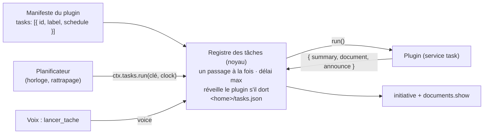

# Tâches et Planificateur (implémenté)

[← Retour à la spec](README.md)

État : **fait** le 6 novembre 2026. Code : `assistant\packages\core\src\tasks.ts` (registre), `assistant\plugins\tasks\scheduler` (horloge). Premier utilisateur : la [veille](veille.md).

## L'idée : quoi, quand, qui déclenche

Une **tâche** est un travail qu'un plugin sait faire seul, sans conversation : la veille du jour, demain un résumé des mails. On sépare trois rôles :

| Rôle | Qui | Exemple |
|---|---|---|
| **Quoi** | Le plugin de la tâche (contrat `task`) | La Veille collecte, trie, écrit le digest |
| **Quand** | Un déclencheur : le plugin Planificateur (horloge), ou la voix (`lancer_tache`) | « 07:30 », « à 8 h du lundi au vendredi », « toutes les 3 h » |
| **Annonce** | Le noyau | Notification « Ta veille est prête », document montré |

Une tâche ne connaît donc ni l'horloge ni les corps. Le Planificateur ne connaît aucune tâche en particulier.



## Déclarer une tâche

Dans le manifeste (lu sans démarrer le plugin, comme les slots) :

```ts
provides: ["task"],
tasks: [{ id: "quotidienne", label: "Veille du jour", schedule: { at: "07:30" }, timeout_s: 900 }],   // { at, days? } ou { every }
```

Puis `ctx.provide("task", { run(taskId, { signal, reason, lastRun }) { … return { summary, document?, announce? } } })`.

- `reason` : pourquoi la tâche tourne (`clock`, `voice` ou `manual`).
- `lastRun` : début du dernier passage **réussi** (la veille s'en sert pour ne garder que les nouveaux articles).
- `announce` : `important` (dit à voix haute), `normal` (notification, par défaut), `silent`.

Une tâche peut aussi dire où sont ses réglages : `configure: "veille"`. Cette rubrique sort alors du menu de la fenêtre et s'affiche sous la tâche (Tâches → « Veille du jour » → Réglages). Un plugin qui ne sert qu'à une tâche n'encombre pas le menu.

## Le registre (noyau)

- Clé d'une tâche : `<entrée>/<tâche>` (ex. `veille/quotidienne`). Une entrée désactivée n'a plus de tâches.
- Le noyau **garde le plugin en marche** pendant le passage (même un plugin `lazy`), puis le laisse s'arrêter.
- Outils du cerveau : `taches` (liste) et `lancer_tache` (écriture, accord ; lance en arrière-plan, le résultat arrive tout seul).
- API plugin : `ctx.tasks.list()`, `ctx.tasks.run(clé)`, `ctx.tasks.onChange(fn)`.

## Emprunter un slot : `ctx.borrow`

Une tâche a souvent besoin d'un élément choisi dans un slot (le cerveau du tri, le moteur de recherche). `ctx.slot` le garderait en marche tout le temps. `ctx.borrow(slot)` le démarre **le temps du travail** et `release()` le rend : un modèle n'occupe rien entre deux passages.

## Le Planificateur

- Rubrique **Tâches** : une fiche par tâche (prochain et dernier passage, résultat ou erreur du dernier essai, interrupteur, **Lancer maintenant**). La planification est dans la fiche, avec des choix tout prêts (07:00, 07:30, 08:00, 07:30 en semaine, toutes les 3 h, jamais).
- La planification est un réglage (clé `taches.<entrée>.<tâche>`), modifiable à la voix : « Floppy, fais ma veille à 8 h ». Formes : `07:30`, `8h` ou `à 8h` (une **heure**), `07:30 lun-ven`, `09:00 week-end`, `toutes les 3h`, `toutes les 30 min`, `jamais`. Une période commence toujours par « toutes les ».
- Une horloge vérifie chaque minute, en heure murale : elle marche après une mise en veille du PC.
- **Rattrapage** : un passage manqué (PC éteint à 7 h 30) tourne une fois, 2 minutes après le démarrage.
- Changer l'heure ne déclenche pas de rattrapage immédiat. Une tâche en échec est réessayée 30 minutes plus tard, pas chaque minute.

## Limites connues

- **Politesse** pas encore faite : le Planificateur ne sait pas si une conversation est en cours (aucun événement « tour en cours » sur le bus). À ajouter : un événement `turn.start` / `turn.end` émis par la conversation.
- `ctx.settings.declare` ne rend pas de quoi retirer un réglage : le réglage d'une tâche disparue reste visible jusqu'au redémarrage du Planificateur.
