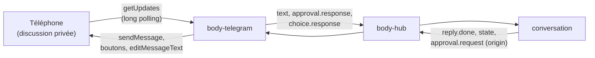

# Parler à Floppy sur Telegram (implémenté)

[← Retour à la spec](README.md)

État : **fait** le 10 novembre 2026. Code : `assistant\plugins\body\telegram` (identifiant du plugin : `body-telegram`). Appels à l'API Telegram et mise en forme partagés avec le canal d'envoi : `packages/toolkit/src/telegram.ts` (`@floppy/toolkit/telegram`).

## L'idée

Le canal `notify-telegram` **envoie** seulement (la veille, le point du matin). Ce plugin est un **corps** : Floppy **lit** tes messages et te **répond**, dans une discussion privée avec ton bot. C'est comme taper dans la fenêtre de discussion, depuis ton téléphone.

- Tu écris « qu'est-ce que j'ai aujourd'hui ? » : la conversation fait un tour texte, comme pour `floppy chat`.
- Floppy « écrit… » pendant qu'il réfléchit, puis répond en Markdown mis en forme (gras, listes, liens).
- Une demande d'accord née de cette discussion arrive avec des boutons **Oui** / **Non**. Répondre « oui » par écrit marche aussi.
- Un choix dans une liste arrive avec un bouton par option.
- Un document (point du matin, veille) demandé depuis Telegram arrive dans la discussion.

## Réglages (Corps et affichage → Telegram)

Un bot par élément (un seul pour l'instant) : nom, **jeton** (coffre des secrets), **personnes autorisées** (numéros d'utilisateur Telegram), **annonces** (`important` par défaut, `all`, `none`).

- **Prends un autre bot que celui du canal de veille.** Un seul programme peut lire les messages d'un bot (`getUpdates`) : sinon le corps et l'action « Trouver l'id » du canal se gênent (Telegram répond 409).
- **Essayer** vérifie le jeton (`getMe`, qui ne lit aucun message).
- **Qui m'a écrit ?** liste les personnes non autorisées qui ont écrit au bot depuis le démarrage, avec leur numéro. C'est ainsi qu'on trouve le sien : écrire au bot, puis recopier le numéro.

## Comment ça marche

- **Long polling** : le plugin demande les nouveaux messages (`getUpdates`, attente de 25 s), en boucle. Rien n'arrive de l'extérieur : pas de port à ouvrir, pas d'adresse publique.
- **Reprise** : le numéro du dernier message lu est gardé dans `<home>/body-telegram/offsets.json`. Un message n'est jamais traité deux fois, même après un redémarrage.
- **Vieux messages** : un message de plus de 30 minutes (`maxAge_min`, Floppy éteint) n'est pas exécuté. Floppy répond une fois : « J'étais éteint quand tu m'as écrit. Renvoie ta demande si elle tient toujours. » Une demande d'hier ne part pas toute seule ce matin.
- **Un corps par personne autorisée** : `telegram-<numéro>`, capacités `text`, `approval`, `choice`, `document`. Il est branché au hub dès le démarrage (pour recevoir les annonces), ou à son premier message si les annonces sont coupées.
- **Annonces** : une initiative (`notify`) va sur Telegram selon le réglage. Par défaut, seulement les importantes (rappels, minuteurs) : la veille et le point arrivent déjà par le canal d'envoi choisi pour leur tâche.
- **Accords** : le hub envoie maintenant le corps d'origine (`origin`) avec `approval.request` et `choice.request`. Le corps Telegram montre **seulement** les demandes nées de sa discussion : une demande faite à la voix sur l'ordinateur reste sur l'ordinateur. Le message est modifié à la fin (« ✅ Accepté », « ❌ Refusé », option choisie) et ses boutons disparaissent.
- **Erreurs** : jeton refusé (401) → le bot s'arrête et la ligne le dit, jusqu'au prochain jeton. Réseau ou Telegram en panne → la ligne passe en avertissement, et le plugin réessaie seul (2 s, puis jusqu'à 60 s).

## Sécurité

- **Liste blanche** : seules les personnes de la liste parlent à Floppy. La liste se règle dans la fenêtre des réglages, **jamais à la voix** (à la voix, on peut seulement activer ou désactiver le bot). Tout autre message, et tout appui sur un bouton par quelqu'un d'autre, est ignoré sans réponse et noté au journal (`body-telegram.refused`).
- **Discussions privées seulement** : un message de groupe ou de canal est ignoré (`body-telegram.not_private`). Conseil donné dans le formulaire : `/setjoingroups` → Disable chez @BotFather.
- Le **jeton** est plus sensible que celui d'un canal : il permet de lire la conversation. Même coffre, même `/revoke` en cas de fuite.
- Les messages passent par les serveurs de Telegram : le bot est marqué **cloud**.
- Les accords gardent leurs règles : un outil `send` demande toujours l'accord, que la demande vienne de la voix ou de Telegram.

## Limites connues

- **Messages vocaux** : pas encore lus (Floppy répond « écris-moi »). Il faudra décoder l'Opus de Telegram, puis passer le son au service `stt`.
- **Photos et fichiers** : ignorés, avec une phrase d'explication.
- Floppy ne parle pas en premier sur Telegram hors des annonces : pas encore de « je t'écris parce que… » choisi par Floppy.
