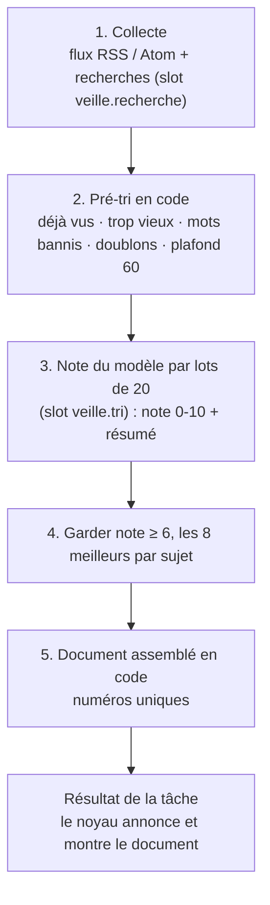

# Veille (implémenté)

[← Retour à la spec](README.md)

État : **fait** le 6 novembre 2026. Code : `assistant\plugins\veille\digest`. S'appuie sur les [tâches](taches.md), les [documents](documents.md), et les services `search` et `completion`.

## L'idée

Tu donnes des **centres d'intérêt** (Réglages → Veille) : un nom, ce qui t'intéresse, des flux RSS, des recherches web. Chaque matin (7 h 30 par défaut), Floppy lit les nouveaux articles, les **trie avec un modèle** selon tes goûts, et prépare un **digest Markdown** : des articles numérotés regroupés par sujet, avec un résumé et un lien. Chaque sujet commence directement par ses articles, sans synthèse générale.

Tu affines **à la voix** : « le 3 ne m'intéresse pas », « plus d'articles sur llama.cpp », « plus jamais de crypto ». Le tri suivant en tient compte.

## Un passage

- **Pré-tri en code** (avant de payer le modèle) : une adresse déjà vue (sans traqueurs `utm_*`, sans ancre) est retirée ; un article publié avant le dernier passage (moins 1 jour) aussi ; un mot banni dans le titre ou l'extrait aussi ; deux titres presque identiques n'en font qu'un.
- **Le modèle** reçoit, pour chaque sujet : ta description, ce que tu aimes, ce que tu évites, et les 20 derniers articles que tu as notés.
- Le **document** est assemblé en code, pas par le modèle : les numéros et les liens sont donc toujours justes.
- Chaque article affiche **Publié le 5 novembre 2026** (ou l'équivalent anglais), à côté de la source et de la note. Sans date valide fournie par le flux ou la recherche : **Date de publication indisponible**. Une date de mise à jour Atom ne remplace pas la date de publication ; aucune date n'est inventée.

## Ce qu'on choisit dans la rubrique Veille

| Choix | Slot | Exemples |
|---|---|---|
| Cerveau du tri | `veille.tri` (service `completion`) | Claude Sonnet (défaut), Claude Haiku, un modèle distant, **le modèle local du cerveau** |
| Moteur de recherche | `veille.recherche` (service `search`) | SearXNG, Recherche Claude, aucun (RSS seulement) |

Le cerveau et le moteur sont **empruntés** (`ctx.borrow`) pendant le passage seulement : rien ne tourne entre deux veilles.

Un plugin de recherche sert deux fois : il donne un **outil** à Floppy (`chercher_web`, `chercher_searxng`) et un **service** `search` à la Veille.

## La rubrique Veille (fenêtre des réglages)

- **Centres d'intérêt** en premier : liste à gauche, détail à droite (description, tes avis retenus, **Sources** : chaque flux et chaque recherche avec une case pour la couper sans la supprimer).
- **+ Ajouter un centre d'intérêt** : nom, ce qui t'intéresse, flux (une adresse par ligne), recherches (une par ligne). **Essayer** lit chaque flux et dit combien d'articles il donne, ou pourquoi il ne répond pas.
- Puis **Cerveau du tri** et **Moteur de recherche** (bouton Activer), puis les **plugins** qui apportent ces choix.

## Préférences

Fichier `<home>\veille\preferences.json`, lisible et modifiable à la main : par sujet et global, `aime`, `evite`, `bannis`, `exemples`.

| Tu dis | Outil `veille_avis` | Effet |
|---|---|---|
| « le 3 ne m'intéresse pas » | `article: 3, avis: moins` | exemple « pas aimé » pour ce sujet |
| « plus d'articles sur llama.cpp » | `sujet, avis: plus` | dans `aime` |
| « moins de levées de fonds » | `sujet, avis: moins` | dans `evite` (note plus basse) |
| « plus jamais de crypto » | `sujet, avis: jamais` | dans `bannis` (retiré avant le modèle) |
| « en fait la crypto ça va » | `sujet, avis: oublier` | retiré des listes |

Autres outils : `veille_interets` (liste ; donne aussi les titres numérotés du dernier digest), `veille_article` (détail d'un article par son numéro ou par des mots du sujet, « l'article sur le TTS » ; sans rien, la liste des titres ; pour l'ouvrir avec `ouvrir_url`), `veille_modifier_interet` (ajouter, modifier ou retirer un sujet, avec accord). « Modifier » ajoute ou retire des flux et des recherches, remplace la description ou renomme ; la demande d'accord dit ce qui change (« Modifier le centre d'intérêt « IA locale » (+ recherches : llama.cpp) »).

**Jamais de centre d'intérêt vide.** Sans flux ni recherche (à la voix, dans la fenêtre, ou après avoir tout retiré), le nom du centre d'intérêt devient sa recherche web : « ajoute un centre d'intérêt sur l'IA locale » cherche « IA locale ». Floppy le dit, et prévient si aucun moteur de recherche n'est choisi. « Fais ma veille maintenant » passe par l'outil du noyau `lancer_tache`.

## Données

- `<home>\veille\veille.db` (SQLite) : articles déjà vus (oubliés après 90 jours) et articles numérotés du dernier digest.
- Les digests eux-mêmes sont des [documents](documents.md) (tag `veille`).

## Limites connues

- Le modèle **local** sert au tri seulement s'il est **celui du cerveau principal** (élément « Modèle local du cerveau ») : le plugin llama.cpp n'a qu'un llama-server, partagé par le cerveau et le tri. Jamais deux modèles sur le GPU. Pendant un tri (≈ 1 min pour 25 articles avec Ornith), le cerveau répond un peu plus lentement. Changer de modèle de cerveau pendant un tri est refusé jusqu'à la fin du tri.
- Coût : environ 1 appel au modèle par lot de 20 articles, sans appel supplémentaire pour une synthèse par sujet.
